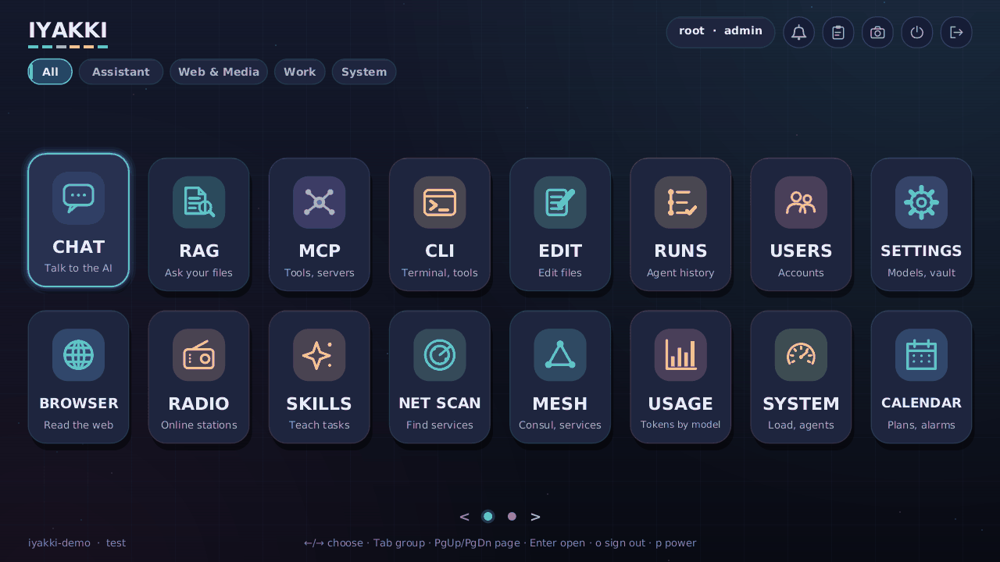
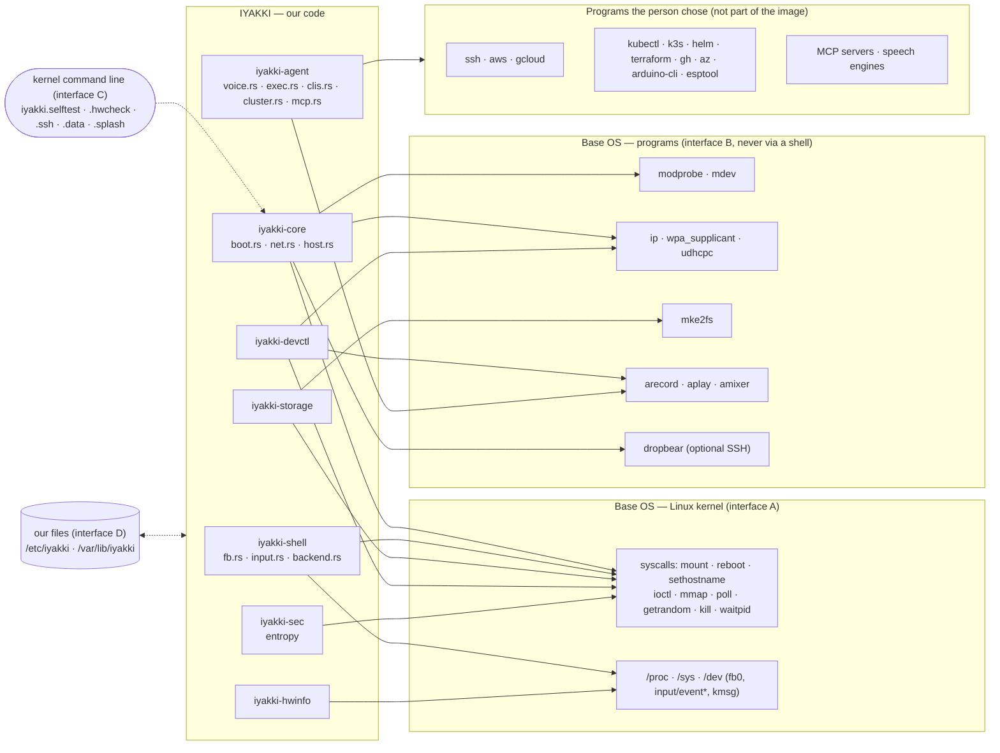
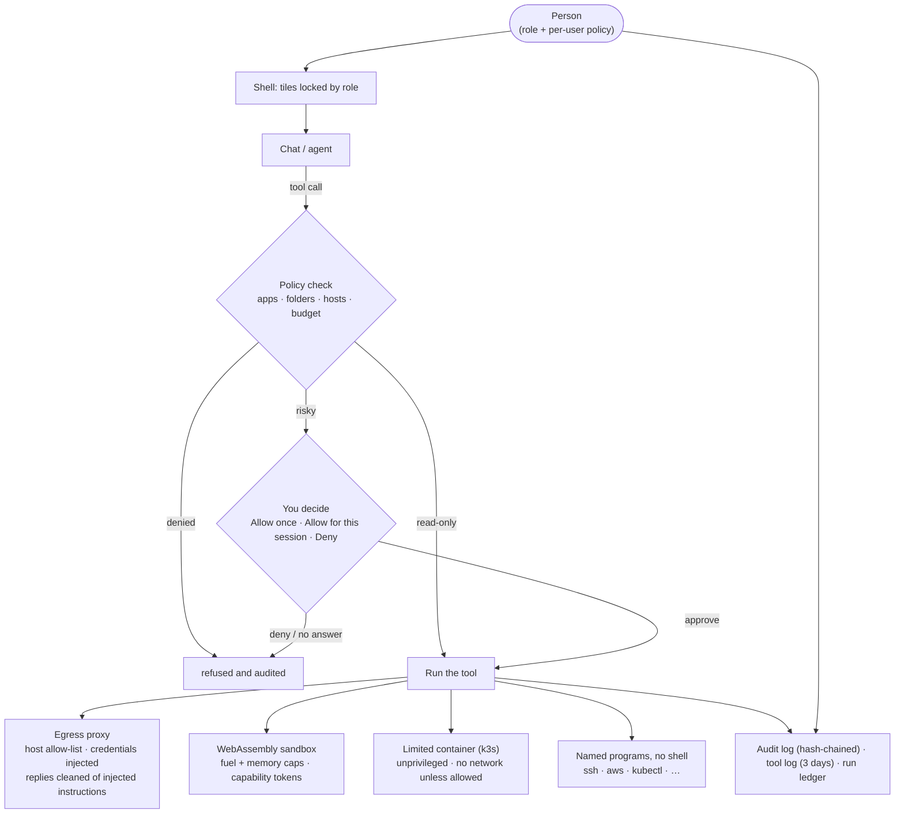
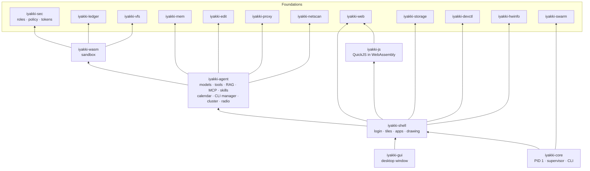
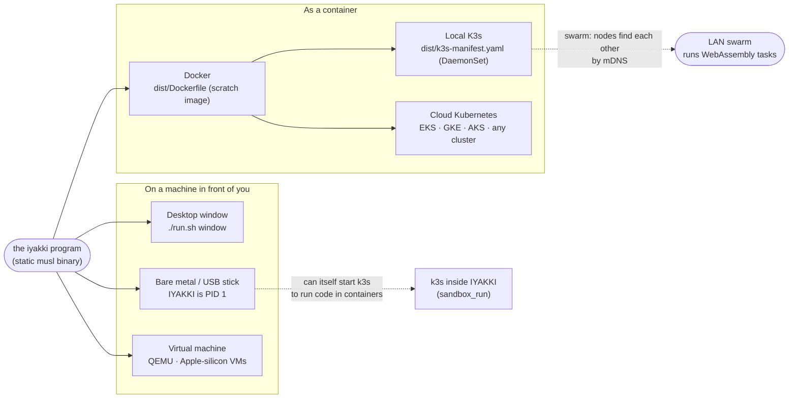

<p align="center">
  
</p>

<h1 align="center">IYAKKI — An OS for Agents</h1>

<p align="center">
  A small, memory-safe operating system written in Rust and WebAssembly, built around an AI assistant<br>
  that is allowed to <em>do</em> things — safely, visibly and only with your permission.<br><br>
  <a href="LICENSE">Apache-2.0</a> · free for any use · permissive dependencies only
</p>

<p align="center">
  <a href="docs/media/iyakki-tour.webp"><b>▶ See IYAKKI in action — a 30-second animated tour</b></a><br>
  <a href="docs/media/iyakki-tour.webp"></a>
</p>


> **Status: alpha (0.1.0-alpha.1), 2026-10-19.** IYAKKI is a first public preview **for developers and testers, not for production**.
> The desktop window and the QEMU virtual machine are the long-tested paths; the USB image has been booted on **one real computer, a
> Mac mini 2018 (Macmini8,1, T2), and nowhere else** (its Wi-Fi and Bluetooth do not work yet); many features are partial
> ([`FEATURES.md`](FEATURES.md)); data formats and upgrade paths are not promised to stay stable. The installer erases the whole drive you
> pick: do not use it on a machine holding anything you cannot lose. Read [`KNOWN-ISSUES.md`](KNOWN-ISSUES.md) first, and the [`RELEASE-NOTES-0.1.0-alpha.1.md`](RELEASE-NOTES-0.1.0-alpha.1.md).



## Quick start

| I want to... | Do this | Read |
|---|---|---|
| **Try it in 10 minutes** (Linux desktop) | `./run.sh window` (needs the Rust toolchain; first run asks you to create the administrator) | [`docs/INSTALL.md`](docs/INSTALL.md#1-window-mode-linux), then [`docs/QUICKSTART.md`](docs/QUICKSTART.md) |
| **Boot it on a PC from a USB stick** | `cargo build --release -p iyakki-usb`, then `sudo target/release/iyakki-usb --install iyakki-install-x86_64.img` (pick the drive, type its name to confirm; **the stick is erased**); turn Secure Boot off | [`docs/INSTALL.md`](docs/INSTALL.md#2-usb-stick) |
| **Install next to Windows or Linux, or on partitions you choose** | Boot the stick and pick *IYAKKI - Install to a disk* (or `sudo target/release/iyakki-usb --plan IMAGE`, or the `iyakki-installer` window): free space only, chosen partitions, or custom sizes; a plan table and a confirmation screen (Install button; a plan that erases data needs a ticked box too) come first; existing filesystems are never shrunk | [`docs/INSTALLER.md`](docs/INSTALLER.md) |
| **Run it in a virtual machine** | `./run.sh build` once (30-40 min), then `./run.sh vm` or `./run.sh vm-disk` (QEMU) | [`docs/INSTALL.md`](docs/INSTALL.md#4-virtual-machine) |
| **Serve it in a browser / on Kubernetes** | `iyakki web`, or `kubectl apply -f dist/k3s-web.yaml` | [`docs/ADMIN-GUIDE.md`](docs/ADMIN-GUIDE.md#network-exposure) |

Linux programs (Debian or Ubuntu with `apt`) run in a sandbox: **IYAKKI menu -> Linux apps** (`docs/LINUX-APPS.md`; downloaded at your click, nothing shipped; alpha, untried on a device). Chat needs a model: **SETTINGS -> Models** (Ollama, OpenAI-compatible, OpenAI, OpenRouter, Anthropic, Gemini; or the GPU of a Mac or another computer on your network: *Mac / GPU host*, `docs/MAC-MODEL-HOST.md`). Something wrong?
[`docs/TROUBLESHOOTING.md`](docs/TROUBLESHOOTING.md) and [`docs/FAQ.md`](docs/FAQ.md).

**All documentation** is listed in [`docs/INDEX.md`](docs/INDEX.md): start here ([`INSTALL`](docs/INSTALL.md),
[`QUICKSTART`](docs/QUICKSTART.md)) · use ([`USER-GUIDE`](docs/USER-GUIDE.md), [`FAQ`](docs/FAQ.md)) · administer
([`ADMIN-GUIDE`](docs/ADMIN-GUIDE.md), [`TROUBLESHOOTING`](docs/TROUBLESHOOTING.md)) · build and extend
([`ARCHITECTURE`](docs/ARCHITECTURE.md), [`CONTRIBUTING`](CONTRIBUTING.md)) · release and legal
([`CHANGELOG`](CHANGELOG.md), [`SECURITY`](SECURITY.md), [`SUPPORT`](SUPPORT.md), [`LICENSING`](LICENSING.md)).

**Report an issue:** see [`CONTRIBUTING.md`](CONTRIBUTING.md#reporting-issues) and [`SUPPORT.md`](SUPPORT.md); security problems go to
[`SECURITY.md`](SECURITY.md). Licence: [Apache-2.0](LICENSE). Community rules: [`CODE_OF_CONDUCT.md`](CODE_OF_CONDUCT.md).

---

## The aim

Today an AI assistant is a chat box inside someone else's operating system. It can talk, but anything it *does*
(read a file, call an API, run a command) is either impossible or happens with whatever power the program around it
happens to have.

**IYAKKI turns that around: the operating system is built for the agent.** The aim of this project is to show that an
assistant can be genuinely useful on a computer — plan your week, read your documents, run `kubectl` or `aws`, try a Python
program in a container, play music, flash a microcontroller — **without being trusted blindly**:

* **Everything the assistant touches goes through one permission model.** Each person has a role (admin, operator, user,
  guest) and a policy: which apps, which folders, which network hosts, which tools, how many tokens. The assistant
  can never do more than the person it works for.
* **Anything risky asks first.** Reading is free; writing a file, calling an API, running a program or starting a
  container pauses for *Allow once / Allow for this session / Deny*. No answer means deny. Every run is recorded in a tamper-evident ledger.
* **Untrusted code runs in a sandbox.** Plugins, tools and model-generated code run in WebAssembly (wasmtime) with a
  fuel budget, a memory cap and capability tokens, or in a limited container, never with the system's own rights.
* **It runs on your own machine.** It talks to the models *you* connect (Ollama on your network, or a cloud provider with
  your key in an encrypted vault). Nothing is sent anywhere you did not configure.
* **The code is ours and permissively licensed.** We write what we can ourselves (editor, browser engine, regular
  expressions, archive unpacking, Markdown, …), depend only on permissive crates, and keep a hard, tested **boundary**
  between our code and the base operating system (see below), so the whole thing stays Apache-2.0 and small enough to
  audit.

**One program, many places.** The same `iyakki` binary boots on real hardware from a USB stick, runs in a virtual machine, runs as a window on your desktop, and runs as a small container on **Docker, a local K3s cluster or a managed cloud Kubernetes** (see *Where it runs* below). It is not tied to a desktop or to bare metal.

## What it looks like

After signing in you get a launcher with tiles. Each tile is an app, locked or unlocked by your role.

**Look.** Every app shares one futuristic design language (dark glass cards, a cyan/magenta neon palette, an accent colour per app, small animated highlights only; set `IYAKKI_REDUCED_MOTION=1` to freeze them): the pieces live in `crates/iyakki-shell/src/fx.rs` and are described in `docs/DESIGN.md`.

**Launcher groups.** The tiles are sorted into named groups shown as chips under the title: *Ask & Create* (CHAT, RAG, SKILLS, CALENDAR, TALES, VOICE, LAB), *Build* (AI IDE, GIT, FLOWS, K8S, EDIT, CLI, MCP, RUNS), *Media* (BROWSER, RADIO, MEDIA, CAMERA), *Data* (DATA, DASH, USAGE) and *Devices & System* (SYSTEM, DISKS, NET SCAN, MESH, USERS, STORE, LINUX WINDOW), plus *Apps* (tiles you install later, custom and Store apps, until you move them; shown once there is one), plus any groups you make yourself (the **+** chip; up to 12, names up to 16 characters). A group with nothing for your role is hidden (one of yours stays, empty, until you fill or delete it). Click a chip or press Tab / Shift+Tab to switch; IYAKKI remembers your last group. **Move a tile** with `m` (a list of groups and *New group…*), a right-click on the tile, or *Pick up* and a click on a chip; a notice offers *Undo* (`u`), and *Reset to default layout* puts every tile back in the groups above (your own groups stay). **Settings** is an icon in the top bar (or the key `s`, F7, the IYAKKI menu), and so is the **speaker**: click to mute, the wheel or a drag to change the volume (the same one the volume keys use). A Store app whose app.json names a group goes there, or asks once whether to create it. The layout is yours alone and changes only where a tile is listed, never what an app may do. When a group has more tiles than fit the window the rest continue on the next page: PageUp/PageDown, the mouse wheel, the dots and arrows at the bottom, or simply arrow past the last tile. The number keys 1-9 open the Nth app of the fixed tile order from any group, wherever you moved it.

| Tile | What it is |
|---|---|
| **CHAT** | Talk to a model; agent mode (`Ctrl+G`) lets it use tools, each risky call asks first; web research, your browser tab, SVG and images in answers |
| **RAG** | Search your documents (and Qdrant/Chroma) and ask questions grounded in them, with citations |
| **MCP** | Connect Model Context Protocol servers and call their tools |
| **CLI** | A policy-checked terminal, and a catalogue to install kubectl, k3s, Helm, Terraform, cloud CLIs, Ollama, DuckDB, Claude Code and more |
| **EDIT** | In-house code editor (11 languages); the assistant proposes edits you accept one by one |
| **RUNS** | History of every agent run, verified against its hash-chained ledger |
| **USERS** | Accounts, roles, per-user limits and the audit log (administrators) |
| **SETTINGS** | Models, agents, vault, voice, network, display, sound, storage, dev cluster, host access, account |
| **BROWSER** | In-house browser (HTML, CSS, JavaScript) plus an optional full WebKit engine; the assistant can use it only with your consent |
| **RADIO** | Internet radio in many languages and your own stations |
| **SKILLS** | Markdown instructions the assistant follows; install signed packages after reading them |
| **NET SCAN** | Find Ollama servers, cameras and other services on your network |
| **MESH** | Consul service view |
| **USAGE** | Token usage per model as a chart |
| **SYSTEM** | Load, memory, disks, processes and every agent run in progress |
| **CALENDAR** | Events, reminders and alarms that ring anywhere in the system |
| **MEDIA** | Music, videos and pictures with plain-words search, ratings, playlists and a download queue |
| **AI IDE** | One workspace per product: editor, terminal, feature board, Browser tab, Kubernetes view and approved Deploy flow |
| **DATA** | Open CSV/TSV/JSON-lines tables of any size, sort, filter, summarise, export |
| **TALES** | AI story teller: a conversation beside the story, automatic pictures, versions, reads aloud |
| **VOICE** | Read pasted text aloud with Kokoro or any set-up voice (voice, speed, lit sentence, where the text goes), and dictate: record, speech to text, copy the transcript. Plus quiet system sounds for sign-in and sign-out |
| **K8S** | Pick a cluster (the managed dev k3s, or a saved kubeconfig profile) and a namespace and explore it: pods, deployments, services, events, nodes and more, YAML (Secret values masked), related objects and pod logs. Read-only until an administrator turns on Allow changes ([`docs/K8S-TILE.md`](docs/K8S-TILE.md)) |
| **DISKS** | See every drive, mount and unmount partitions, eject USB drives and SD cards safely, and (administrators, behind Advanced) change partitions with name, size and serial confirmations; the system drive is never touched; only fakes tested so far ([docs/DISKS.md](docs/DISKS.md)) |
| **STORE** | Find, install and remove skills, tools, MCP servers, themes, driver packs; every app wears a trust badge; a Store switcher and your own private store |
| **DASH** | Dashboards over Prometheus, Elasticsearch/OpenSearch, ClickHouse and DuckDB, read-only, with an assistant |
| **FLOWS** | Design, schedule and watch workflows; the assistant examines failed runs and proposes fixes you approve |
| **INBOX** | Not a tile: the bell (or `F9`) with notifications, tasks and approvals |

Every tile, its keys and its limits: [`docs/USER-GUIDE.md`](docs/USER-GUIDE.md). Long descriptions of the larger ones follow under *Features in more detail*.

**What the assistant can do in agent mode** (each tool is gated by your policy; the risky ones ask first):
read files and search your documents · look things up on the web (`web_search`, `web_fetch`), the weather (`weather`, Open-Meteo) and share prices (`stock_quote`), all with sources and never from memory, and read the page open in your browser (`browser_page`, asks every time) · call web APIs (`http_request`) · run read-only text commands (`terminal`) ·
run `ssh`, `aws`, `gcloud` and any CLI you installed (`run_command`) · plan and read your calendar and alarms ·
play and pause music · list, download and use models, including drawing pictures with a picture model · install CLI tools ·
start a local k3s cluster and **run code in a fresh, limited container** (`sandbox_run`: Python, Node, shell) to practise or test.

Also: a clipboard history, screenshots (`F12`), a help popup on every screen (`F1`), voice dictation and read-aloud.

## How IYAKKI relates to the base OS

IYAKKI is **not** a Linux distribution fork. It is a program (and a set of apps) that runs on top of a stock Linux
kernel and a few ordinary base programs. We keep the line between "ours" and "theirs" sharp, written down, and tested.

```
  ┌──────────────────────────────────────────────────────────────────────────────────────┐
  │  YOU  ·  keyboard · mouse · touch · voice                                            │
  ├──────────────────────────────────────────────────────────────────────────────────────┤
  │  IYAKKI — our source code (crates/ + dist/buildroot overlay), Rust, Apache-2.0       │
  │                                                                                      │
  │   iyakki-core   PID 1: boot, supervisor, CLI           iyakki-shell   login, tiles   │
  │   iyakki-agent  models, tools, RAG, MCP, skills        iyakki-wasm    sandbox        │
  │   iyakki-sec    roles, policy, capability tokens       iyakki-proxy   egress proxy   │
  │   iyakki-web/js browser engine                         iyakki-edit    editor engine  │
  │   iyakki-ledger · iyakki-vfs · iyakki-mem · iyakki-storage · iyakki-devctl · …       │
  ╞══════════════════════════════════════════════════════════════════════════════════════╡
  │  THE BOUNDARY  (BOUNDARY.md, enforced by crates/iyakki-core/tests/boundary.rs)       │
  │   A  kernel ABI: syscalls, /proc, /sys, /dev, ioctls          (listed files only)    │
  │   B  named base programs, started with fixed arguments, never through a shell        │
  │   C  kernel command-line options  (iyakki.hwcheck=1, iyakki.data=ram, …)             │
  │   D  files we own: /etc/iyakki  and  /var/lib/iyakki                                 │
  ╞══════════════════════════════════════════════════════════════════════════════════════╡
  │  BASE OS — not ours, used unmodified, and replaceable by the user                    │
  │   Today: Buildroot 2026.02 · Linux 6.12.112 · musl · BusyBox · kmod · iproute2       │
  │   wpa_supplicant · alsa-utils · e2fsprogs · CA certificates · dropbear (optional)    │
  ├──────────────────────────────────────────────────────────────────────────────────────┤
  │  Boot loader (GRUB) · firmware · hardware (x86-64 PC, Apple-silicon VM, ARM64 board) │
  └──────────────────────────────────────────────────────────────────────────────────────┘
```

The rules, in short (full text in [`BOUNDARY.md`](BOUNDARY.md)):

1. **One direction.** IYAKKI depends on the base OS; the base OS knows nothing about IYAKKI except that it starts `iyakki`
   as PID 1.
2. **Four kinds of interface only** (A–D above). Anything else is a violation.
3. **No patches to upstream** (kernel, Buildroot, base programs). **GPL stays at arm's length:** base programs are only
   *executed*, never linked, so our code remains Apache-2.0.
4. **Every touchpoint is listed and enforced.** A test fails if code outside a listed file starts a process or makes a
   system-level call, or if a listed file no longer needs its row.
5. **The base OS is yours to choose.** Because the boundary is this short and listed, the user can replace the base OS (see
   *Bring your own base OS* below).

### The base OS we ship today

The images we build use a deliberately tiny base made with **[Buildroot](https://buildroot.org) 2026.02.3**, with no
systemd and no glibc. IYAKKI itself is the init program (PID 1). Versions below are from the `libre` x86-64 image's
`legal-info/manifest.csv`; the source of truth is `dist/buildroot/build.sh` (`BR_VERSION`) and `dist/buildroot/configs/`.

| Part | What | Version |
|---|---|---|
| Kernel | Linux, stock plus one config fragment (`dist/buildroot/board/iyakki/linux.fragment`); drivers are modules loaded by hardware alias | 6.12.112 |
| C library / toolchain | musl, built by Buildroot's own toolchain (GCC) | musl 1.2.6 · GCC 14.3.0 |
| Init | none: `iyakki` starts as PID 1 | — |
| Userland | BusyBox (shell tools, `mdev`, `udhcpc`), util-linux | BusyBox 1.37.0 · util-linux 2.41.4 |
| Networking | iproute2, wpa_supplicant, iw, wireless-regdb, libnl, OpenSSL, CA certificates | iproute2 6.17.0 · wpa_supplicant 2.11 · OpenSSL 3.6.2 |
| Storage | e2fsprogs (`mke2fs` for the data volume), kmod (`modprobe`) | e2fsprogs 1.47.3 · kmod 33 |
| Sound | ALSA library and utilities (`aplay`, `arecord`, `amixer`) | alsa-utils 1.2.15.2 |
| Remote diagnostics | dropbear SSH, only when the boot entry asks (`iyakki.ssh=1`) | dropbear 2026.91 |
| Boot loader | GRUB (BIOS and UEFI) | 2.12 |
| Architectures | x86-64 (BIOS+UEFI hybrid ISO and an installable USB image); aarch64 (UEFI disk image for VMs on Apple Silicon and ARM64 boards) | — |

Everything in this table is **base OS**: unpatched, run as separate programs, and replaceable (see *Bring your own base
OS* below). The `iyakki` binary on top of it is a single static musl executable.

### Where exactly the code touches the base OS



### Inside IYAKKI: who may do what

The same permission model sits in front of every tool, whether you or the assistant uses it.



### How the code is organised



## Try it (start here)

    ./run.sh window    # the IYAKKI shell in a desktop window: setup, login, all the tiles
    ./run.sh vm        # boot the real ISO in QEMU (needs ./run.sh build once, ~30-40 min)
    ./run.sh screens   # render every screen to /tmp/iyakki-screens
    ./run.sh test      # all automated tests

First launch shows a setup screen: pick an admin username and password (8+ characters). In **USERS** create more
accounts, give them roles (admin / operator / user / guest) and switch apps, limits, network hosts and MCP servers on
or off per user. Sign out (`o`) and sign in as them to see the tiles lock.

**Chat needs a model.** Open **SETTINGS → Models**, or use **NET SCAN** to find an Ollama server on your network and
add it in one click. (Or put `chat.url = http://localhost:11434/v1/chat/completions` and `chat.model = <name>` in
`~/.local/share/iyakki-dev/ai.conf`.) RAG reads `.txt/.md` files from `~/.local/share/iyakki-dev/docs/shared/` (shared)
and `docs/<username>/` (private). Reset the demo with `rm -rf ~/.local/share/iyakki-dev`.

An administrator's first sign-in also adds **samples** (an MCP server, three documents, three skills) so there is
something to try; delete them where they live (MCP tile, RAG → Documents, SKILLS tile) and they stay deleted.

**Mouse and clipboard.** Everything is clickable. Select text by dragging (double click a word, triple click a
paragraph, Shift+click to extend) in the chat transcript, the terminal output and the details panes, then `Ctrl+C`; a
click no longer copies by itself (hover a message or code block for its copy button). A **right click** opens a context
menu at the pointer: Cut / Copy / Paste / Select all over a text field, the app's own entries (browser: link, Back,
Forward, Reload, View source; editor: Comment line; chat: Copy message, Copy code block), and always *Clipboard
history…*. `Ctrl+V` pastes the latest copy; `Ctrl+Shift+V` or the clipboard icon opens the clipboard *history*. `F1`
explains the current screen, `F12` takes a screenshot to the clipboard. In the desktop window the clipboard is shared
with your system.

## Bring your own base OS

The base OS under IYAKKI is **not part of IYAKKI and not fixed**. The images we build use Buildroot (a stock Linux kernel
and BusyBox), because that is the smallest, but you can put IYAKKI on top of a different base:

| Base | How | What IYAKKI needs from it |
|---|---|---|
| **The Buildroot image we build** (Linux 6.12 + musl + BusyBox, see the table above) | `dist/buildroot/build.sh` → ISO, USB stick, VM disk | Nothing to do; this is the tested path |
| **Your own Buildroot / Yocto / custom image** | Use `dist/buildroot` as an external tree, or copy the `iyakki` binary and `/etc/iyakki` into your image and start it as PID 1 | The tables in `BOUNDARY.md`; the kernel options in `dist/buildroot/board/iyakki/linux.fragment` |
| **Another Linux distribution** (Alpine, Debian, Ubuntu, Fedora, …) | Run the static `iyakki` binary as an ordinary service or as the desktop window; it does not need to be PID 1 | A Linux kernel; ordinary programs where a feature uses one (`ip`, `wpa_supplicant`, `arecord`/`aplay`, `mke2fs`, `ssh`); a writable `/var/lib/iyakki` |
| **A container host** | The OCI image on Docker, K3s or a cloud Kubernetes (see below) | A container runtime; a volume for the data |
| **A kernel that is not Linux** | A port of the files in `BOUNDARY.md` table A (the system calls we make) | That table *is* the porting list |

The reason this works is the boundary above: IYAKKI uses the kernel ABI, a short list of ordinary named programs, a few
kernel command-line options and two folders of its own, and **nothing else** — a test enforces it. Boot-only work
(mounting, loading drivers, rebooting) happens only when IYAKKI really is PID 1, so on any other base it simply does not run.

*Honest status:* the Buildroot image (in QEMU, and on one Mac mini 2018) and a Linux desktop are the tested paths. The static program has also been
run as an ordinary program on **Alpine, Debian, Ubuntu, Fedora and Arch Linux** (containers: `dist/test-bases.sh`) and as a
hardened service on a real systemd (`dist/systemd/iyakki.service`); the framebuffer desktop, driver loading and the container
cluster are what a distribution still has to arrange itself. The checklist for swapping the base is in
[`docs/OTHER-BASES.md`](docs/OTHER-BASES.md); what is left is tracked as `F-PKG-14` in `FEATURES.md`.

## Where it runs

IYAKKI is one Rust program with one boundary to the host (see above), so it is not tied to one kind of machine. What
changes between places is only *how it starts* and *what the host gives it*.



| Where | How | What you get | Status |
|---|---|---|---|
| **Desktop window** | `./run.sh window` | The full shell with every tile, on your real network and files | Works; the fastest way to try it |
| **Bare metal** | Build the ISO, write it to a USB stick (`docs/BOOT-TEST.md`) | The full shell on a framebuffer, IYAKKI as PID 1, driver autoload, its own k3s for running code | Booted in QEMU (BIOS and UEFI) and on one Mac mini 2018 (T2) from a USB SSD (2026-10-18/19; Wi-Fi and Bluetooth not working there); other real hardware still to be tested. (Intel Macs boot USB sticks through the firmware's own boot picker, the Option key; what then works, and the Mac mini 2014 test list, are in `docs/MAC-HARDWARE.md`. Apple Silicon Macs: use the VM row.) |
| **Virtual machine** | `./run.sh vm`, `vm-direct`, `vm-disk`, `vm-arm` (ARM64 as on Apple Silicon); see `docs/LOCAL-TEST.md` | The same as bare metal | Works in QEMU |
| **Docker** | `docker build -f dist/Dockerfile -t iyakki:0.1.0 .` | A tiny `scratch` image running the supervisor (`iyakki serve`) as an unprivileged user: WebAssembly sandbox, capability tokens, ledger, CLI; with `IYAKKI_WEB=1` also the whole desktop in a browser | Image and manifest written; the manifest passes `kubectl --dry-run` |
| **Local K3s** | Load the image, `kubectl apply -f dist/k3s-manifest.yaml` | One supervisor per node (a DaemonSet), hardened (non-root, read-only root, all capabilities dropped, seccomp), joined into a LAN swarm that runs WebAssembly tasks on its peers | Same status as Docker |
| **Cloud (EKS, GKE, AKS, any Kubernetes)** | Push the same image to your registry and apply the same manifest (use a Deployment instead of host networking where mDNS discovery is not wanted) | The same headless supervisor and sandbox, close to your cloud services | The image is standard OCI, but it has **not yet been tried on a managed cloud** |

Two different relationships with Kubernetes are worth keeping apart:

* **IYAKKI running on K3s or a cloud cluster** — the container rows above. IYAKKI is a workload in someone else's cluster.
* **K3s running inside IYAKKI** — on a real machine IYAKKI can start its own local k3s so the assistant can run and manage
  containers for you ("try this Python program" starts a Python container). That is the **CLI → CLIs → k3s** feature and
  is a different thing from the DaemonSet.

**The desktop in a browser.** A container or a cloud machine has no screen, so IYAKKI serves its desktop to a web browser
instead: `iyakki web` (or `iyakki serve --web`, the environment `IYAKKI_WEB=1`, or the boot option `iyakki.web=1`) starts an
HTTPS and WebSocket server written for IYAKKI, people sign in with the accounts of the machine, and the browser shows
their own shell on a canvas (only the changed tiles are sent, coded to suit the content, with a quality level that follows the speed of the link, a data saver and touch support for phones; `docs/REMOTE-PROTOCOL.md`) and sends keys, mouse and paste back. Every
tile works at once because the browser only sees pixels, and the same role limits apply. With no screen there is no
first-run setup, so create the first account from the command line:

```
echo 'a long password' | docker run -i --rm -v iyakki-data:/var/lib/iyakki iyakki:0.1.0 user add admin --role admin --password-stdin
docker run -p 8443:8443 -e IYAKKI_WEB=1 -v iyakki-data:/var/lib/iyakki iyakki:0.1.0 serve     # then open https://localhost:8443
```

The certificate is made on first start (self-signed, so the browser warns once; put your own `cert.pem` and `key.pem` in
`/var/lib/iyakki/tls` to avoid that), and `IYAKKI_WEB=http:8080` serves plain HTTP for a proxy or ingress that does the TLS.
For Kubernetes, `dist/k3s-web.yaml` is a Deployment with a data volume, a one-time Job that adds the first account from a
Secret, and a Service. Features that need hardware (the radio's sound, the camera) act on the machine IYAKKI runs on, not
on the browser's. Tried with Chrome, in Docker and on a local K3s; **not yet tried on a managed cloud**.

## Documentation map

The full, grouped map is [`docs/INDEX.md`](docs/INDEX.md). The core files:

| File | Read it for |
|---|---|
| [`BOUNDARY.md`](BOUNDARY.md) | Every place our code touches the base OS, and the rules |
| [`FEATURES.md`](FEATURES.md) | The feature matrix: one row per feature with status, progress and the tests that prove it (checked by a test) |
| [`LICENSING.md`](LICENSING.md) | Licensing policy, what ships in an image, firmware, third-party code |
| [`Agent OS Architecture Specification.md`](Agent%20OS%20Architecture%20Specification.md) | The original design and roadmap |
| [`docs/LOCAL-TEST.md`](docs/LOCAL-TEST.md) · [`docs/BOOT-TEST.md`](docs/BOOT-TEST.md) | Trying it on this computer, then on real hardware |
| [`docs/BROWSER-ROADMAP.md`](docs/BROWSER-ROADMAP.md) | What the browser can't do yet |
| [`docs/BROWSER-AGENT.md`](docs/BROWSER-AGENT.md) | The assistant in your browser: consent, threat model, the test runner and spec format |
| [`docs/OTHER-BASES.md`](docs/OTHER-BASES.md) | Running IYAKKI on another base OS (distributions, systemd) and swapping the Buildroot base |
| [`docs/MACOS.md`](docs/MACOS.md) | IYAKKI on a Mac: the window, Ollama on the Mac, and a VM |
| [`docs/MAC-HARDWARE.md`](docs/MAC-HARDWARE.md) | IYAKKI on Mac hardware: what works per model, driver packs in the Store, the Mac image variant, the Mac mini 2014 test checklist |
| [`docs/MEDIA-SEARCH.md`](docs/MEDIA-SEARCH.md) | The media catalog index, the search grammar, downloads, and keeping credentials in vaults |
| [`docs/BATTERY.md`](docs/BATTERY.md) | Laptop battery and charging: the top-bar indicator and popup, warnings and the clean shutdown at the critical level, where the data comes from, the kernel options (rebuild needed), what is not supported yet |
| [`docs/KEYBOARD-AND-FN-KEYS.md`](docs/KEYBOARD-AND-FN-KEYS.md) | Volume, brightness, keyboard light, media, WiFi and power keys with the on-screen bar; Apple Fn-key mode and key repeat in Settings, Keyboard; per-machine notes, key codes, known gaps (Touch Bar display, DDC/CI), real-device checklist |
| [`docs/MULTI-DISPLAY.md`](docs/MULTI-DISPLAY.md) | Layouts (50:50, 30:70, 2x2 ... panes with several apps at once), the keys, the memory gate, and the design and test plan for several displays |
| [`docs/CLOUD-MODE.md`](docs/CLOUD-MODE.md) | Cloud mode: for servers, cloud VMs and remote-desktop-only machines, hides the tiles, Settings pages, Devices rows and keys that need a local screen, speakers or camera; Automatic / On / Off, `iyakki.mode=cloud` |
| [`docs/MEDIA-PLAYER.md`](docs/MEDIA-PLAYER.md) | IYAKKI's own video and sound player (ffmpeg decodes), installing ffmpeg, controls, what the image options do |
| [`docs/STORY.md`](docs/STORY.md) | The TALES story teller: the prompt and its safety rules, reading aloud, the library, and what the image needs for speech |
| [`docs/VOICE.md`](docs/VOICE.md) | Reading aloud with no setup: the speech engines found on the computer, the browser voice and the voice helper, what is GPL and not shipped, bare-metal options |
| [`docs/CLI-SSH.md`](docs/CLI-SSH.md) | The SSH client in the CLI tile: host keys, vault keys, saved connections, rules for the assistant |
| [`docs/JOBS.md`](docs/JOBS.md) | Detached jobs: long commands that outlive the chat, the Jobs strip, `job_start` for the assistant and Claude Code |
| [`docs/PLATFORM-SERVICES.md`](docs/PLATFORM-SERVICES.md) | Gitea and the private store deployed into a k3s cluster you pick, with an approved plan |
| [`docs/SHARED-FOLDERS.md`](docs/SHARED-FOLDERS.md) | Share a folder over HTTP on the local network (files or a website), secret link or password, off by default, read-only by default |
| [`docs/FIREWALL.md`](docs/FIREWALL.md) | Incoming connections blocked by default; allow by host name, IP, range or network, presets, a 60-second Keep so a wrong rule cannot lock you out |
| [`docs/STORE.md`](docs/STORE.md) · [`docs/APP-AUTHORING.md`](docs/APP-AUTHORING.md) | Signed packages, the private store, several stores and the portal; making and publishing apps |
| [`docs/ZRAM-AND-INSTALL.md`](docs/ZRAM-AND-INSTALL.md) · [`docs/HARDWARE.md`](docs/HARDWARE.md) | Compressed swap and the on-device installer; which machines run it |
| [`docs/INSTALLER.md`](docs/INSTALLER.md) | Install next to another system: free space, chosen partitions, dual boot, the plan file, boot-menu install mode, the window installer, recovery |
| [`docs/OWNER-CHECKLIST.md`](docs/OWNER-CHECKLIST.md) · [`ALPHA-GATE.md`](ALPHA-GATE.md) | What the owner must do before tagging; the release gate with evidence |
| [`docs/DASHBOARD.md`](docs/DASHBOARD.md) | The DASH tile: connectors, the security model, how to add a connector, why DuckDB runs as a command |

## Features in more detail

* **New in the alpha.** **Jobs**: slow commands run detached, with a Jobs strip (progress, Log, Stop) and an inbox note when they end.
  **Approvals**: Allow once / Allow for this session / Deny, and the modes *Ask first*, *Auto-approve safe* and *Autopilot* (`Ctrl+Q`).
  **TALES** is a conversation: a chat panel beside the story, corrections in words with saved versions, automatic pictures (real
  images, SVG, or a built-in cartoon composer), reading aloud with the speech engines the computer already has or the browser's voice
  (Settings, Voice). **STORE** has a Store switcher, *Add a store* from a portal link, and a private store you can run in your own cluster
  (**platform services**: Settings, Dev cluster, Platform services; also Gitea). Message boxes take 20,000 characters. zram swap and an
  on-device installer (Settings, System). All new, all tested with fakes: see KNOWN-ISSUES.md.

* **Chat sessions with memory.** Every chat is saved and listed in a side panel (hide/show with `Ctrl+W`). A chat opens on
  its last three days (up to 1000 messages) and older messages load as you scroll up. Each finished exchange is indexed in a
  private knowledge-base namespace, so only a recent window goes to the model verbatim and older turns come back *by
  relevance*. Every chat has its own work folder; deleting a chat deletes its memory, runs and files.
* **Agent mode** (`Ctrl+G`). Risky tools pause for Allow once / Allow for this session / Deny. Every run is recorded in RUNS with a
  hash-chained ledger that detects tampering. Tool calls are also logged for three days (`toollog`).
* **Budgets per run** (USERS → `b`): tokens, seconds, files written and cost. Tokens are the provider's own counts when it reports them (OpenAI-style, Anthropic, Gemini, Ollama) and an estimate
  (about four characters each) otherwise; the USAGE tile charts them.
* **Skills.** A skill is a small Markdown file (`name`, `description`, `triggers`, instructions). Signed `.iyp` packages
  are reviewed (who signed, what they say) before installing.
* **Tool packages (WASM).** A `.iyp` package of `type: tool` carries a WebAssembly module and becomes the agent tool
  `pkg_<name>` once installed (`tool install`, same review as skills: signed by a trusted key, an unknown key or
  unsigned, the last two only with `--yes`). Build one in the terminal with
  `tool build manifest.json module.wasm [--key key] [--out file]` (`tool keygen <file>` makes a signing key);
  `tool list | show | remove` mirror the skill commands.

  ```json
  {"name": "word-count", "version": "1.0.0", "license": "MIT",
   "description": "Count the words in a text",
   "schema": {"type": "object", "properties": {"text": {"type": "string"}}, "required": ["text"]},
   "capabilities": ["read:{home}/notes", "write:{home}/out", "net:example.com"],
   "budget": {"fuel": 5000000, "memory_mb": 8, "seconds": 5}}
  ```

  `capabilities` default to none: such a tool has no file or network functions at all. `read:`/`write:` take an
  absolute path (`{home}` is the caller's home folder) and `net:` a host; each is granted only if the caller's own
  policy allows it too, and every call is shown for approval with the capabilities listed. The `budget` (CPU
  instructions, memory, real seconds) is a request that the caller's policy caps; going over stops the guest with a
  message naming the limit. The module exports `memory` (at least three pages) and `run(input_len: i32) -> i32`:
  the JSON arguments are at byte offset 65536, the answer is left at 131072 and its length returned (negative = error).
  It may be a binary or, while developing, WAT text. Files under `read:` scopes are copied into the sandbox before the call
  and files written under `write:` scopes are copied out afterwards; the guest never touches the real disk.
* **Code editor and "edit with the assistant"** (`Ctrl+E` in Chat): the open file goes to the model as clearly marked
  *data*; its reply comes back as proposed changes you accept or reject one by one. Nothing touches the file until you
  accept and save.
* **Voice.** `Ctrl+R` dictates, `Ctrl+O` reads answers aloud; engines are configured in Settings → Voice.
* **Vaults.** API keys live in encrypted vaults (system and per-user) or external secret providers; settings only hold
  references.
* **Keeping your data on the live ISO.** The ISO runs from RAM, so by default nothing survives power-off. Settings →
  Storage (admins) turns a spare disk or USB drive into the **IYAKKI-DATA** volume (it refuses the boot medium, asks you
  to type the disk name, formats ext4 and copies what you have so far). The volume is not encrypted as a whole (the
  vaults inside it are).
* **The desktop in a browser.** `iyakki web` (or `iyakki serve --web`, `IYAKKI_WEB=1`, boot entry "also in a browser") serves each
  person's own shell over HTTPS to a browser canvas; see *Where it runs*. `iyakki user add` makes accounts without a screen.
* **SYSTEM and `iyakki top`.** Load, memory, disks, network, the process list (administrators can stop or kill one) and every
  agent run in progress, which can be stopped one by one or all at once.
* **WiFi.** Settings → Network → `w` scans, joins (open, WPA2, WPA3, hidden networks) and remembers networks; for WPA2 only the
  key made from the passphrase is kept. NET SCAN → Devices lists machines seen on the network and raises an alert when a new one appears.
* **Disks you can rehearse on.** `./run.sh window` shows virtual disks only (`./run.sh disk add 8G`); it cannot reach this
  computer's drives. Text and button size is chosen per person (Settings → Account).
* **Releases.** `./run.sh release` signs the images (`SHA256SUMS` + an ed25519 signature) and writes the download page;
  `iyakki release verify` checks a download. `dist/buildroot/boot-time.py` measures power-on to sign-in.
* **Swarm.** `iyakki serve --swarm` discovers peers on the LAN (libp2p + mDNS) and runs WebAssembly tasks on them,
  with no capabilities by design.

**MEDIA search and chat.** The MEDIA app keeps a hybrid index of your library (an inverted index with BM25 plus a small dense vector per item, fused with Reciprocal Rank Fusion, all in our own code; no database engine). Each item has a kind (song, video, image, podcast), types found from the genre tag, folder and file names and a built-in vocabulary (`kuthu`/`kutthu`/`koothu`/`குத்து`, melody, beats, devotional, ghazal, rock, carnatic, hip-hop, lofi and more), languages, your own tags, a 0-5 star rating and a play count. Type `kutthu song`, `melody songs by anirudh above 4 stars`, `latest tamil beats` or `photos from 2024` into the search box; press 1-5 to rate, `t` to tag, `D` to queue downloads of songs, videos or pictures from direct addresses (any words as the category; the Downloads page shows each one's status). In the chat, "play a kutthu song" makes the assistant call `media_search` and `media_play`; the same player and queue are shown in the MEDIA app. Details, the query grammar and benchmark numbers: [`docs/MEDIA-SEARCH.md`](docs/MEDIA-SEARCH.md).

**Credentials live in vaults.** The assistant is told never to ask for passwords, API keys, tokens or cookies in the chat. When it needs one it calls `vault_request`, which opens a private masked form (in the INBOX approvals and in the open chat) where you type the secret straight into your own vault; the assistant only learns `stored as uvault:<name>`. If you paste something that looks like a key, token or private key into the chat, it is not sent to the model: you are offered to store it in the vault and a placeholder goes on instead. Settings and tools refer to secrets as `vault:<name>` (system vault) or `uvault:<name>` (your vault), never by value.

## What's in the box

| Crate | Purpose |
|---|---|
| `iyakki-core` | `iyakki` binary: PID 1 boot (mounts, driver coldplug, networking), supervisor, CLI |
| `iyakki-wasm` | wasmtime sandbox: fuel + memory caps, snapshots, forking, speculative branching, replay recording |
| `iyakki-vfs` | in-memory filesystem with quota, fork and diff |
| `iyakki-sec` | roles and policy, unforgeable revocable capability tokens |
| `iyakki-ledger` | hash-chained execution ledger, time-travel to any recorded call |
| `iyakki-mem` | L1 registers / L2 scratchpad / L3 vector store, with paging |
| `iyakki-data` | table service behind DATA (CSV/TSV/JSON lines, pipelines, built-in and Polars engines) |
| `iyakki-flow` | workflow engine behind FLOWS (scheduler, retries, healing, versions; no UI or network) |
| `iyakki-drivers` | driver packs: hardware detection, firmware placement, kernel-module checks |
| `iyakki-webview` | shell side of the optional full web engine helper |
| `iyakki-zram` · `iyakki-relcheck` | memory tuning (zram swap) · repository release checks |
| `iyakki-hw` | mic and camera bridges into WASM guests (`audio`, `video` features) |
| `iyakki-shell` | login, role-aware launcher and all the apps; draws to a framebuffer, a window or a PNG |
| `iyakki-agent` | model providers, knowledge base (BM25 + vector), external RAG, vaults, settings, MCP client, tools, calendar, skills and packages, CLI manager, container cluster, radio, usage |
| `iyakki-edit` | the editor engine, in-house, no dependencies |
| `iyakki-web` · `iyakki-js` | the browser engine (HTML/CSS/layout/images) and its JavaScript platform (QuickJS-ng in WebAssembly) |
| `iyakki-remote` | the desktop in a web browser: HTTPS + WebSocket server, sign-in, sessions, the screen streamed to a canvas |
| `iyakki-proxy` | egress proxy: host allow-list, credential injection, response sanitizing; HTTPS transport |
| `iyakki-netscan` | local-network scanner (models, cameras, media, devices) |
| `iyakki-storage` | finds the IYAKKI-DATA volume, lists disks, makes a disk persistent (with safety refusals) |
| `iyakki-devctl` · `iyakki-hwinfo` | Settings controls (links, WiFi, sound, radios) and the hardware report for the boot hardware check |
| `iyakki-swarm` | libp2p + mDNS: discover LAN peers and run WASM tasks on them |
| `iyakki-usb` | host tool: writes an image to a USB stick safely |
| `iyakki-ui` · `iyakki-gui` | the desktop window (`iyakki-desktop`); `iyakki-gui` is a separate Cargo workspace |

`dist/` has the Dockerfile, the K3s manifest, the JavaScript-engine build script and the Buildroot external tree for
bootable images.

## Build, test, boot

    cargo test --workspace                            # all automated tests (990+)
    cargo deny check licenses sources                 # licence audit (also in crates/iyakki-gui)
    dist/buildroot/build.sh libre                     # BIOS+UEFI ISO, no proprietary firmware
    dist/buildroot/build.sh hw                        # adds linux-firmware blobs (read their licences first)
    ARCH=aarch64 dist/buildroot/build.sh libre        # ARM64 disk image for VMs
    dist/buildroot/qemu-persist-test.sh               # two QEMU boots: data written in boot 1 is there in boot 2
    cargo run -p iyakki-core -- run tests/fixtures/hello.wat
    cargo run -p iyakki-core -- serve --swarm         # on two machines/terminals…
    cargo run -p iyakki-core -- swarm-run tests/fixtures/hello.wat   # …runs on the other one

Guests have no WASI. They import module `iyakki`: `log`, `token_get`, `fs_read`, `fs_write`, `http_fetch` (ABI in
`crates/iyakki-wasm/src/lib.rs`; sensor modules use `iyakki_buf_ptr`/`iyakki_buf_cap`/`process`, see `iyakki-hw`).

The kernel config enables drivers (as modules, matched by modalias at boot) for Ethernet (Intel, Realtek, Broadcom,
Atheros/Qualcomm, Marvell, Aquantia, Mellanox, USB NICs and phone tethering), WiFi (Intel, Atheros, Realtek, MediaTek,
Broadcom, Ralink, Marvell), NVMe/SATA/USB/SD storage, USB and I2C-HID input, Intel/AMD/Nouveau/virtio graphics,
audio, UVC cameras, TPM, watchdog, RTC and VM guest drivers. Ethernet and a WiFi network can be configured in `/etc/iyakki/net.conf`; WiFi networks are normally joined from Settings → Network.

## Status

Everything listed in `FEATURES.md` as *done* has unit tests; the file is checked by a test, so a row cannot claim a
test that does not exist. At the time of writing: **311 features done, 301 partial, 65 planned**.

**Verified in this repo**
* `cargo test --workspace` (3,845 tests passed on 2026-10-18), licence audit for both workspaces (`cargo deny`), the third-party licence file
  (`cargo about`).
* The x86-64 ISO and the ARM64 disk image were built, and booted in QEMU (BIOS and UEFI): kernel, `iyakki` as PID 1, driver
  autoload, DHCP, a sandboxed WASM guest, clean power-off, a data volume that survives a reboot
  (`dist/buildroot/qemu-test.sh`, `qemu-persist-test.sh`). Power-on to the sign-in screen: about 1.6 s in QEMU
  (`dist/buildroot/boot-time.py`).
* On real hardware (one machine, a Mac mini 2018, Macmini8,1, T2, 2026-10-18/19): booting the install image from a USB SSD, persistent
  `/home`, HDMI and built-in audio, a USB webcam, the k3s dev cluster and Store → Setup (formerly Quick install), Claude Code and Copilot CLI sign-in, and the full web
  engine opening Google and YouTube (VP9 video plays).
* Last full `cargo test --workspace` (2026-10-18): 3,845 passed, 0 failed, 59 ignored; a final run precedes the tag.
* Against the real services: Ollama (list, chat, pulling a model, and installing and starting the real server), all eleven CLI
  tools from their vendors with checksums, a real k3s cluster running sandboxed code with its limits (in a privileged
  container and on the booted image), the Docker image on a real K3s, the browser front end in a real Chrome.
* The static program on Alpine, Debian, Ubuntu, Fedora and Arch containers, and as a hardened systemd service.

**Not verified**
* Real hardware other than that one Mac mini: booting on any PC or other Mac (`docs/BOOT-TEST.md` is the guide), touch, other GPUs. Wi-Fi
  and Bluetooth of the Mac mini do not work yet (Apple's firmware and the `BCM.hcd` patch file are missing); no Wi-Fi association has
  happened on any real access point. Secure Boot is verified in QEMU only; the T2 MacBook Pro 2019 patches were never booted; Apple Silicon is a VM only.
* Live calls to OpenAI, Anthropic and Gemini (needs keys); picture generation (Ollama's image models run only on macOS);
  Copilot full tool use, Autopilot with external agents, Developer mode and tile-app publishing beyond loopback; the ARM64 cluster and CLI installs.
* Platform services (Gitea, the private store), jobs, voice engines and TALES pictures: fakes and scripted stand-ins only, never a real cluster, speaker or picture model (`KNOWN-ISSUES.md`).
* The `hw` image (firmware blobs) was never booted. The desktop window on a Mac (`docs/MACOS.md`).

**Known gaps**
* Browser: no video decoding in the built-in engine; the full web engine (web and macweb images) plays YouTube (VP9/Opus) but not H.264/AAC
  video such as TikTok's (not shipped on purpose: patent policy). The built-in engine has no canvas, no IndexedDB, no PDF viewer; Chinese, Japanese,
  Korean and emoji text shows as boxes (Indic, Arabic and Hebrew scripts are shown).
  Details in `docs/BROWSER-ROADMAP.md`.
* Radio plays MP3 only.
* Size: the libre ISO is about 60 MB; the spec's 30 MB / 100 ms targets are not met for the all-hardware image.
* No direct DRM/KMS renderer (the window uses eframe on Wayland/X11, so the screen resolution cannot be chosen); no copy-on-write
  snapshots; a built-in cosine store instead of LanceDB/Qdrant; no Bluetooth userland (Bluetooth does not work on the Mac mini 2018 yet).

## Licence

IYAKKI is licensed under the **Apache License 2.0** — see [`LICENSE`](LICENSE) and [`NOTICE`](NOTICE). Copyright 2026
IYAKKI contributors. You may use, change and redistribute it for any purpose, including commercially.

* **Our code** is original work for this project; nothing is copied from other projects.
* **Dependencies** (Rust crates) must be permissive (Apache-2.0, MIT, BSD, ISC, Zlib, Unicode, CC0, …); `cargo deny`
  enforces it and fails on copyleft or unknown licences. The texts are in `THIRD_PARTY_LICENSES.txt`.
* **Bootable images** contain GPL/LGPL base programs (Linux, BusyBox, GRUB, …) as *separate executables*; anyone who
  distributes an image must provide their source (`build.sh` produces `legal-info/`). The default `libre` image contains
  no proprietary firmware; the `hw` image does, under each blob's own licence.
* **Tools you install from the CLIs tab** (kubectl, k3s, aws, gcloud, …) and container images (python, node, alpine) are
  downloaded from their vendors at your request and keep their own licences; they are not part of IYAKKI.
* Details and the name/trademark note: [`LICENSING.md`](LICENSING.md).

## Contributing

* Prefer writing it ourselves over adding a dependency; any dependency must be permissive.
* Touching the base OS from a new place needs a row in `BOUNDARY.md` in the same change (a test enforces it).
* A feature is not finished until it has a row in `FEATURES.md` and tests that exercise it.
* Never write to a drive without the person confirming its name and size; destructive actions always ask first.
* The people behind the idea, the sponsors and the hardware testers: [`docs/PROJECT-TEAM.md`](docs/PROJECT-TEAM.md).
