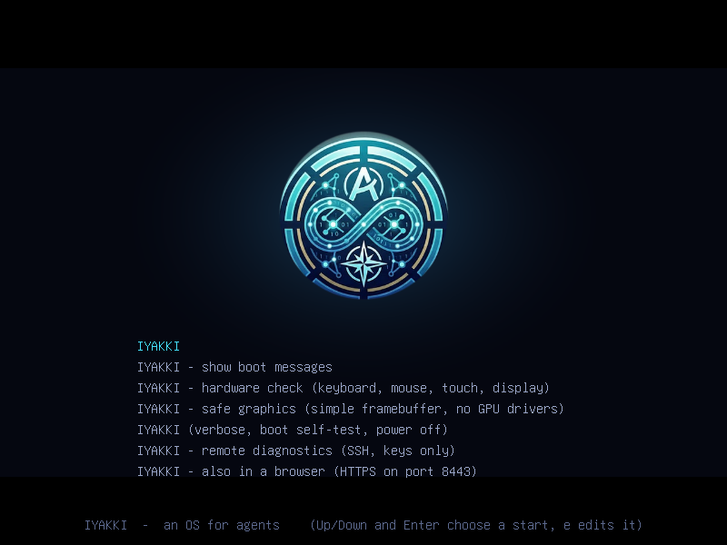

# IYAKKI on Mac hardware

What works, what is missing and what you do about it, for the Macs we test on and the ones that may come next. Written
for the person holding the Mac and the USB stick, and for whoever builds the image.

Contents: 1 Short answers, 2 Why the Debian script cannot be used, 3 What the image has today, 4 Mac mini 2014
(Macmini7,1), 5 MacBook with a FaceTime HD camera, 6 T2 Macs, 7 Apple Silicon, 8 The Mac image variant, 9 Driver packs
in the Store, 10 Test checklist for the Mac mini 2014, 11 Licences, 12 Unverified.

Facts below were checked against a primary source when a source is named; anything that was not is in section 12 and
is not stated as fact elsewhere.

## 1. Short answers

* **"Drivers for Mac bare metal, a button in the app store?"** Yes, with limits: STORE has a **Drivers** filter next to
  MCP, CLI, Skills, Apps and Extensions. It lists *Drivers for this machine* (found from the DMI product name and the PCI
  and USB ids), what state each is in, and a button per item: Install (from a USB stick or folder, or from the catalog),
  Remove, Why. A driver pack contains **data only**: firmware files, modprobe options, kernel option suggestions and,
  for people who build them elsewhere, prebuilt modules for the exact running kernel. It never compiles anything.
* **Mac mini 2014:** with the **standard image** you get Ethernet (tg3), Intel graphics (i915, no firmware needed for
  Haswell), USB and an external keyboard. You do **not** get the built-in Wi-Fi out of the box (BCM4360 has no open
  driver), the fan and temperature sensors (applesmc), the Cirrus audio codec, and Bluetooth is limited until you supply
  Broadcom's firmware file. The **Mac image variant** (section 8, not built yet) adds the kernel drivers. The built-in
  Wi-Fi works only with Broadcom's non-free `wl` driver that **you** build on a Linux PC and install as a signed pack
  (section 4 and `dist/drivers/build-wl-pack.sh`); we never ship it. A USB Wi-Fi adapter with an open driver or the
  Ethernet port need none of that.
* **FaceTime camera:** the Mac mini 2014 has none. For MacBooks it needs an out-of-tree driver (facetimehd) plus Apple's
  firmware, which you supply; the Mac image variant would have to build the driver with the kernel.
* **Camera on a Mac mini:** no Mac mini has a built-in camera; plug in a USB webcam (UVC, driver `uvcvideo`). Some cheap ones
  need a driver quirk, which IYAKKI applies by itself (section 6, *Mac mini 2018: USB webcam*).
* **T2 Macs:** the Mac image variant builds t2linux's apple-bce module: the built-in speaker and the headphone jack of a Mac mini
  2018 played a tone with it (section 6). Not possible on the standard image or with a driver pack.
* **Apple Silicon:** a separate effort (Asahi-class). Documented only (section 7).

* **Running IYAKKI as a window on macOS (any Mac, no booting):** the code compiles for macOS (`./run.sh check-macos`, compile check only,
  never run on a Mac yet) but everything in this document about drivers, firmware and booting from a stick is Linux-only and does not apply
  to the window: see `MACOS.md` for what works on macOS and what does not.

## 2. Why the Debian script cannot be used

The script you pasted installs `build-essential dkms linux-headers`, builds the facetimehd firmware extractor and the
`bcwc_pcie` driver with DKMS, writes `/etc/modules-load.d/facetimehd.conf`, pipes `curl -s https://t2linux.org | bash`
as root, then runs `depmod` and `modprobe`.

| Step | Why it cannot run on IYAKKI | What we do instead |
|---|---|---|
| `apt install ...` | The image has no package manager and no `apt`. | Nothing is installed from a distribution. |
| `build-essential`, `dkms`, kernel headers | No compiler, no headers, no `make` on the device, by design. A kernel module must be built for the exact kernel release (and configuration) it will load into; DKMS exists to rebuild per kernel, and the image's kernel is immutable per image. | Drivers the kernel can have go into the **Mac image variant** (built on a build machine). Prebuilt out-of-tree modules are accepted only as a driver pack whose `vermagic` equals the running kernel and whose signature chain is Official, Verified or Trusted. |
| `bcwc_pcie` (facetimehd) via DKMS | Out-of-tree (GPL-2.0, "experimental" by its own README, <https://github.com/patjak/facetimehd>). | Section 5. |
| facetimehd firmware extraction | The firmware is part of Apple's macOS driver (`AppleCameraInterface`); it is extracted from Apple's download on the user's machine, so Apple's licence applies and nobody may redistribute the result. | The device extracts it in Rust from a file **you** supply, with SHA-256 checks on the input and the output (section 9). |
| `/etc/modules-load.d/facetimehd.conf` | The root file system is in RAM and rebuilt each boot. | The pack lists the modules to load; the supervisor loads them at boot after the data volume is mounted. |
| `curl -s https://t2linux.org \| bash` | See below. | Never. |
| `depmod`, `modprobe` | `modprobe` exists, `depmod` data is built with the image. | The pack asks for `modprobe` / `insmod` of named modules only. |

**`curl ... | bash` of a web page as root is unsafe** on any system: you run whatever the server sends at that moment,
unreviewed, with full power, and a hijacked domain or a changed page owns the machine. Do not do it here or anywhere.
Also, **t2linux.org is not an installer** as far as could be verified: its wiki (<https://wiki.t2linux.org/>) is a
community knowledge base with per-distribution guides (Arch, Fedora, Ubuntu and others), and what it describes is a
*patched kernel plus kernel modules* (the T2 Buffer Copy Engine stack, and the Touch Bar and ambient light driver which
the wiki says was upstreamed in kernel 6.15), installed through distribution packages or the project's ISOs. It does
not describe a script to pipe into a shell. What the pasted line fetched is therefore not something this project can
vouch for; section 6 covers what T2 support really is.

## 3. What the image has today

Read from `dist/buildroot/` (kernel 6.12.112, Buildroot 2026.02.3). `libre` is the default; `hw` adds linux-firmware blobs.

**Kernel options present** (`board/iyakki/linux.fragment`): `CONFIG_MODULES`, `FW_LOADER`, `HID`, `HID_GENERIC`,
`USB_HID`, `HID_MULTITOUCH`, `TIGON3` (Broadcom Ethernet), `CFG80211`, `MAC80211`, `BRCMFMAC` (+`_USB`, `_PCIE`, `_SDIO`),
`BRCMUTIL`, `B43`, `BT`, `BT_HCIBTUSB` with `BT_HCIBTUSB_BCM`, `BT_BCM`, `DRM_I915`, `DRM_XE`, `SND_HDA_INTEL`,
`SND_HDA_CODEC_REALTEK`, `_HDMI`, `_CONEXANT`, `_SIGMATEL`, `_ANALOG`, `_GENERIC`, `SND_USB_AUDIO`, `FB_EFI`, `HWMON`,
`HOTPLUG_PCI_PCIE`, `X86_INTEL_PSTATE`. Modules are unsigned-friendly: no `MODULE_SIG_FORCE`, no lockdown LSM.

**Missing for a Mac mini 2014:**

| Need | Option or file | In the image? |
|---|---|---|
| Fan and temperature sensors | `CONFIG_SENSORS_APPLESMC`, `CONFIG_SENSORS_CORETEMP` | **No** (`HWMON` is on, the drivers are not) |
| Built-in audio (Cirrus CS4206) | `CONFIG_SND_HDA_CODEC_CIRRUS` | **No** (Realtek, Conexant, Sigmatel, Analog only; HDMI audio works) |
| Apple keyboard function-key options | `CONFIG_HID_APPLE` (`hid_apple fnmode=`) | **No** (a USB Apple keyboard works through `HID_GENERIC`, without the Fn options) |
| Wi-Fi BCM4360 | none in the kernel; proprietary `wl` | **Not in any image.** You build `wl` yourself and install it as a signed pack (sections 4 and 9); the kernel already has what it needs (`CFG80211=m`, `MODULES`, `RFKILL`) |
| Wi-Fi firmware for BCM43602-class Macs | `brcm/brcmfmac43602-pcie.bin` | `libre`: no. `hw`/`mac`: **yes** (Buildroot's `BR2_PACKAGE_LINUX_FIRMWARE_BRCM_BCM43XXX` installs it, <https://github.com/buildroot/buildroot/blob/master/package/linux-firmware/linux-firmware.mk>) |
| Bluetooth patch-RAM `brcm/BCM20702A1-05ac-8289.hcd` (name the kernel logs) | not in linux-firmware; **Buildroot has no Broadcom Bluetooth firmware option** | **No** on every variant; you supply it |
| Intel graphics firmware | Haswell needs none | n/a (`hw` has `I915` blobs for later generations) |
| Ethernet BCM57766 | `CONFIG_TIGON3` | **Yes** |
| Thunderbolt 2 | PCIe hotplug set up by the firmware (`HOTPLUG_PCI_PCIE`); `CONFIG_USB4` is for later controllers | partial; see section 12 |
| EFI boot | `EFI`, `EFI_STUB`, `FB_EFI` | **Yes**; Apple EFI quirks in section 4 |

## 4. Mac mini 2014 (Macmini7,1)

Hardware, from the t2linux hardware database (<https://www.t2linux.com/hardware/desktop/Apple/MacMini_7/>), which lists
it by PCI and USB id: Haswell-ULT integrated graphics; **Broadcom BCM4360** 802.11ac Wi-Fi; **Apple Bluetooth Host
Controller, USB 05ac:8289** (on a BCM2046 hub); **Broadcom BCM57766** Gigabit Ethernet; Intel HD Audio controllers (the
codec is not named there; it is a Cirrus Logic CS4206 in this generation, see section 12). No camera, no T2 chip.

| Component | Out of the box on a mainline kernel | Needs | Licence verdict | Standard image | Mac variant |
|---|---|---|---|---|---|
| Ethernet (BCM57766) | `tg3`; firmware blobs are not needed for this chip as far as known | `CONFIG_TIGON3` | GPL driver; any firmware GPL-incompatible blob is in linux-firmware | works | works |
| Graphics (HD 5000) | `i915`, no firmware for Haswell | `CONFIG_DRM_I915` | GPL | works | works |
| **Wi-Fi (BCM4360, PCI 14e4:43a0)** | **No open driver.** `b43` does not support it; the usual Linux answer is Broadcom's proprietary `wl` (broadcom-sta), PCI ids 14e4:43a0 and 14e4:4360 (<https://wiki.debian.org/wl>), which has "a binary-only component" and must be built for the exact kernel. Arch users also report `brcmfmac` as unconfirmed for this chip (<https://wiki.archlinux.org/title/Broadcom_wireless>). `brcmfmac` does support the related **BCM43602** (PCI 14e4:43ba, 43bb, 43bc, aa52), which is a different chip (<https://wireless.docs.kernel.org/en/latest/en/users/drivers/brcm80211.html>). | proprietary `wl.ko` | **Not redistributable, not GPL**; we never bundle it | **works only with a locally built non-free driver pack** (same pack as the Mac variant; the image needs nothing new) | **works only with a locally built non-free driver pack** (`dist/drivers/build-wl-pack.sh`, section 9) |
| Bluetooth (USB 05ac:8289) | `btusb` binds and the adapter starts from its built-in firmware; the kernel can load a newer patch-RAM `.hcd` over it | `BT_HCIBTUSB`, `BT_HCIBTUSB_BCM`, `BT_BCM` (all in the image); the `.hcd` file | Broadcom firmware, **no redistribution grant**: you supply | works in a limited way; full after the pack | same |
| Audio (CS4206) | needs the Cirrus codec driver | `CONFIG_SND_HDA_CODEC_CIRRUS` | GPL | no analog audio (HDMI works) | works |
| Fan and sensors | `applesmc` + `coretemp`; the firmware's own fan curve keeps running without them | `CONFIG_SENSORS_APPLESMC`, `CONFIG_SENSORS_CORETEMP`, and a userspace fan controller if you want to set speeds (a daemon like `mbpfan` is not shipped; in-house replacement is future work) | GPL | no | read-only sensors; no fan daemon yet |
| Keyboard, trackpad | USB/Bluetooth Apple devices: `hid_apple` for `fnmode`, `iso_layout` options; works as plain HID without it | `CONFIG_HID_APPLE`, `CONFIG_HID_APPLEIR` | GPL | plain HID | full options |
| Thunderbolt 2 | PCIe tunnels set up by firmware show as PCIe devices if hotplug works | `CONFIG_HOTPLUG_PCI_PCIE` (in image) | GPL | unverified | unverified |
| EFI boot | the image boots as UEFI x86_64 | quirks below | n/a | boots (to be verified on your Mac) | same |

**EFI boot quirks to expect** (all unverified until you boot it): hold Option at power-on to pick the USB stick; the
firmware may offer the stick twice ("EFI Boot"); an HDMI monitor that is attached late can leave the framebuffer on
the wrong output, so plug it in before power-on; Apple's firmware passes device properties through EFI that
`CONFIG_APPLE_PROPERTIES` makes the kernel read.

### Wi-Fi: what to do on this machine

(T2 Macs such as the Mac mini 2018 and the MacBook Pro 2019 have a Broadcom BCM4364 or BCM4377 instead: see [`MAC-WIFI-BLUETOOTH-SETUP.md`](MAC-WIFI-BLUETOOTH-SETUP.md) for the firmware routes, the checks and a prompt for an AI agent.)

Three ways, best first. All three are shown, in plain words and with the exact command, on the card of the Wi-Fi entry
in STORE, Drivers (`mac-wifi-bcm4360`, button "From USB…").

**A. Build Broadcom's `wl` yourself (non-free, never shipped).** On a Linux PC, not on the Mac:

```
sh dist/drivers/build-wl-pack.sh --accept-broadcom-licence
```

It prints Broadcom's licence from the tarball, downloads the driver from Broadcom (sha256 pinned in the script; offline:
`--source FILE`), applies Debian's kernel-compatibility patches (pinned; or `--patches DIR`), compiles `wl.ko` against
the Mac image's own kernel build tree (`target/buildroot-mac/build/linux-6.12.112`, copied: the tree is never written
to), strips debug info, checks that the module's `vermagic` names the image kernel and has the same build flags as a stock
module, and writes a **signed** pack `dist/drivers/out/mac-wifi-bcm4360-<version>.iyp` with your own publisher key
(made with `iyakki pkg keygen` if absent, kept in `~/.config/iyakki/publisher/`, never in the output folder). It prints
the public key line. Then, on the Mac: STORE, Settings, *Trust a publisher key* (paste the line); copy the output folder to
a USB stick; STORE, Drivers, *Broadcom BCM4360 Wi-Fi*, *From USB…*, give the folder; read the review (kernel module,
**non-free**, tainted kernel) and accept. If the kernel tree is not prepared for out-of-tree modules the script says what
`make -C <tree> modules_prepare` needs and does it in a copy with `--prepare-in-copy`.

What this gives and does not give: a normal `wlan0` through cfg80211 (the patched wl uses cfg80211, no wireless
extensions), so Settings, Network, `iw` scans and `wpa_supplicant` (nl80211) work as for any card. **WPA2** works;
**WPA3-only (SAE) networks do not**: wl does its own association and has no SAE. The module taints the kernel; the pack
only loads into the exact kernel it was built for (rebuild after an image update). Licence: Broadcom's section 2.3 asks that
anyone you give a copy to also gets the licence, so the output folder carries `BROADCOM-LICENCE.txt`; do not publish the
pack. **Not verified on a Mac yet:** the module has been built and checked against the kernel tree, but never loaded
(no hardware here); test row 4b below is the first real test.

**B. A USB Wi-Fi adapter with an open driver.** Nothing to build, nothing non-free. In the Mac image (kernel options in
`linux.fragment`, firmware from the `hw` set): MediaTek **MT7612U** (`mt76x2u`, `mt7662.bin`), **MT7921AU** (`mt7921u`),
**MT7601U**, Atheros **AR9271** (`ath9k_htc`, `htc_9271.fw`). Not usable: Realtek RTL8812AU/RTL8821AU (no in-kernel driver)
and MediaTek MT7610U (needs `mediatek/mt7610u.bin`, which Buildroot's package cannot select).

**C. Ethernet** (`tg3`), or a Wi-Fi router or extender in client mode next to the Mac. Always works.

### Clock and the Devices button

A Mac mini's firmware keeps the time in its own clock, which IYAKKI reads at boot; if the clock battery is flat or the NVRAM was reset
the machine starts in 1970. The top bar's clock then shows the time in amber with a `!` and says why when you point at it. As soon as
Ethernet is up, IYAKKI asks `time.cloudflare.com` (then `pool.ntp.org`) and sets the clock (Settings, Time; the zone list is built in,
no tzdata package is needed). The **Devices** button next to the screenshot icon (F8) lists the network, Bluetooth, screens, sound,
camera, keyboard and storage in one place and, when the BCM4360 Wi-Fi or the Bluetooth firmware is missing, says so in plain
words with **Driver help** one click from STORE, Drivers ([`USER-GUIDE.md`](USER-GUIDE.md#the-top-bar-clock-and-devices)).

## 5. MacBook with a FaceTime HD camera

The camera of many MacBooks since about 2013 is a PCIe device, Broadcom 1570 ("720p FaceTime HD", PCI 14e4:1570). The
Linux driver is the community `facetimehd` (`bcwc_pcie`): out of tree, **GPL-2.0**, experimental. It needs a firmware
file that comes from Apple's macOS driver.

* The standard image cannot use it: no driver. The **Mac image variant** would need a build step that compiles
  `facetimehd` against the image's kernel (not written yet; section 8).
* **Firmware.** `patjak/facetimehd-firmware` documents the recipe: the firmware is a gzip stream inside Apple's
  `AppleCameraInterface` file, at a fixed offset, accepted only if the file's SHA-256 is a known build and the result's
  SHA-256 is a known firmware. Most Macs need firmware 1.43.0 (OS X 10.11.5 driver); the 12-inch MacBooks (MacBook8,1,
  9,1, 10,1) need 5.60.0 (macOS 10.12.6). IYAKKI implements this in Rust (`crates/iyakki-drivers/src/facetime.rs`).
  **You supply the file.** The device does not download from Apple: the file Apple serves is a multi-gigabyte update
  disk image (xar + pbzx + cpio layers) that the upstream tool unpacks with seven helper programs, and IYAKKI has no
  such unpacker yet. Take `AppleCameraInterface` out of the image on another computer (7-Zip can do it), put it on a
  USB stick, and give the path in Store, Drivers. Before anything is read, the tile shows Apple's licence situation
  and you must accept it.
* The Mac mini 2014 does not have this camera; the Store does not recommend it there.

## 6. T2 Macs

T2 Macs (2018 and later MacBook Pro and Air, iMac 2020, iMac Pro, Mac mini 2018, Mac Pro 2019) put the keyboard,
trackpad, audio and more behind the Apple T2 chip. The t2linux project (<https://wiki.t2linux.org/>) provides the
**apple-bce** module (BCE: the T2's internal USB as a virtual host controller, VHCI, plus its sound card, `aaudio`) and
further patches. What IYAKKI does with it:

* **The Mac image variant builds apple-bce** (`dist/buildroot/package/apple-bce`, selected only by
  `configs/iyakki_mac.fragment`, so `mac` and `macweb`): t2linux's `apple-bce-drv` at commit `c7448ca0` (June 2026, builds
  on 6.12), compiled as an out-of-tree module against the image's own kernel, plus two IYAKKI patches (listed in
  `BOUNDARY.md` rule 3). It loads by its PCI id (`106b:1801`) during "Starting hardware drivers". The standard images do not
  have it and a driver pack cannot add it (a module for one exact kernel); the Store's `mac-t2` entry says "needs the Mac
  image variant" and shows "driver apple_bce is loaded" there.
* **Sound:** apple-bce adds ALSA card `Apple T2 Audio` (`/proc/asound/cards`: `AppleT2x1 - Apple T2 Audio`) with
  `Speaker` (device 0, mono, S24_LE 48 kHz), `Codec Output` (device 2, the headphone jack, stereo) and a capture device 3;
  its only mixer control is `Codec Output Jack` (on when headphones are in). There is no hardware volume control (nor on
  the HDMI devices of card 0, which have only `IEC958` switches), so IYAKKI writes `/etc/asound.conf` (the root file system
  is in RAM) with an ALSA `softvol` device over a `dmix` of the output in use and makes it `default`:
  ```
  pcm.iyakkimix { type dmix; ipc_key 24747; ipc_perm 0666; slave { pcm "hw:1,3"; rate 48000; channels 2; format S16_LE; period_size 1024; buffer_size 8192 } }
  pcm.iyakkivol { type softvol; slave.pcm "iyakkimix"; control { name "IYAKKI"; card 1 } min_dB -51.0 max_dB 0.0 }
  pcm.iyakki    { type plug; slave.pcm "iyakkivol" }
  pcm.!default  { type plug; slave.pcm "iyakkivol" }
  ctl.!default  { type hw; card 1 }
  ```
  The dmix is there because a softvol over the bare device (`plughw:1,3`) is **exclusive**: seen on the Mac mini 2018 with
  the macweb image, IYAKKI's radio held `aplay -D iyakki` open on `pcm3p` and the web engine's `alsasink` (it opens
  `default`) got `Resource busy`, so YouTube was silent while the radio was loud. With a dmix, two `aplay` streams (44.1 and
  48 kHz) open and play at once on the HDMI output with no errors (checked by hand with a temporary config). The `plug`
  layers convert any rate, channels and format to what the dmix runs at. The dmix server key is `24680 + card * 64 +
  device`, one per output. The T2 chip's devices take only 24-bit: the headphone jack is stereo `S24_LE`, the built-in
  speaker is **one channel** `S24_LE` with the chip's own 20 ms periods, so the speaker's dmix is mono and a `route` plugin
  (`iyakkimono`, both channels at half level) mixes stereo down under the volume. Read on the machine (`aplay -D hw:0,0
  --dump-hw-params`): speaker 1 channel S24_LE 48000, headphones 2 channels S24_LE 48000, HDMI `hw:1,3` S16_LE/S32_LE
  32000 to 192000. With these, 44.1, 48 and 22.05 kHz streams played together on the speaker's dmix. A plug straight over a
  mono dmix failed for stereo input at 44.1 kHz ("Unable to install hw params"), which is why the route is there. If the
  dmix cannot be opened on a device (the priming open fails), the file falls back to the exclusive `plughw:C,D` for that
  device (log line `dmix on card C device D could not be opened`) and does not try dmix again until IYAKKI restarts.  The file is rewritten when the output changes (headphones `hw:0,2`, a monitor `hw:1,3`, a USB device; an output
  whose card has a hardware `Master`/`PCM`/`Speaker`/`Headphone` volume gets a plain plug and keeps that control). The
  control `IYAKKI` exists only after the device has been opened once, so IYAKKI plays 10 ms of silence through it first,
  then sets the volume of Settings -> Sound with `amixer -c 1 sset IYAKKI N%`; mute is 0 % (softvol has no switch) with the
  level kept. IYAKKI's players use `-D iyakki`, other programs (ffplay) get it as `default`; each output keeps its last
  volume (in the settings file on the data volume). A hand-written `/etc/asound.conf` (without IYAKKI's first line) is never
  touched, and nothing is written while a sound server runs. The equivalent file written by hand, then `amixer -c 1 sset
  Master 30%` after one play, was verified on the Mac mini 2018 (2026-10-18); IYAKKI's own writing of it is unit-tested only. Settings -> Sound picks, in Automatic: headphones in the jack, then a monitor with speakers on
  HDMI/DP, then a USB (then Bluetooth) audio device, then the built-in speaker. Without the module the HDMI behaviour below
  is unchanged.
* **The T2's network link:** apple-bce also brings up a USB network device of the T2 itself (`cdc_ncm`, `eth1`, MAC
  `ac:de:48:00:11:22`). It leads into the T2, not to a network; IYAKKI leaves it down and starts no DHCP client on it.
* **T2 MacBooks:** the keyboard, trackpad and Touch Bar keys are built into the Mac image (not tried yet); see
  "MacBook Pro 2019" below.
* **Not covered:** custom Touch Bar drawing (appletbdrm + tiny-dfr), fan control on T2 (the t2linux applesmc patches), the
  `apple-bce` suspend path. Wi-Fi and Bluetooth firmware on these Macs come from macOS.

**Mac mini 2018 (Macmini8,1) on real hardware, 2026-10-18** (image: Mac variant, Linux 6.12.112, booted from the USB stick;
everything over SSH; nothing written to any disk). The module was built by hand with the same command Buildroot's
kernel-module step runs (`make -C target/buildroot-mac/build/linux-6.12.112 M=<dir> ARCH=x86_64
CROSS_COMPILE=x86_64-buildroot-linux-musl- modules`; `vermagic: 6.12.112 SMP preempt mod_unload`, identical to the
image's modules), copied to `/tmp` and inserted with `insmod` after `modprobe snd-pcm`:

| Step | What happened | Result |
|---|---|---|
| Stock apple-bce | `apple-bce 0000:02:00.1: probe with driver apple-bce failed with error -22`, then `aaudio 0000:02:00.3: aaudio: No BCE available` | **failed**: the driver asks for five MSI vectors; x86 gives a device more than one only with interrupt remapping (`CONFIG_IRQ_REMAP` plus `intel_iommu=on`, what t2linux kernels use), which this kernel does not have |
| Patch 0001 (one shared MSI vector) | `1 MSI vector(s); mailbox and DMA share vector 0`, `apple-bce: handshake done`, `bce-vhci: BCE VHCI Host Controller` (USB bus 7), `aaudio: Remote device 35 Speaker`, `Codec Output`, `Codec Input`, `input: Apple T2 Audio Codec Output`; card 1 `Apple T2 Audio`. On the second load the VHCI also listed `Apple T2 Controller` (05ac:8233, the `cdc_ncm` link) and `Apple Headset` (05ac:8103, HID buttons of the jack) | **worked** |
| `aplay -D plughw:1,0 tone440.wav` (3 s, 440 Hz) at 16:10:08 UTC | played for 3 s, then at the end of the drain `BUG: scheduling while atomic: irq/81-bce` in `aaudio_pcm_trigger <- snd_pcm_period_elapsed <- aaudio_handle_timestamp <- bce_handle_dma_irq`, a 500 ms stall and `aaudio_handle_reply: No queued item found for tag: S030`. Unloading afterwards hung 30 s in the VHCI stop (`bce-vhci: Possible desync, cmd cancel timed out`) and then finished | **played, with a kernel bug** (upstream: the period update runs inside the completion handler's spinlock and stopping waits for a reply that only that handler can deliver) |
| Patch 0002 (period updates from a work item) | `aplay -D plughw:1,0 tone440.wav` 16:12:52-16:12:55 UTC (built-in speaker, 440 Hz, 3 s) and `aplay -D plughw:1,2 tone880.wav` 16:13:05-16:13:09 UTC (headphone jack, 880 Hz, 3 s): both returned 0, no kernel warning (only the existing `aaudio_pcm_pointer while not started` info line) | **played cleanly**. Whether the tones were *heard* is up to the person at the machine (owner to confirm) |
| Machine afterwards | still answering, Ethernet unchanged (`eth0` up, `eth1` = T2 link down), apple-bce left loaded | fine |

Not verified yet: the Buildroot package inside a full image build (it was downloaded, hash-checked and patched in a scratch
Buildroot output; the build step is the command above), loading at boot by coldplug, the headphone jack switching
(`Codec Output Jack` read `off` with nothing plugged in), IYAKKI's sound selector on the real card (tested against a copy of
the card's `/proc/asound` shape), and suspend/resume.

**Bluetooth on the Mac mini 2018 (kernel side starts, the controller stays silent; checked live 2026-10-18).** The BCM4364's
Bluetooth is on a UART, not USB: ACPI `\_SB_.PCI0.URT0.BLTH` (`BCM2E7C:00`, status 15) on the Intel LPSS UART `0000:00:1e.0`
(`8086:a328`, `dw-apb-uart.0`, `ttyS0` at `0x4000100000`), powered through Apple's ACPI methods `BTPU`, `BTPD` and `BTLP` (in the
DSDT, they set a bit in the embedded controller). With the kernel options of `board/iyakki/linux-mac.fragment` the Mac image
now gets as far as: `hci_uart_bcm serial0-0` bound, `/sys/class/bluetooth/hci0` and an `rfkill` switch exist, `btbcm`, `hci_uart`
and `bluetooth` are loaded, `BTPU` returns success (instrumented build), the UART's CTS line is asserted while powered.
What does not happen: the controller never answers. The first command the kernel sends is "update baudrate" (`0xfc18`, because
the ACPI property `baud` says 3000000 and `hci_bcm` sets the operating speed before setup) and it times out (`command 0xfc18
tx timeout`, then `BCM: Reset failed (-110)`); with that early command suppressed, plain `HCI Reset` (`0x0c03`) also times out,
at 3000000 and at 115200 baud, and the port's receive counter in `/proc/tty/driver/serial` never moves. So `hci0` has no
`address` file, the kernel log has no `BCM … build` line and no firmware is ever requested: **the missing firmware is not what
stops it** (t2linux: the BCM4364 starts from ROM; for a UART controller whose sub-version the kernel does not know it would
ask for `brcm/BCM.hcd`, which the macOS script writes only if macOS has exactly one BCM4364 `.hcd`). The Devices page shows
"no answer" for such an adapter. `devctl::btmgmt`'s control socket opens and answers on this machine (the controller list is
empty because the controller never came up).

Ideas for the silent controller, in the order worth trying (each needs a kernel rebuild; none is verified): (1) this image has
neither `CONFIG_X86_INTEL_LPSS` (ACPI LPSS handler) nor `CONFIG_PINCTRL_CANNONLAKE`, which distribution T2 kernels have, so the
UART pads or clocks may not be set as the firmware expects (both are now in the Mac fragment as a trial); (2) the controller may
only answer after the Wi-Fi half of the combo chip is powered (brcmfmac and its firmware are also missing here), which the owner
can test by installing the Wi-Fi firmware first; (3) a logic analyser or a kernel debug build on TX/RX; (4) comparing with a
T2 Mac running a distribution kernel (`dmesg | grep -i bluetooth`). To retry without a full image: `modprobe -r hci_uart;
modprobe hci_uart; dmesg | tail` (it takes about 30 s; the first lines show the baudrate command), and
`/usr/bin/btctl list` (built from `crates/iyakki-devctl/examples/btctl.rs`) lists controllers that came up.

**Installing the patch file (`brcm/BCM.hcd`) and the Wi-Fi firmware:** step-by-step routes, verification lines and rollback are in [`MAC-WIFI-BLUETOOTH-SETUP.md`](MAC-WIFI-BLUETOOTH-SETUP.md). The newest check (see `KNOWN-ISSUES.md`) is that the controller now answers and asks for `brcm/BCM.hcd`; the account above describes the earlier, silent state.

**Bluetooth software (IYAKKI, no BlueZ).** `iyakki-devctl::btmgmt` is a client for the kernel's management interface (raw HCI
socket, control channel, root): controller info, power, discoverable/connectable/bondable, scan with names and device kinds,
pairing (the confirm / passkey / PIN questions go to the caller), connected devices, disconnect, unpair; tested against a fake
socket (`cargo test -p iyakki-devctl btmgmt`). What it does **not** do: use the paired device. A classic keyboard, mouse or game
pad needs a HID session (SDP lookup, an L2CAP connection and the kernel `hidp` module; `CONFIG_BT_HIDP=m` is in the fragment),
a low-energy one needs a GATT client feeding `/dev/uhid` (`CONFIG_UHID=m`); speakers and headphones need A2DP (AVDTP over
L2CAP, the SBC codec, an ALSA sink) and AVRCP for buttons. Estimates: HID over classic about 600 lines, HID over GATT about
1500, A2DP sink with SBC about 1500 plus a sound path. The pragmatic alternative is BlueZ 5 (`BR2_PACKAGE_BLUEZ5_UTILS`
with `BR2_PACKAGE_BLUEZ5_UTILS_PLUGINS_HID`/`_AUDIO` and D-Bus): GPL-2.0 (the library part LGPL-2.1), roughly 3 MB installed,
run as separate programs (`bluetoothd`, `bluetoothctl`) across the base-OS boundary, with a sound server or `bluez-alsa` for
audio. Neither route matters until the controller answers.

**Steps for a person with a T2 Mac (once the Mac image is rebuilt with these files):**

```text
./run.sh build-mac                      # or: dist/buildroot/build.sh mac  (rebuilds the kernel once, builds apple-bce)
# write the image to a USB stick, boot the Mac from it (hold Option), sign in
cat /proc/asound/cards                  # expect  1 [Audio ]: AppleT2x1 - Apple T2 Audio
aplay -l                                # expect  card 1: Audio [Apple T2 Audio], device 0: Speaker / device 2: Codec Output
# Settings -> Sound: "Built-in speaker (Apple T2 Audio)" in use with no monitor or headphones; Test sound
dmesg | grep -iE 'apple-bce|aaudio'     # if there is no card: the probe messages say why
```

By hand on an image without the package (as on 2026-10-18): build the module against that image's exact kernel tree as
above, `scp -O` it to `/tmp`, `modprobe snd-pcm; insmod /tmp/apple-bce.ko`, then `aplay -D plughw:1,0 some.wav`.
`rmmod apple_bce` works but may take about 30 seconds (VHCI stop timeout).

* **Sound on the Mac mini 2018 without apple-bce is HDMI/DP or USB only.** Seen on real hardware with the Mac image: ALSA card 0
  `HDA Intel PCH` has only the HDMI playback devices 3, 7 and 8 (Intel Kaby Lake HDMI codec) and **no device 0**. A monitor on the
  HDMI port (it shows as DRM connector DP-3) turned `HDMI/DP,pcm=3 Jack` on and `/proc/asound/card0/eld#2.6` `monitor_present 1`,
  and `aplay -D plughw:0,3` played. ALSA's `default` (card 0 device 0) is silent there, so IYAKKI chooses the output itself:
  Settings -> Sound shows `HDMI: <monitor name>` in use automatically, plays on the next port when the monitor moves, and with no
  monitor and no T2 card says *no sound output: connect a monitor with speakers over HDMI/DP or a USB audio device; built-in
  speakers on T2 Macs need the apple-bce driver of the Mac image*. A USB audio device works too (`snd-usb-audio`).

### Mac mini 2018 (Macmini8,1): blank screen and flicker at start

Hardware: Intel UHD 630 (Coffee Lake, display version 9). The HDMI port is **not** an HDMI output of the GPU: it is DisplayPort
`DP-3` behind an on-board DP->HDMI converter (DPCD branch OUI `00:10:fa`, id `pHDMIf`). Booting the Mac image with a portable
monitor on HDMI showed GRUB, then about 30 seconds of "no signal" with a few flickers, then the sign-in screen. The kernel log
(`drm.debug=0x106`) showed three signal losses, each of which the monitor needs seconds to recover from:

| Time | What happened | Cause | What was done (all **unverified** until the image is rebuilt and booted on the Mac mini) |
|---|---|---|---|
| 2.60 s | `[CRTC:53:pipe A] Full modeset due to CDCLK change`: i915 turned off the pipe the firmware had lit, only to lower the display clock to 337.5 MHz | i915: on Skylake..Coffee Lake a CDCLK change needs every pipe off | Mac variant only: kernel patch `board/iyakki/patches/linux/6.12.112/0001-...cdclk...patch` keeps a higher running CDCLK while pipes are on (raising still works). Checked with `patch --dry-run` against 6.12.112; not built here |
| 2.78-3.43 s | AUX to the converter times out during link training at 5.4 Gb/s; pipe enabled with a dead link | the converter after the pipe was turned off | Follows from the first row: without that modeset the firmware's trained link is kept. A second patch (wait for AUX to answer, start training at the firmware's link rate) was evaluated and **not** written: it would touch the link-training state machine; proposal below |
| 3.87 s | `8b/10b link not ok, retraining` -> full modeset -> trained at 1.62 Gb/s | consequence of the failed training | as above |
| 4.32 s | another `fastset requirement not met, forcing full modeset` | i915's own hotplug handling re-committing the framebuffer console's mode after the retrain (most likely; see below) | IYAKKI checked: it never sets a mode, pans, blanks or switches consoles (a test enforces it), keeps the console in graphics mode from 1.2 s on and never switches it back to text |

**Why our code is not the 4.32 s trigger.** The boot screen only opens `/dev/fb0`, reads its settings (`FBIOGET_VSCREENINFO`,
`FBIOGET_FSCREENINFO`), maps it and writes pixels; i915's fbdev has no `open` hook, so none of that commits a mode. The text console
was put in graphics mode (`KDSETMODE`) at 1.24 s, before i915 loaded; entering graphics mode does not set a mode (only leaving it
does, which we now never do after a boot screen), and the console's own redraw is skipped in graphics mode. What does commit the
fbdev mode is i915's hotplug path (`drm_fb_helper_hotplug_event`), run when the converter signals after the retrain; with the
fallback link the new commit does not match the running one, hence a full modeset. To confirm, look between 4.21 and 4.32 s in a
`drm.debug=0x106` log for `hotplug`/`HPD` lines from i915 just before the modeset. Options looked at for the console:
`fbcon=nodefer` does nothing on this kernel (no deferred takeover); `fbcon=map:9` (no text console on any screen) would not stop
that commit, which happens without the console, and would leave "show boot messages" blank, so it is not used.

**Monitor not detected at boot.** On an earlier boot every connector read "disconnected" after i915 loaded and the screen stayed
dark until the cable was re-plugged. IYAKKI now probes again: when no connector of a GPU driver is connected 1 s after the driver
binds, it writes `detect` to `/sys/class/drm/card*-*/status` of the connectors that are not connected, every 500 ms for up to
20 s, once more when the desktop starts, and on each DRM `change` event (at most every 2 s). A connected connector is never
probed. The log says what happened: `display: DP-3 connected after 3 probes`, or `display: no monitor detected after 40 probes`.
When one connects, the boot screen (or the desktop) writes its whole picture again on it.

**Boot options.** Linux 6.12 has no `i915.fastboot` (i915 always tries to keep the firmware's mode; the parameter only produces
`unknown parameter 'fastboot' ignored`), so it is not in the menu. The normal entries keep `quiet loglevel=3
vt.global_cursor_default=0`. **IYAKKI - safe graphics** keeps the firmware's screen as it is: `nomodeset` plus
`modprobe.blacklist=i915,...`, so there is no mode change at all (and no GPU acceleration, fixed resolution). Manual workaround if
DP-3 is still not detected: edit the entry (`e` at the menu) and add `video=DP-3:e` (forces that connector on).

**GRUB on the stick.** The stick tested still had the old text menu (no logo, no `gfxpayload=keep`): that image was built before
the graphical menu was added. `post-image.sh` now writes the menu from `board/iyakki/grub.cfg` into both the ISO and the install
image and stops the build if the result lacks `gfxpayload=keep`, the theme or the remote diagnostics entry; `build.sh` rebuilds
GRUB when its module list changes (Buildroot would keep a GRUB without the video modules).

**Not written (proposal): AUX recovery before link training.** In `intel_dp_start_link_train()` for a DP branch device whose last
AUX transfers failed with `-ETIMEDOUT`, poll DPCD 0x000 for up to 300 ms before training, and start at the link rate the
firmware had trained (read back during the hardware readout) instead of the maximum. Needs a change in
`drivers/gpu/drm/i915/display/intel_dp_link_training.c` and carrying state across the readout; left out until the CDCLK patch
has been tried on the machine. Upstream has the fallback logic (lower rate after a failure) but nothing that waits for a branch
device's AUX to come back.

**SSH host key.** With `iyakki.ssh=1` and a data volume on disk, the host key lives at
`/var/lib/iyakki/ssh/dropbear_ed25519_host_key` and is the same on every boot (no more "host key changed" warnings).

### Mac mini 2018: USB webcam

The Mac mini has no built-in camera, so a USB webcam is the camera. Seen on a Mac mini 2018 (kernel 6.12.112) with a
**SHENZHEN Fullhan HD 4MP WEBCAM** (USB `1d6c:0103`, UVC 1.00; interfaces 0 and 1 video, 2 and 3 a microphone):

1. With the stock drivers the kernel log showed `usb 1-8: 3:1: cannot get freq at ep 0x89` (`snd-usb-audio` asking the
   microphone for its sample rate), then `uvcvideo 1-8:1.1: Failed to set UVC probe control : -110`, after which the camera
   answered nothing (not even `can't set config #1, error -110`) until it was unplugged.
2. Plugged in again with the microphone interfaces left unauthorized, `uvcvideo` failed with `Failed to query (129) UVC probe
   control : -32`.
3. With `echo 0x100 > /sys/module/uvcvideo/parameters/quirks` (`UVC_QUIRK_PROBE_DEF`) and
   `echo 1-8:1.0 > /sys/bus/usb/drivers/uvcvideo/bind`, `/dev/video0` and `/dev/video1` appeared and the camera status in
   the Devices view turned green.

Whether the microphone query in step 1 is what made the camera stop answering is **not proven**.

**What IYAKKI does now** (code: `crates/iyakki-drivers/src/camquirk.rs`, run from `crates/iyakki-core/src/camera.rs`):

* A small table of known cameras (vendor:product -> `uvcvideo` quirks value, and whether to keep its microphone off). It starts
  with `1d6c:0103` -> `0x100`, microphone off. The microphone part is a **precaution** because of step 1, not a proven fix; this
  camera's microphone is therefore not available in IYAKKI.
* **Camera plugged in at power-on.** A first version failed here: the coldplug loaded `uvcvideo` by alias, which probed the camera
  without the quirk at 3.7 s (`-32`), and IYAKKI's own attempt came much later, after the camera had stopped answering (`-110`).
  Now the very first boot step writes `/etc/modprobe.d/iyakki-camera.conf` (`blacklist uvcvideo`, `blacklist snd_usb_audio`: no alias
  loading, neither by the coldplug nor by `mdev`). Before the deferred drivers load, IYAKKI sets `power/control=on` for known cameras
  and their audio and video interfaces `authorized=0`, then loads `uvcvideo` and `snd-usb-audio` by name (`modprobe uvcvideo`, which
  the blacklist does not stop) when such devices are present. A background thread then authorizes the video interfaces, writes the
  quirk to `/sys/module/uvcvideo/parameters/quirks`, binds `1-8:1.0` through `/sys/bus/usb/drivers/uvcvideo/` and writes the old
  value back at once (the parameter is global; `uvcvideo` only reads it while probing). Nothing waits first, so the camera's first
  probe already has the quirk. If the bind fails (`No such device`) it is tried once more after 0.5 s, unless the kernel log shows
  `-110` since the camera was plugged in: then it says so and does not retry.
* **Camera plugged in later (hot plug)**, as before: on a kernel `add` event the microphone is turned off and the quirk bind follows
  at once (this worked on the Mac mini: `needed uvcvideo quirk 0x100` 11 ms after the `-32`).
* Any other UVC camera whose probe failed (a `UVC probe control` failure for its port in the kernel log since it was plugged in) is
  tried at once with `0x100`, then with `0x2` (`UVC_QUIRK_PROBE_MINMAX`), the same way; with no failure logged it waits up to 4 s
  and then only says that no quirk was tried.
* The log says what happened: `camera: 1d6c:0103 needed uvcvideo quirk 0x100 (video0, video1)`, `camera: ... microphone kept off
  as a precaution (1-8:1.2, 1-8:1.3)`, `camera: ... stopped answering (UVC probe control timed out, -110); unplug it and plug it in
  again`, or `camera: ... still has no video device after uvcvideo quirks 0x100, 0x2`. See them with `dmesg | grep camera:`.

**Unverified:** the boot path with the camera plugged in at power-on has not been booted since this rework (the hot-plug path
has). Why the first version's quirk bind came only after about 120 s is not proven; the likely cause is that driver loads and the
bind blocked in the kernel on the camera's 5-second USB timeouts. Now no driver touches the camera before its microphone is off and
its video is held back, and nothing is retried after `-110`. If the camera stops answering anyway, unplug it and plug it in again.

### MacBook Pro 2019 (T2): what the next Mac image carries

Prepared 2026-10-18 for the owner's 2019 MacBook Pro with an i7 and a **Touch Bar** (exact model not known yet). Same Mac image
as the Mac mini 2018, same kernel 6.12.112, one kernel rebuild. Sources: the t2linux wiki (<https://wiki.t2linux.org/>, state
page and Wi-Fi/Bluetooth guide, wiki commit `c16ca396`), t2linux `linux-t2-patches` (the 6.12 series at commit `7a48a744`,
the 6.18 branch, main), the kernel sources 6.12.112 and 6.18.56. **Nothing below was tried on a MacBook.**

**Which 2019 MacBook Pro** (`cat /sys/class/dmi/id/product_name`):

| Model | Size | Graphics | Wi-Fi / Bluetooth | Trackpad USB id | Keyboard backlight |
|---|---|---|---|---|---|
| MacBookPro15,1 | 15" (2018/2019) | Intel UHD 630 + Radeon Pro 555X/560X (Polaris 11) | BCM4364, Bluetooth on UART | 05ac:027c (J680) | hid-apple |
| MacBookPro15,3 | 15" (Vega option) | UHD 630 + Radeon Pro Vega 16/20 (Vega 12) | BCM4364, UART | not named in t2linux's list (probably J680) | hid-apple (probably) |
| MacBookPro15,2 | 13", four ports | Intel Iris Plus 655 | BCM4364, UART | 05ac:027b (J132) | hid-apple |
| MacBookPro15,4 | 13", two ports (2019) | Intel Iris Plus 645 | **BCM4377**, Bluetooth on PCIe | 05ac:027d (J213) | hid-apple |
| MacBookPro16,1 | 16" (late 2019) | UHD 630 + Radeon Pro 5300M/5500M (Navi 14) | BCM4364 (B3), UART | 05ac:0340 (J152F) | **no** driver in 6.12 or 6.18 |

**In the next build** (kernel options in `board/iyakki/linux-mac.fragment`, patches in
`board/iyakki/patches/linux/6.12.112/`, all GPL-2.0 kernel code with source and commit in each header):

| Part | How | Patch / option | Checked here |
|---|---|---|---|
| Internal keyboard | apple-bce's VHCI + hid-apple: 6.12 already has every T2 keyboard id (`WELLSPRINGT2_*`) and its Fn handling; the backlight (`APPLE_BACKLIGHT_CTL`, LED `:white:kbd_backlight`) on J132/J680/J213 | `HID_APPLE=m` (was there) | source read |
| Trackpad | usbhid already leaves the trackpad interface alone in 6.12 (`hid_mouse_ignore_list` has the T2 ids), but no driver takes it; t2linux's 6.12-era patch adds the T2 ids and geometry to bcm5974 | `0003-Input-bcm5974-add-support-for-the-T2-Macs.patch` (138 lines added, one file), `MOUSE_BCM5974=m` | applies, compiles |
| Touch Bar keys | hid-appletb-kbd (keyboard mode: the T2 itself draws Esc + F1-F12 or the media/brightness keys and sends key presses; Fn switches layers) and hid-appletb-bl (backlight; dims after 5 min, off after a further minute) | `0002-HID-apple-touch-bar-backlight-and-keyboard-mode-backport.patch` (771 lines added, 2 removed: the two driver files from v6.18, Kconfig, Makefile, hid-quirks), `HID_APPLETB_KBD=m`, `HID_APPLETB_BL=m` | applies, kconfig, compiles with W=1 |
| 15"/16" screen | at power-on the gmux routes the internal panel to the Radeon; amdgpu drives it (already in the image, `DRM_AMDGPU=m`), firmware `amdgpu/polaris11_*`, `vega12_*`, `navi14_*` is in the `hw` firmware set (checked in the built image tree). Brightness through apple-gmux (`APPLE_GMUX=m`, MMIO gmux of T2 Macs, upstream since 6.4) | nothing new | firmware listed |
| 16" with 5300M | t2linux fix for "SMU: I'm not done with your previous command" at boot, only for PCI 1002:7340 subsystem 106b:0219 | `0004-drm-amd-pm-fix-boot-of-the-Radeon-Pro-5300M-in-MacBookPro16-1.patch` (16 lines, rebased onto 6.12's code) | applies, compiles |
| 13" screen | i915 (Coffee Lake GT3); our CDCLK patch 0001 applies to it too (display version 9) | nothing new | — |
| Wi-Fi | brcmfmac (BCM4364 `14e4:4464`, BCM4377 `14e4:4488`), firmware from macOS | `dist/drivers/mac-wifi-firmware-from-macos.sh` now also copies `C-4377__s-*` and `C-4355__s-*`, writes `.txcap_blob` (was wrongly `.txcb`) and cleans spaces in the NVRAM file | `bash -n`, run on a made-up firmware tree |
| Bluetooth, BCM4364 | UART, hci_bcm (in the Mac fragment); runs from ROM, no file needed (t2linux); optional single macOS patch file copied as `BCM.hcd` | — | binds and powers on; the controller does not answer yet (section 6) |
| Bluetooth, BCM4377 (15,4) | PCIe function `14e4:5fa0`, driver hci_bcm4377 (board `apple,formosa`); needs `brcm/brcmbt4377b3-apple,formosa-<m or u>.bin` and `.ptb` from macOS Monterey or later | `BT_HCIBCM4377=m`; the macOS script copies and renames them (Asahi/t2linux naming) | kconfig, compiles |
| Store | `mac-wifi-brcmfmac` matches BCM4364/4377/4355 and accepts `.txcap_blob`; `mac-bt-broadcom` matches `14e4:5fa0` and accepts `brcmbt*.bin`/`.ptb`; folder patterns with a `*` in the middle (`brcmfmac*.bin`) now match (before, they matched only the literal name, so the Wi-Fi folder install found nothing) | `crates/iyakki-drivers` | unit tests |

The Touch Bar starts in the media-key layer (upstream default `mode=2`); holding Fn shows F1-F12. To make F1-F12 the
default: `echo 1 > /sys/bus/hid/drivers/hid-appletb-kbd/*/mode` (until reboot) or the module option
`options hid_appletb_kbd mode=1` (0 = Esc only, 1 = F-keys with Fn for media, 2 = media with Fn for F-keys). Not yet offered in
Settings or by the Store's keyboard pack.

**Documented only (not in the build):**

* **Touch Bar drawing** (appletbdrm, `DRM_APPLETBDRM`, and tiny-dfr in userspace): not needed for the keyboard mode; the
  T2 draws the keys itself. Would need a 520-line DRM driver backport plus a vsprintf FOURCC change, and tiny-dfr (Rust,
  Cairo/librsvg) in the image.
* **Switching the 15"/16" panel to the Intel GPU** (t2linux `2009-apple-gmux-allow-switching-to-igpu-at-probe` plus the
  apple-set-os EFI loader so the firmware leaves the iGPU on; and `2008-i915-4-lane-quirk-for-mbp15-1`): not done, amdgpu
  drives the panel. The t2linux state page lists AMD GPUs as partially working: changing resolution can crash them;
  workarounds are `amdgpu.dpm=0` on the kernel command line or
  `echo high > /sys/bus/pci/drivers/amdgpu/0000:*/power_dpm_force_performance_level`.
* **Replacement trackpad of the MacBookPro15,1** (USB `05ac:0278`, `J680_ALT`): only t2linux's later hid-magicmouse series
  covers it. If `lsusb` shows `05ac:0278`, the trackpad will not work with this image; use a USB mouse.
* **Keyboard backlight of the 16"** (MacBookPro16,1, J152F): needs t2linux's "magic backlight" driver, not upstream.
* **Battery and power:** the ACPI battery and AC adapter (`/sys/class/power_supply/BAT0`, `ADP1`) are standard ACPI and in
  the kernel; IYAKKI does not show the battery level yet. Suspend: s2idle on T2 Macs is unreliable without t2linux's later
  pieces (apple-bce suspend/resume, `9001-ACPI-x86-Apple-T2-systems-need-early-CPU-offlining`, unloading brcmfmac before
  sleep); do not rely on suspend, shut down instead. A battery charge limit needs t2linux's applesmc series (not carried).
* **Wi-Fi with wpa_supplicant 2.11+:** the t2linux wiki reports a regression on Broadcom chips; workaround
  `brcmfmac.feature_disable=0x82000` on the kernel command line (try only if joining fails).
* **Bluetooth on BCM4377 and 2.4 GHz Wi-Fi** interfere (t2linux): use 5 GHz Wi-Fi while Bluetooth is on.

**Why a 6.12 backport and not the 6.18 kernel** (evaluated 2026-10-18; decision with the owner):

| | A: stay on 6.12.112 + patches 0002-0004 (prepared for this build) | B: move the Mac variant to 6.18 LTS |
|---|---|---|
| Touch Bar keys | the same two driver files as 6.18 (one macro bridged: `timer_container_of` -> `from_timer`; `secs_to_jiffies` is already in 6.12.112); the 6.12 Kconfig/quirks parts are t2linux's 6.12 series, which matches upstream | upstream, nothing to carry |
| Trackpad | bcm5974 T2 patch (138 lines) | still not upstream in 6.18: t2linux's 6.18 branch uses hid-magicmouse (`4003`, `4004`), which only applies on top of its 5,247-line `4001-asahi-trackpad` (Apple Silicon SPI/dockchannel HID); the bcm5974 patch also applies and compiles on 6.18.56 |
| Mac mini 2018 work already tried | unchanged kernel: 0001 (CDCLK), apple-bce with its two patches, UART Bluetooth options, the sound card's shape | whole kernel changes: 0001 applies to 6.18.56 (offset 1) and compiles; apple-bce `c7448ca0` + our two patches compile cleanly against 6.18.56 (`vermagic: 6.18.56 SMP preempt mod_unload`); everything tried on the Mac mini must be tried again |
| Mac mini 2014 `wl` pack | unchanged (Debian patches fit up to 6.12) | `build-wl-pack.sh` needs a newer broadcom-sta patch set (not known to build on 6.18) |
| Build changes | none beyond patches and options | `BR2_LINUX_KERNEL_CUSTOM_VERSION_VALUE` overridden in `iyakki_mac.fragment` only (a custom version needs no Buildroot hash; headers stay 6.12, which is allowed), a `patches/linux/6.18.x/` folder, fragment review (6.18 splits `SND_HDA_CODEC_CIRRUS` into `CS420X`/`CS421X`; `HYPERV` becomes bool), driver packs rebuilt for the new vermagic, the `6.12.112` texts in the Store and docs, `boot_menu.rs` |
| Risk | four small patches on a kernel that already boots on the Mac mini 2018 | many unrelated changes at once on the only tried T2 machine |

**Test checklist for the owner (MacBook Pro 2019):**

```text
In macOS first (once):
  1. Restart holding Cmd+R until the Apple logo -> macOS Recovery -> Utilities -> Startup Security Utility
     (sign in as an administrator). Secure Boot: "No Security" (or "Medium Security" with a signed image, `docs/SECURE-BOOT.md`; untested on a T2 Mac). External Boot: "Allow booting from external or
     removable media". Restart.
  2. Still in macOS, for Wi-Fi/Bluetooth:  bash mac-wifi-firmware-from-macos.sh /Volumes/<STICK2>
     (copies Apple's firmware to a second stick; MacBookPro15,4: macOS Monterey or later for the Bluetooth files).
Boot IYAKKI:
  3. Plug the IYAKKI stick in (USB-C, or a USB-C to USB-A adapter; the t2linux wiki says some adapters do not boot),
     power on holding Option (Alt), pick "EFI Boot". The remote diagnostics entry starts SSH (iyakki.ssh=1).
  4. cat /sys/class/dmi/id/product_name                -> which model (table above)
  5. lsmod | grep -E 'apple_bce|hid_apple|bcm5974|hid_appletb|amdgpu|i915'
     dmesg | grep -iE 'apple-bce|bce-vhci|aaudio|bcm5974|appletb|gmux|amdgpu|smu'
     lsusb                     -> 05ac:027x or 0340 (keyboard+trackpad), 05ac:8302 (Touch Bar), 05ac:8102 (its backlight)
  6. Type on the internal keyboard (sign-in screen); Caps Lock light. Keyboard backlight (13"/15"):
     ls /sys/class/leds; echo 100 > /sys/class/leds/*kbd_backlight/brightness
  7. Trackpad: the pointer moves, a click clicks; grep -A4 bcm5974 /proc/bus/input/devices
  8. Touch Bar: media keys shown; hold Fn -> F1-F12; Esc works; F10 opens the IYAKKI menu with Fn held.
     echo 1 > /sys/bus/hid/drivers/hid-appletb-kbd/*/mode   -> F1-F12 by default. Idle 5 min -> it dims.
  9. Screen (15"/16"): ls /sys/class/drm /sys/class/backlight (gmux_backlight expected); brightness in Settings.
     If the screen freezes or goes black when amdgpu loads: reboot, 'e' at the menu, add amdgpu.dpm=0, note it.
 10. Sound: cat /proc/asound/cards -> Apple T2 Audio; Settings -> Sound -> Test sound (speakers, then headphones).
 11. Wi-Fi: lspci -nn | grep 14e4; dmesg | grep brcmfmac (it names the files it wants); STORE -> Drivers -> Wi-Fi ->
     Install from folder or USB -> <STICK2>/iyakki-wifi-firmware; then Settings -> Network.
 12. Bluetooth: ls /sys/class/bluetooth; dmesg | grep -iE 'bcm4377|hci_bcm|bluetooth'
     (15,4: install the brcmbt* files from the same folder through STORE -> Drivers -> Bluetooth).
 13. Battery: cat /sys/class/power_supply/BAT0/capacity /sys/class/power_supply/ADP1/online
 14. Fans/heat: sensors (applesmc may not bind on T2 without the t2linux patches; note what it says).
 15. Do not count on suspend (lid close); if you try it, note whether it wakes and the keyboard/Wi-Fi come back.
Send back: the output of 4, 5, 9, 11, 12 and what worked in 6-8 and 10.
```

## 7. Apple Silicon (aarch64): VM works today; bare metal planned for M1/M2/M3 only

Apple Silicon Macs are not supported by the standard `aarch64` image on the bare metal; it targets generic UEFI ARM64 machines and VMs,
and it runs as a VM on **every** Apple Silicon Mac (UTM, QEMU with `-accel hvf`, `./run.sh vm-arm` on Linux). Bare metal would use Asahi Linux's
boot chain (m1n1, device trees, the linux-asahi kernel, an installer package). Asahi supports M1 and M2 and, since September 2026, M3 with
limits (boot framebuffer only, no GPU); **M4, M5 and M6 have no installer and no usable drivers yet**. The plan, the image variant's first files
(`dist/buildroot/board/iyakki-apple/linux-asahi.fragment`, `dist/buildroot/configs/iyakki_apple.fragment`), the installer package generator
(`dist/asahi/make-installer-package.sh`), licences and the owner's questions are in `docs/APPLE-SILICON.md`. Nothing has been built into an
image or booted on a Mac.

## 8. The Mac image variant (not built, not wired into default builds)

Files: `dist/buildroot/configs/iyakki_mac.fragment` (Buildroot options) and `dist/buildroot/board/iyakki/linux-mac.fragment`
(kernel options). It adds `HID_APPLE`, `HID_APPLEIR`, `SENSORS_APPLESMC`, `SENSORS_CORETEMP`, `BACKLIGHT_APPLE`,
`APPLE_GMUX`, `APPLE_PROPERTIES`, `BCMA` and `BRCMSMAC`, `SND_HDA_CODEC_CIRRUS` and `_CA0132`, `USB4`, and the `hw`
firmware set (which carries `brcmfmac43602-pcie.bin`). Nothing proprietary beyond what `hw` already has.
It also builds the out-of-tree **apple-bce** module for T2 Macs (`package/apple-bce`, GPL-2.0, two patches; section 6) and
the UART Bluetooth options for the Mac mini 2018 (`SERIAL_8250_DW`, `SERIAL_DEV_BUS`, `BT_HCIUART_BCM`), and for T2 MacBooks
`MOUSE_BCM5974`, `HID_APPLETB_KBD`, `HID_APPLETB_BL` and `BT_HCIBCM4377` with kernel patches 0002-0004 (section 6, "MacBook
Pro 2019"). `verify-kernel-config.sh` with `VARIANT=mac` applies the variant's kernel patches to the source tree it checks
(once; an already-applied patch is skipped), because the Touch Bar options only exist after patch 0002.

Build (x86_64 only; first check the options resolve):

```text
VARIANT=mac dist/buildroot/verify-kernel-config.sh        # downloads the kernel source once, checks the fragment
dist/buildroot/build.sh mac                                # same as:  ./run.sh build-mac   (output: target/buildroot-mac)
```

**The `macweb` variant** (`./run.sh build-macweb`, output `target/buildroot-macweb`) is `mac` plus the full web engine (WPE WebKit, GStreamer, Mesa
llvmpipe; `build.sh` appends `iyakki_firmware.fragment`, `iyakki_mac.fragment`, then `iyakki_web.fragment`). Use it when the Mac should run YouTube, Gmail
or other web apps: the plain `mac` image has only the built-in reader (the BROWSER tile then shows a "needs the full web engine" banner for those
sites). Options: `--h264` (H.264/AAC), `--crocus` (Mesa's Haswell GPU driver; hours more, unverified), `--iris`. `VARIANT=macweb dist/buildroot/verify-kernel-config.sh`
checks the same kernel fragments as `mac`. On the Haswell Mac mini (HD 5000) the engine renders in software (iris does not support Haswell); see
`docs/YOUTUBE-ON-IYAKKI.md` for the test steps, RAM (4 GB works, 8 GB comfortable), size and diagnostics. `./run.sh release --with-macweb` collects it
as `iyakki-macweb-*`. It has **not been built or booted**.

`./run.sh build`, `build-web` and `build-arm` are unchanged. The variant has **not been built or booted**; the fragment
has not been run through kconfig (it needs the kernel source). Treat the first build as a test.

## 9. Driver packs in the Store

**From the top bar.** The IYAKKI menu (click the name IYAKKI, or F10) has a **Mac drivers** page: Wi-Fi firmware (run
`dist/drivers/mac-wifi-firmware-from-macos.sh` on the Mac's own macOS, then STORE, Drivers, Install from folder or USB), T2 audio,
Bluetooth and the USB camera as the Devices reader sees them (status only), and a button to STORE, Drivers.

A driver pack is an `extension` package with `ext_kind: driver` and `target: system` (docs/STORE.md section 12). Payload:

```json
{"v":1,"matches":[{"dmi_vendor":"Apple*","usb":"05ac:82*"}],
 "files":[{"path":"brcm/BCM20702A1-05ac-8289.hcd","data":"<base64>","sha256":"<hex>"}],
 "modprobe":["options hid_apple fnmode=2"], "load":["hid_apple"], "reload":["btusb"],
 "cmdline":["acpi_osi=Darwin"],
 "modules":[{"name":"wl","kernel":"6.12.112","data":"<base64>","sha256":"<hex>"}],
 "unload":["b43","brcmsmac","bcma","ssb"],
 "why":"plain words"}
```

* **Firmware** goes to `/var/lib/iyakki/firmware/<pack>/files/<path>` on the data volume and is linked into
  `/lib/firmware/<path>`, the folder every kernel always searches. The root file system is in RAM, so the supervisor
  rebuilds the links at **every boot**, after the data volume is mounted and before the network, sound and Bluetooth
  drivers load (`iyakki-core/src/boot.rs`, `late_boot`). A file the image already has is never replaced. (The kernel's
  `firmware_class.path` takes only one folder; the link farm lets several packs coexist.) Drivers that load *before*
  the data volume is mounted (storage, input, display) cannot use pack firmware; those that matter for Macs (Wi-Fi,
  Bluetooth, audio, camera) load later.
* **Reload.** After installing, the pack's `reload` drivers are unloaded and loaded again (`modprobe -r`, `modprobe`),
  so a driver that already gave up finds its file. Nothing is compiled.
* **modprobe options** (`options`, `blacklist`, `softdep` only, plain words; nothing that can run a command) are written
  to `/etc/modprobe.d/iyakki-<pack>.conf` at install and every boot.
* **Kernel command line suggestions** are shown to the person and never applied.
* **Module dependencies and conflicts.** `insmod` does not look for dependencies, so the device reads the module's
  `depends=` (for `wl`: `cfg80211`) and runs `modprobe` for each first. The pack's `unload` list names drivers that would
  take the same hardware (`b43`, `brcmsmac`, `bcma`, `ssb`); they are unloaded, in that order, if loaded, and the
  pack's `blacklist` lines keep them out at the next boot (`bcma` would otherwise bind the BCM4360 PCI id). A module
  already loaded is not inserted twice. A module may be up to 8 MiB (the real `wl.ko` is about 7.5 MB, because it carries
  Broadcom's object file) and an extension package up to 12 MiB.
* **Prebuilt kernel modules** are accepted only when (a) the pack's signature chain is Official, Verified or Trusted,
  never Community, Unsigned or local; (b) the module's own `vermagic` (read from its ELF `.modinfo`) names the running
  kernel release and, when the image has a stock module to compare with, the same build flags; (c) the same checks pass
  again at every boot (a kernel update disables the module with a message instead of loading it). A non-GPL module also
  taints the kernel; the review says so. The image does not enforce module signatures, so a matching, trusted module
  loads; on a system with lockdown or `MODULE_SIG_FORCE` it would not.
* **Trust.** Packs use the Store's trust levels and revocation list unchanged. Only administrators install drivers, and
  only for the whole machine.
* **Air-gapped path (the main one).** A Mac with no working Wi-Fi installs from a USB stick: Store, Drivers, pick the
  entry, "Install from folder or USB". The device scans the folder (two levels deep, no symlinks) for the file names the
  entry accepts (for Bluetooth `*.hcd`, for brcmfmac `brcmfmac*.bin`, `.txt`, `.clm_blob`), builds a local unsigned pack,
  and shows the normal review (unsigned: warning that must be accepted). A folder that holds a **signed** `.iyp` pack named
  for the entry (the Wi-Fi driver: `mac-wifi-bcm4360-*.iyp`; the newest version wins) hands that package to the review
  unchanged, so its signature decides the trust level. Packs can also come from Ethernet through a
  catalog, or as a signed `.iyp` file from the stick (STORE, Settings, install from a file).
* **Camera firmware** (section 5): "Extract firmware from a file" reads the Apple driver file you point to, after the
  licence notice is accepted, checks SHA-256 on both ends, and makes a local pack.

**Built-in entries** (metadata and instructions; no blobs). Each says one of four things:

| Entry | Standard image | Status |
|---|---|---|
| `mac-gpu-intel` Intel graphics | works with the standard image | information |
| `mac-wifi-brcmfmac` Broadcom Wi-Fi firmware (BCM43602-class) | works after installing the pack (you supply the firmware, or use the `hw`/`mac` image) | folder |
| `mac-wifi-bcm4360` BCM4360 (Mac mini 2014) | works with a locally built non-free driver pack (you build `wl`, never shipped) | folder (a signed `.iyp` from the folder or USB stick) |
| `mac-bt-broadcom` Bluetooth firmware | works after installing the pack (you supply the `.hcd`) | folder |
| `mac-facetimehd` FaceTime HD camera | needs the Mac image variant (and the build step for the driver), plus your Apple file | extract |
| `mac-t2` T2 Macs | needs the Mac image variant (apple-bce: built-in speaker, headphone jack; MacBook keyboard, trackpad, Touch Bar keys; section 6) | information |
| `mac-fan-sensors` fan and sensors | needs the Mac image variant | information |
| `mac-audio-cirrus` built-in audio | needs the Mac image variant | information |
| `mac-keyboard-options` `fnmode=2` | needs the Mac image variant (hid_apple); a real pack you can install now | built in |

**Assistant tools.** `driver_status` (read-only) reports what detection found and what is missing.
`driver_install {pack, source}` always asks, even in Auto mode (it is on the hard-ask list), shows the same review as the
tile, and for the camera requires `accept_licence: true` after the person has read the notice.

## Boot screen and no boot logo (investigation)

Owner report: booting the Mac variant on an Intel Mac mini (Macmini7,1) from the stick, over Ethernet, showed no logo or boot screen.
The desktop did appear, so the display path works; only the first seconds were missing. What was checked, in the order of how
likely each cause is for this machine (nothing here could be tested on a real Mac; the owner will send `dmesg | grep -i splash`):

| # | Cause | Why it fits a Mac mini | What was done |
|---|---|---|---|
| 1 | **The GPU driver takes the screen over and the splash is over before it comes back.** `i915` is a module loaded by coldplug; when it binds it removes the firmware's `simpledrm`/`efifb` screen (`fb0` disappears and is created again, the panel is re-programmed and goes dark for a second or more). With `quiet` nothing else shows. | Haswell graphics, a module `i915` loaded during "Starting hardware drivers" | The splash now notices a lost screen, reopens `/dev/fb*` and goes on drawing (up to 15 s of retries) instead of ending with "stopped early"; every change is logged. |
| 2 | **No framebuffer early: GRUB left a text mode.** GRUB without `gfxterm`/`all_video` and without `gfxpayload=keep` hands a VGA text mode to the kernel (BIOS) or lets the EFI stub pick; with no `screen_info` framebuffer there is no `fb0` until `i915` is up. | Macs also offer the stick as a legacy-BIOS entry (orange "Windows") | GRUB now loads `all_video gfxterm png gfxmenu`, sets `gfxmode=auto` and `gfxpayload=keep`, and draws the menu over the IYAKKI logo (`dist/buildroot/board/iyakki/grub.cfg`, `grub/theme.txt`, `grub/iyakki-bg.png`). The builtin module lists (`BR2_TARGET_GRUB2_BUILTIN_MODULES_PC/EFI`) gained the video modules. |
| 3 | **Boot too fast: the desktop replaced the splash.** The splash only lives until the shell starts (about 98% progress); on a fast SSD that is a second or two, and `quiet` hides everything before it. | NVMe/SSD, nothing to wait for | `iyakki.splash=N` holds the splash for at least N seconds (cap 30); the menu now stays 3 s on the logo. |
| 4 | **The framebuffer node was missing or late.** `/dev/fb0` is created by devtmpfs/mdev; a node can lag the kernel's `/sys/class/graphics/fb0`, and the old code waited only for `fb0`. | | The splash thread now waits for any `fbN`, creates a missing node from `/sys/class/graphics/fbN/dev`, and logs what the kernel has every 5 s while it waits. It never blocks boot (it is a thread). |
| 5 | **Pixel format or stride the drawing code did not expect.** Mac EFI reports 32-bit BGRX at 2560x1440 with a padded stride; other firmware reports 24-bit or 16-bit, RGB order or 10-bit channels. | odd panels, 4K | Geometry now comes from a tested `fb::geometry` (stride, memory length, 16/24/32 bits, any bitfield order, channel widths over 8 bits, missing fields). |
| 6 | **fbcon or another writer on the screen.** The text console draws over a framebuffer the splash does not own. | | The splash switches the console to graphics mode (`KDSETMODE`) before drawing, as before. |
| 7 | **DRM master conflict between splash and shell.** | | Not a cause: both use the fbdev emulation (no DRM master); the splash lets go (`wait_until_stopped`) before the shell opens the screen. |
| 8 | **Mac EFI 'GOP' oddities** (rotated panels, a mode that changes). | | Not verified; the log line with the geometry will show it. |

Not done: drawing through `/dev/dri/card*` directly (dumb buffers). `simpledrm` and `i915` both provide `fb0` through the fbdev
emulation (`CONFIG_DRM_FBDEV_EMULATION=y`), so a DRM path would only help if that emulation failed, which the log would show first.

**What the log says** (`dmesg | grep -i splash`, also `/var/log/iyakki-boot.log` with seconds since start):

```
[  1.9] splash: boot screen requested (minimum 8 s); waiting for a framebuffer. graphics: fb0; drm: card0
[  1.9] splash: /dev/fb0 appeared 3 ms after the boot screen was requested
[  1.9] splash: drawing on /dev/fb0: simpledrm 2560x1440 32 bpp stride 10240 (R16/8 G8/8 B0/8)
[  6.2] splash: screen changed (simpledrm 2560x1440 ..., i915drmfb 2560x1440 ...), following it
[ 12.0] splash: stopped after 205 frames in 10.1 s (boot finished)
```

Knobs: `iyakki.splash=N` (minimum seconds, 0 to 30; the "show boot messages" entry has no boot screen at all);
`modprobe.blacklist=i915` ("safe graphics") keeps the firmware screen; `iyakki.shell=0` skips the shell and the boot screen.
Test: `dist/buildroot/qemu-splash-test.py` (screenshots of the boot screen; `STRICT_LOG=1` also requires the log lines) and
`dist/buildroot/qemu-splash-test.py --grub` (the logo at the GRUB menu, BIOS and, with OVMF, UEFI). Neither script was run for this change (no image with these changes exists yet). The GRUB menu itself was checked with `dist/buildroot/qemu-grub-menu-test.py` (a GRUB EFI program made from this PC's GRUB modules, with the defconfig's module list and the real files, booted in QEMU with OVMF; it passed) ; the BIOS (PC) build and a real Mac were not.

## Boot time: first start and the gap before the desktop

Measured on a Mac mini 2018 from a USB SSD (`macweb` image, dmesg times): storage found at 3.45 s, **"first boot, formatted sda3" at 10.93 s** (mke2fs about 7.5 s on a 931 GB partition; the same step took 0.2 s in the previous image), data mounted at 11.07 s, **first picture at 16.43 s** (5.3 s after "boot (to login)"; 3.33 s to 8.82 s in the previous image).

The format. `mke2fs` already ran with `lazy_itable_init=1,lazy_journal_init=1`, so it writes almost nothing; on a plain file of 900 GB it takes 0.02 to 0.06 s whatever the options. What it can still wait for: (1) a discard (TRIM) of the whole partition, which a USB SSD can take seconds over; (2) the kernel's random pool, which `mke2fs` asks for (volume UUID, directory hash seed) and which blocks until the pool is ready (in QEMU with no entropy device "random: crng init done" came at the same moment the format finished). Both are removed: `-E nodiscard` (a new volume has nothing worth trimming), and IYAKKI hands `mke2fs` its own UUID and `hash_seed` read from `/dev/urandom`, which never waits (neither is a secret). A volume of 256 GiB or more also gets `-i 65536` (one inode per 64 KiB instead of 16 KiB), so the inode tables the kernel fills in the background after the mount are about 3.8 GB instead of 15 GB. The journal stays, `-m 1` stays, lazy initialisation stays; the filesystem is the same ext4. `crates/iyakki-storage` `mke2fs_args` has the list and a test. If the Mac still shows a slow format, `dmesg` now has "data: first boot, formatted ... in N ms" and "data: mount took N ms", and "random: crng init done" shows whether the random pool was the wait.

The boot screen says what is slow: "Waiting for the storage device", "Formatting the data partition (first start only)…" (it runs once, after an install), "Setting up your home folder…", "Starting your desktop…" (stage numbers 78, 80, 86, 94, 98 only go up). The animation runs on its own thread, so a long blocking step (mke2fs) does not freeze it.

The gap before the first picture. New log lines split it: "boot: shell thread started", "boot: display found", "boot: services opened in N ms (stores, vault key, dev cluster)", "boot: shell environment took N ms (services, sound, accounts)", "boot: shell constructed in N ms", "shell: ... display set up in N ms", and "shell: first picture on screen (... N ms after the display was opened)". In QEMU the shell environment takes 50 to 270 ms and the first picture comes about 0.4 to 0.6 s after the display is opened, so the Mac's 5.3 s is not in the shell's own construction; the likely suspects are the CPU shared with `late_boot` (loading the deferred drivers, among them the T2 `apple-bce` and `aaudio`) and the display wait. Read the new lines on the Mac before changing more.

## Boot time: the wait at the GRUB logo

Measured on a Mac mini 2018 from a USB SSD: after the GRUB menu the logo stays about 20 s, then the IYAKKI boot screen appears at kernel time 1.3 s. The 20 s is GRUB and the Mac's firmware reading `bzImage` (12.7 MB) and the initramfs (`rootfs.cpio.zst`, 119 MB; 567 MB unpacked, of which `/lib/firmware` is 360 MB and `/lib/modules` 102 MB) through the firmware's own USB driver, about 6 MB/s. The whole root file system is the initramfs. GRUB reads each file once (no double read in `grub.cfg`).

What was done (all on paper-measured sizes; nothing rebuilt or booted on a Mac yet):

| Step | Effect | Where |
|---|---|---|
| Firmware kept to what Macs need | `/lib/firmware` 357 MB to 45 MB (385 files); compressed in the cpio 74 MB to 8 MB; the initramfs 119 MB to about 64 MB. Estimated GRUB wait ~20 s to ~11 s | `board/iyakki/mac-firmware.keep` (the one list), `prune-firmware.sh`, called by `post-build.sh` for `mac` and `macweb` only; a test keeps the required files matched |
| A message under the logo | "Loading IYAKKI from USB. Please wait 30 seconds to 1 minute: the screen stays on this logo, then the boot animation starts." printed by every entry before GRUB reads the kernel | `grub.cfg` (function `iyakki_loading`) |

Kept: i915 (skl, kbl, cml, icl), amdgpu (Tonga, Polaris, Vega, Navi 10/12/14/21/23, Southern Islands) and radeon, brcmfmac PCIe (BCM43602, BCM4350) and brcmsmac, tg3, Realtek Ethernet, MT7612U, MT7921AU (with its Bluetooth), MT7601U, AR9271/AR7010, AR9170, RT2870-family and the RTL8761B Bluetooth dongles. Dropped: iwlwifi and Intel Bluetooth, ath10k/ath12k, rtw88/rtw89/rtlwifi, bnx2/bnx2x/ice/e100, Marvell, Broadcom SDIO and Cypress, other GPUs. A Mac with a dropped card uses the `hw` image or a driver pack. The `hw` image is unchanged (a PC may have any of those cards); the same list approach could trim it too, but its audience is unknown, so that is the owner's call.

**Compression.** zstd -19 versus xz -9e on the trimmed cpio (241 MB): 64.2 MB versus 57.6 MB. Decompression on one core, measured on a Ryzen 9 7940HS: zstd 0.4 s, xz 1.4 s (an i7 is roughly 2 to 3 times slower: ~1 s versus ~3-4 s). xz saves 6.6 MB, about 1.1 s of USB reading, and costs about 2 s more decompression, so no gain: zstd stays.

**Modules** (102 MB, 17.6 MB compressed): 47 MB is GPU (amdgpu 23 MB, i915 8.5, nouveau 5.7, xe 5.7, radeon 3.5). Dropping nouveau, xe, mlx5, bnx2x and ice would save only about 5 MB compressed (~1 s) and needs kernel-config changes (a rebuild); not done. Building them with `CONFIG_MODULE_COMPRESS_ZSTD` would not help (the cpio is compressed already).

### Plan: a side image read by Linux's USB driver (not built)

Idea: the installer puts the big parts (firmware, modules) on the FAT boot partition as one file; GRUB loads only a small initramfs (kernel + binary + busybox, about 15 MB), and `boot.rs` mounts the file early with Linux's own xHCI/UAS driver (tens of MB/s on a T7), so the wait at the logo drops to about 3-4 s and Linux reads the rest in 1-2 s.

* **Image build:** after the root file system is made, split `/lib/firmware` and `/lib/modules` out into `side.sqfs` (mksquashfs -comp zstd is on the build host; Buildroot has `host-squashfs`) and leave a small `rootfs.cpio.zst`. `post-image.sh` copies both into `install-root/boot/`. `genimage-install.cfg` grows the FAT partition from 256 MB to 512 MB. Roughly 1 day.
* **Kernel:** `CONFIG_SQUASHFS=y` + `SQUASHFS_ZSTD` (not set today), built in; the loop driver is already built in. One kernel rebuild.
* **Early mount in `boot.rs`:** right after the pseudo file systems, before the `vfat` and coldplug steps: wait for a block device labelled `IYAKKI-BOOT` (the USB disk needs ~1 s to appear), mount it read-only, loop-mount `side.sqfs`, then overlay or bind `/lib/firmware` and `/lib/modules` (`modules.dep` must be there before the first `modprobe`). If the file is missing (ISO, CD, VMs, a stick made by an older installer) nothing happens and the initramfs must then carry everything: the image build would therefore need two cpios (full for the ISO, small for the install image), which doubles the image steps. The data-volume driver packs (section 9) are not affected. Roughly 1 day plus QEMU tests (`qemu-persist-test.sh`, `qemu-splash-test.py`) with a mock USB disk.
* **Installer (`iyakki-usb`):** it already writes the FAT boot partition by copying the template, so the extra 100-150 MB file is just copied (`fatclone.rs`/`writer.rs` need the partition size and file list, not new host tools; works on macOS). Risk: a 512 MB partition changes the layout and the tests with fixed sizes; the data partition shrinks by 256 MB.
* **Risks:** boot with the boot partition on a disk the kernel names late (waiting logic), kernels updated without the side image (versions must match: name the file by the kernel release), RAM use is lower (the squashfs is not unpacked to RAM). Total effort about 3 days. Not started because it touches the kernel config, image build, `boot.rs` and the installer together.
* **Formatting the data partition at install time** (removes the ~3 s first-boot format): the installer would have to write an ext4 file system itself. macOS has no `mke2fs`; a small pure-Rust writer for one fixed ext4 layout is possible but a new file-system writer is a real risk on a user's data volume. Not recommended for alpha; the first boot already tells the person what it is doing.

## 10. Test checklist for the Mac mini 2014 (bare metal)

Boot the standard image from the stick (hold Option, pick the stick), then in the Terminal tile or over SSH
(`iyakki.ssh=1`). Record the output for each line; "expect" is what the research predicts, not a promise.

| # | Component | Commands | Expect (standard image) | Expect (Mac variant) |
|---|---|---|---|---|
| 1 | Identity | `cat /sys/class/dmi/id/product_name /sys/class/dmi/id/sys_vendor`; `uname -r` | `Macmini7,1`, `Apple Inc.`, `6.12.112` | same |
| 2 | Boot and display | `dmesg \| grep -iE 'efi|i915|drm|fb0|splash'`; `cat /var/log/iyakki-boot.log`; `ls /sys/class/drm` | EFI framebuffer, then i915 card with a connected HDMI/DP connector | same |
| 3 | Ethernet | `ip link`; `dmesg \| grep -i tg3`; `ip addr` | an `eth*`/`en*` link, tg3 bound, an address from DHCP | same |
| 3b | Private MAC address | `iyakki net mac`; `cat /sys/class/net/*/address /sys/class/net/*/addr_assign_type`; then `iyakki net mac per-network --ethernet && iyakki net mac apply --ethernet --yes` (over SSH this drops the session; use the console) and look at the router's client list | before: Ethernet `mode off`, current = hardware address (`addr_assign_type` 0), the router shows the real address; after: a locally administered address (second hex digit 2, 6, A or E), `addr_assign_type` 3, DHCP lease under the new address; `tg3` is expected to accept `SIOCSIFHWADDR` with the link down. **Not tested on hardware yet.** | same |
| 4 | Wi-Fi, before any pack | `lspci -nn \| grep -i 14e4`; `ip link \| grep -i wl`; `rfkill list`; `dmesg \| grep -iE 'brcm\|b43\|wl'` | `14e4:43a0` present, **no wlan interface** (no open driver binds it) | same |
| 4b | Wi-Fi after the self-built `wl` pack | build with `dist/drivers/build-wl-pack.sh`, trust the key, install from USB (section 4); then `lsmod \| grep -E '^wl\|cfg80211'`; `cat /proc/sys/kernel/tainted`; `ip link show wlan0`; `iw dev wlan0 scan \| grep SSID`; join a WPA2 network in Settings, Network; reboot and repeat | `wl` loaded, tainted non-zero (bit 0 or 12), `wlan0` present, scan lists networks, DHCP lease, still there after reboot (boot log: `driver pack mac-wifi-bcm4360`). **Not tested on hardware yet.** | same |
| 5 | Bluetooth | `lsusb \| grep 05ac:8289`; `ls /sys/class/bluetooth`; `hciconfig -a` or `bluetoothctl list`; `rfkill list`; `dmesg \| grep -iE 'bluetooth\|firmware\|hcd'` | `hci0` present, `dmesg` line asking for `brcm/BCM20702A1-05ac-8289.hcd` (that exact name tells you which file to supply) | same |
| 6 | Bluetooth after the pack | install the `.hcd` from a USB stick in Store, Drivers; then `ls -l /lib/firmware/brcm`; `dmesg \| grep -i hcd`; `hciconfig -a` | link into `/var/lib/iyakki/firmware/...`; patch-RAM load message, version string changes | same |
| 7 | Audio | `aplay -l`; `cat /proc/asound/cards`; `dmesg \| grep -iE 'hda\|cirrus\|cs42'` | HDMI audio only, no analog codec | analog card with CS420x codec |
| 8 | Fan and sensors | `sensors`; `ls /sys/devices/platform/applesmc.768`; `cat /sys/class/hwmon/hwmon*/name` | `coretemp`/`applesmc` absent | both present; `fan1_input` readable |
| 9 | Keyboard and trackpad | `cat /proc/bus/input/devices`; `lsmod \| grep hid`; for Apple USB keyboard press F1 | keyboard works; F-keys are media keys | `hid_apple` loaded; `cat /sys/module/hid_apple/parameters/fnmode` shows `2` after the pack |
| 10 | Thunderbolt | `lspci -nn \| grep -i thunderbolt`; `ls /sys/bus/thunderbolt/devices`; attach a device and `dmesg \| tail` | note what appears; unverified | note |
| 11 | Store view | open STORE, Drivers | rows for GPU (loaded), Wi-Fi (no driver yet, with a From USB… button and the three options under Why), Bluetooth (firmware missing), fan, audio, keyboard; none for the camera or T2 | statuses move to loaded |
| 12 | Assistant | ask "what drivers are missing?" | `driver_status` output matches row 11 | same |
| 13 | Reboot test | reboot after step 6 | firmware links rebuilt from the data volume (boot log: `driver pack mac-bt-broadcom`) | same |

If the data volume is not persistent (`iyakki.data=ram`), packs do not survive a reboot: the checklist uses a persistent
stick.

## 11. Licences: what we ship and what we do not

| Item | Licence | Do we bundle it? |
|---|---|---|
| Linux kernel and its drivers (i915, tg3, btusb, hid_apple, applesmc, snd-hda, brcmfmac, ...) | GPL-2.0 | yes, in the image |
| `facetimehd` (`bcwc_pcie`) | GPL-2.0, out of tree | only in a future Mac image build, never as a pack the device compiles |
| linux-firmware blobs (brcmfmac43602, i915, tigon, ...) | redistributable, not open source (see LICENSING.md) | only in `hw` and `mac` |
| Broadcom Bluetooth `.hcd` files | Broadcom's; no redistribution grant known | **no**: you supply |
| Broadcom `wl` (broadcom-sta) | proprietary with a binary-only component | **no**, never: `dist/drivers/build-wl-pack.sh` downloads it from Broadcom and builds it on the owner's PC for the owner's machine; `dist/drivers/out/` and `*.ko` are in `.gitignore` |
| Debian's kernel-compatibility patches for broadcom-sta | downloaded at build time (pinned checksum), not stored in this repository | **no** |
| Apple's camera firmware | Apple's licence | **no**: extracted on your machine from your file |
| apple-bce (t2linux, out-of-tree module) and IYAKKI's two patches to it | GPL-2.0 (`MODULE_LICENSE("GPL")`; kernel code, source in `legal-info/`) | only in the Mac image variant (`package/apple-bce`) |
| Kernel patches 0002-0004 of the Mac variant: Touch Bar drivers hid-appletb-kbd/-bl (upstream Linux v6.18 files; Ronald Tschalär, Kerem Karabay, Aditya Garg), bcm5974 T2 trackpad (t2linux, Aun-Ali Zaidi), Radeon Pro 5300M fix (t2linux, Atharva Tiwari) | GPL-2.0 (kernel code; source in `legal-info/` with the kernel) | only in the Mac image variant; source URL and commit in each patch header |
| other t2linux kernel patches (appletbdrm, T2 applesmc, gmux switching, hid-magicmouse trackpad, ...) | GPL-2.0 | no |
| This repository's driver packs and tables | Apache-2.0 | yes |

## 12. Unverified

Said plainly so nobody builds on it by accident.

* The Cirrus Logic **CS4206** codec in the Macmini7,1 (the hardware database page did not name the codec). The driver
  option `CONFIG_SND_HDA_CODEC_CIRRUS` is right for 6.12 from memory of the kernel tree; newer kernels split it into
  `CS420X` / `CS421X` options. Checked by nobody here.
* The exact name of the Bluetooth firmware the kernel requests on the Mac mini (`BCM20702A1-05ac-8289.hcd` is the
  pattern the kernel uses, `brcm/BCM20702A1-<vid>-<pid>.hcd`; a search turned up that form for another machine) and where
  a legal copy comes from. `dmesg` on your Mac says the real name.
* Which Wi-Fi chips `brcmsmac` and `brcmfmac` cover beyond the ones the kernel wiki lists; `brcmfmac` for BCM4360 is
  reported as unconfirmed by Arch users and is treated as unsupported.
* The self-built `wl` pack: the build, the vermagic check and the pack/signature checks were run on a PC against the Mac
  image's kernel tree; **loading it on a Macmini7,1, scanning, joining a network and surviving a reboot were not**. The
  BCM4331 (14e4:4331) is left out of the pack's match list on purpose: the open `b43` can drive it and the pack
  blacklists `b43`. Debian's patches are only known to build for kernels up to 6.12 here.
* The facetimehd recipe table (`facetime.rs`) was transcribed from the upstream script through a summarising tool, not
  from the raw file; the 1.43.0 and 1.45.0 firmware checksums differ by one character in what was read, so only 1.43.0
  and 5.60.0 are used. A wrong value fails closed (nothing is written, the real checksums are printed). Compare with
  `extract-firmware.sh` upstream before relying on it. The PCI id 14e4:1570 for the camera is from the driver's README
  ("Broadcom 1570").
* The list of T2 product names (`MacBookPro15,*`, `16,*`, `MacBookAir8,*`, `9,*`, `iMac20,*`, `iMacPro1,1`, `Macmini8,1`,
  `MacPro7,1`) is from general knowledge of which models have the T2, not from Apple's list in this session.
* The Bluetooth USB id match `05ac:82*` is a guess at the family; the Mac mini's `05ac:8289` is verified.
* Thunderbolt 2 behaviour, the EFI quirks in section 4, and whether the image boots on the Mac at all: not tested.
* The Mac image variant has not been run through kconfig or built; the option names are for 6.12.
* MacBook Pro 2019 (section 6): none of it was booted. Which USB id the MacBookPro15,3 trackpad has (not in t2linux's
  list), whether hid-apple passes the Fn key on to hid-appletb-kbd for the layer switch on 6.12 (later kernels add an
  `APPLE_DISABLE_FKEYS` flag for the Touch Bar keyboards), whether the 5300M fix is needed on 6.12 at all (t2linux added it
  in July 2026 for newer kernels), and the Bluetooth file names from macOS (taken from the Asahi/t2linux script's rules,
  not from a real Mac's folder).
* `modprobe -r` of a driver that something still uses fails; the pack then reports it and the driver loads at the next
  restart.
* Nothing in this document was tried on a Mac. Section 10 is how to find out.
