# IYAKKI user guide

**For:** people who use IYAKKI day to day (any role). Administrators also read [`ADMIN-GUIDE.md`](ADMIN-GUIDE.md).
**You will get:** what every tile does, how to drive it, its keys, and its limits.

Every screen has a help popup: press **F1** and it lists that screen's keys. The key lists below were taken from those
popups in the source, so they match this build. Which tiles you see depends on your role (see
[Roles](#roles-and-what-you-see)).

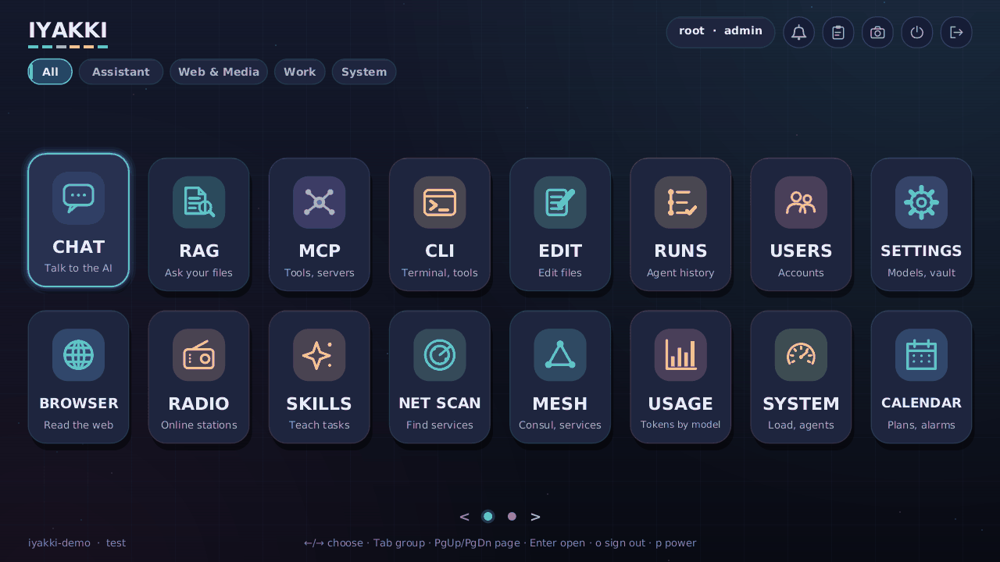

Contents: [Global keys](#global-keys-and-the-help-overlay) · [Launcher](#the-launcher) · [Approvals and modes](#approvals-ask-first-auto-approve-safe-autopilot) ·
[Inbox](#inbox) · [Tiles](#tiles) · [Voice](#voice) · [Look and size](#density-and-text-size)

## Global keys and the help overlay

| Key | What it does |
|---|---|
| **F1** | Help for the current screen, then the keys that work everywhere |
| **F8** or the Devices button | The Devices popover (next to the screenshot icon): network, Bluetooth, screens, sound, camera, keyboard and pointer, storage and battery at a glance; see [The top bar](#the-top-bar-clock-and-devices) |
| **Volume, brightness, keyboard light, media and power keys** | Work anywhere on the IYAKKI screen with a bar at the bottom centre; the key never reaches the open app. Hold to repeat. The Power key opens a Power off / Restart card and does nothing until you choose. Settings, Keyboard has the Function keys choice for Apple keyboards, key repeat, the detected controls and a key-code finder; see [`KEYBOARD-AND-FN-KEYS.md`](KEYBOARD-AND-FN-KEYS.md) |
| **Cloud mode** | On a server, cloud machine or any computer with no screen, sound or camera of its own, IYAKKI hides MEDIA, RADIO, TALES, VOICE and CAMERA, the Sound, System sounds, Display, Keyboard and Bluetooth pages and the Fn keys. The number keys 1 to 9 then count only the tiles shown. Administrators choose Automatic, On or Off in Settings, Cloud mode; About says why it is on; see [`CLOUD-MODE.md`](CLOUD-MODE.md) |
| **F7** or the clock | Settings, Time |
| **F10** or a click on the name IYAKKI | The IYAKKI menu: About, Quick install (opens Store → Setup), Media player, Linux apps, Mac drivers, Settings; see [The IYAKKI menu](#the-iyakki-menu) |
| **F9** or the bell | Open or close the INBOX from anywhere (the app you left keeps running) |
| **F12** or Print Screen | Screenshot to the clipboard: click two corners, or Enter for the whole screen, then save a PNG or close. Saved to `~/Pictures` if your account may write there, else the data folder's `screenshots` |
| **Esc** | Back (leaves a text field first) |
| **Ctrl+V** | Paste the latest copy |
| **Ctrl+Shift+V** or right-click | Clipboard history; its **Scan QR** button (Ctrl+K) copies text from a QR code held up to the camera (see below) |
| `o` (launcher) | Sign out |
| `p` (launcher) | Power menu, if your role allows |

**Selecting and copying.** Drag over text in the chat transcript, terminal output and detail panes to select (double-click
a word, triple-click a paragraph, Shift+click to extend), then **Ctrl+C**. A plain click does not copy; hover a message
or code block for its copy button. **Right-click** opens a menu (Cut/Copy/Paste/Select all over a text field, the app's own
entries, always "Clipboard history..."). In window mode the clipboard is shared with your system.
**On a touch screen** a tap clicks and a quick drag scrolls. To open the same menu, press and hold one spot without moving for
about a second and lift your finger: the menu appears there, with larger entries you can tap. To select text, press and hold
for half a second and then drag. (If you start the computer with `iyakki.touchscroll=0`, a finger works as a plain mouse and has no hold gesture.)

**Copy from a QR code.** To get a secret or any text onto this computer without a remote channel, make a QR code of the text on a phone or another computer (any QR-code maker will do), open the clipboard history and press **Scan QR** (Ctrl+K). IYAKKI asks first whether the camera may turn on, then shows **CAMERA IS ON**, a live picture and a frame to hold the code in. When a code is read the camera turns off and you see what it holds *before* anything is copied: long text is cut on screen (all of it is copied), and text that looks like a secret (a long token-like string, `sk-`, key, token, password) is hidden behind dots with a **Show** button. Choose **Copy**, **Scan again** or **Cancel**. The box **Secret: keep out of the history and clear after paste or in 60 seconds** starts ticked for hidden text: such a copy is not listed in the history, pastes once with Ctrl+V and is gone after that or after 60 seconds. The system clipboard gets the text once (so you can paste it on the Mac) and is overwritten with an empty text when the secret goes, unless you copied something else in IYAKKI since. A copy made in another program in between cannot be seen and would be overwritten at the 60 seconds. A web address read this way is only copied as text, never opened. Nothing read is logged, saved or sent; the audit says only "clipboard scan: n characters, secret yes/no". With no camera the dialog says so.

## The top bar: clock and Devices

**The login screen's top bar and Power button.** On the machine's own screen, the sign-in screen and the first-run setup screen
have a slim bar at the top: the host name, the network (*Wi-Fi: NetworkName*, *Ethernet connected* or *no network*), the battery
when there is one, the time and the date, and a red **Power** button at the right end. The bar only shows things; nothing in it
opens Settings before you sign in. **Power** (or **Ctrl+P**, or the keyboard's power key) opens a card with **Power off**,
**Restart**, **Sleep** (only where the system can sleep; **s** does it) and **Cancel**: Left/Right/Tab move the highlight, **Enter** or **y** does the highlighted choice, **Esc** or any other key closes the card
and nothing happens. No password is asked, because someone at the machine can pull the plug anyway; the audit log records
*power.off* or *power.reboot* by "login screen". When the bar is too narrow (a small or phone-sized screen) the date, then the battery, network and host name drop out first; Power and the time stay.
A session in the browser (remote desktop) never shows the bar or the button, and the power key and Ctrl+P do nothing there before sign-in, so nobody on the network can switch the machine off from the login page.
Sleep suspends the machine; the session is locked first, so you sign in again on waking. Some computers (Apple T2 Macs in particular) may not wake from it: see KNOWN-ISSUES.md. Where the system cannot power off (the window mode on a development computer), the card says *This system cannot power off from here*.

**The battery (laptops only).** A laptop shows a small battery next to the clock: green, amber under 20 %, red under 10 %, a white
bolt while it charges, a plug when the adapter is in and the battery is full or protecting itself, a question mark when the level
is not known, and the percentage beside it. Click it or press **F4** for the percentage bar, the status in plain words, the time
left, the battery's health and the power adapter; **Battery settings** (or Enter) opens Settings, Battery. A desktop, a virtual
machine and a Mac mini show nothing. At 20 % and 10 % a short message appears once, at 5 % a **Plug in now** card, and at 3 % a
30 second countdown card with **Cancel shutdown** (Esc); plugging in cancels it. Then the computer shuts down cleanly. In
Settings, Battery: *Show the percentage in the top bar*, *Low battery warnings* and (administrators) *Shut down at the critical
level*. See [`BATTERY.md`](BATTERY.md).

**The clock.** Every screen after sign-in shows the time (24-hour by default, `14:05`) at the top, with a short date beside it
when there is room (`Sat 17 Oct`). Point at it for the full date, the time zone and, when needed, a warning; click it (or press
**F7**) to open Settings, Time. A clock that was never set (a Mac mini or a board without a working clock battery starts in
1970) is shown in amber with a `!` and the tooltip says so: the machine asks a time server as soon as the network is up
(below). The calendar and the assistant use the same local time.

**Settings, Time.** *Everyone*: `h` 12/24-hour clock and `s` seconds in the bar (your own choice). *Administrators*: `z` time
zone (type to search the list), `u` back to the machine's own zone, `n` network time on or off, `c` another time server, `y`
ask the server now, `b` set the clock to the network time even if that moves it back by more than 5 seconds, `a` **Detect
automatically** on or off and `d` detect now. Detect automatically is off until you switch it on, because it asks an internet
service (ipapi.co, then worldtimeapi.org) which time zone this network's **public IP address** is in; nothing else is sent.
While it is on the zone is looked up again after sign-in and every 6 hours (10 minutes after a failure) and only a real zone
this machine knows is applied; the page shows the last answer or why it failed. Choosing a zone with `z` makes it fixed and
switches detection off. The zone list comes from the image's zone files (tzdata, public domain, is part of the images); a
machine without them uses a built-in table of the common zones with their daylight-saving rules. Network time is a small built-in SNTP client: it asks `time.cloudflare.com`, then
`pool.ntp.org`, once the network is up and every 4 hours, and sets the clock (it is PID 1, so it may). It sets a clock that is
before 2024 at once, steps forward at any size, ignores differences under half a second, and **never puts the clock back by
more than 5 seconds by itself**: the page tells you and waits for `b`. A desktop window follows the computer it runs on and
only offers the 12/24-hour and seconds choices.

**Devices.** The screen icon beside the camera (or **F8**) opens a compact list, read in the background so drawing never waits:

| Row | What it shows | Click or Enter goes to |
|---|---|---|
| Ethernet, Wi-Fi | link state, address, speed; for Wi-Fi the network name and signal (`-48 dBm (excellent)`); the first row also shows the host name | Settings, Network |
| Bluetooth | adapter present and powered, paired devices; **Scan** when the Bluetooth service exists | Settings, Bluetooth |
| Display | each connected output with monitor name, resolution, refresh rate and the interface size | Settings, Display |
| Sound | output, **one master volume** and mute, test chime; `A` shows Advanced (boost, volume control, stereo test, channel walk) | Settings, Sound |

**One master volume.** The volume keys, the mute key, Settings, Sound (slider, Louder, Quieter, Mute), the Mute button in the Devices popover and the volume bars of the Radio all change the same value and the same mute switch, and each shows it within a frame. The level is kept in the settings file across restarts. It is applied once: by IYAKKI's sound control (`IYAKKI`, an ALSA software volume that the radio, media player and any `aplay`-based player go through), and only where there is none (a card with a working hardware volume, or no `/etc/asound.conf`) do the players scale their own samples. Mute keeps the level; a louder or quieter step while muted unmutes. If the sound control is not ready (the card still starting, or another program holds the card) the volume key says *Volume control not ready* instead of showing a bar.
| Camera, Keyboard and pointer | what the kernel found | |
| Storage | drives and free space on the data volume | Settings, Storage |
| Battery | level and charging, only when there is one | |

A red dot means something is expected and missing ("Wi-Fi: no interface found", "Bluetooth: no adapter driver or firmware") and
the line gives the plain-words reason from the Drivers list. **Driver help** (button, or `d`) opens STORE, Drivers. Keys: Up/Down,
Enter, `a` the row's first button, `r` read again, Esc or F8 closes. On macOS or a desktop window the rows it cannot see say "not
available on this OS". Everything is read from `/sys` and `/proc`; a missing file is just "not there".

**Installs.** While Store → Setup (or the `iyakki quick-install` command) is installing something, a small turning ring with the number of installs sits left of the
clock (filled to the progress when the installs report one); for ten minutes after the last one ended it shows a check or a
cross. Click it to see every running and recent install with its bar and last line, **Log** for the live output (it follows the
end; scroll up to read, Esc closes it), **Stop**, **Dismiss**, and *All jobs in RUNS*.

## The IYAKKI menu

Click the name **IYAKKI** at the top left of the home screen, or press **F10** anywhere. Up/Down and Enter or the letter of an
entry; Esc goes back a page and closes; a click outside closes.

* **About IYAKKI** (`a`): version, build, variant, the running kernel (with the Mac image's patches when it has them),
  IYAKKI's licence (Apache-2.0), a short *Licence boundary* in plain words (the base OS runs as separate programs and is never
  linked; GPL kernel code on the Mac image; firmware; Apple firmware never shipped; sources in the image's legal-info) and,
  scrollable, every licence inside: the Rust crates linked into the program grouped by licence, and the programs of the images.
* **Quick install** (`q`): no page of its own any more. The entry (and its key, so old habits keep working) opens the **Store on its
  Setup tab**, described in [Store -> Setup](#store--setup). Everything the long Quick install page did is there, as cards.
* **Media player** (`m`): which player the image has, a file to play, Stop, and MEDIA. Video and sound (the camera's `.avi`
  recordings too) play in IYAKKI's own player once the media player is installed (Store → Setup → Media tools; the Media page has an
  Install button); without it the page says so. See [`MEDIA-PLAYER.md`](MEDIA-PLAYER.md).
* **Linux apps** (`l`): Debian and Ubuntu programs in a sandbox of their own. Make a sandbox (Debian 12/13, Ubuntu 22.04/24.04; the base is
  downloaded and checked, never shipped), open a terminal in it (CLI tile, `linux use <name>`), install packages with `apt` as a background job,
  mount folders (read-only unless you choose), switch its network on or off, delete it by typing its name. Third tab: ready-made **image apps** for
  the dev cluster. Needs the full command-line permission. See [`LINUX-APPS.md`](LINUX-APPS.md) and [`BUILD-YOUR-OWN-IMAGE-APP.md`](BUILD-YOUR-OWN-IMAGE-APP.md).
* **Linux windows** (tile **LINUX WINDOW**, System section; Store → Setup → Linux apps → *Linux windows*): a graphical program of a Debian sandbox in an
  IYAKKI window. One click installs a display server and a test program with `apt` (about 250 MB, an administrator's click); then choose a program in the tile,
  press Start, click into the window to use it (keys, mouse, wheel). The strip shows CPU and memory of the sandbox; Stop or closing the tile ends everything.
  The clipboard is shared only by the *Paste into window* and *Copy from window* buttons, as text. No graphics card and no sound. Needs the full command-line
  permission. See [`LINUX-WINDOWS.md`](LINUX-WINDOWS.md).
* **Mac drivers** (`d`): Wi-Fi firmware (run `dist/drivers/mac-wifi-firmware-from-macos.sh` on the Mac's macOS, then STORE,
  Drivers, Install from folder or USB), T2 audio, Bluetooth and the USB camera as the system sees them, with STORE, Drivers.
* **Settings** (`s`): Settings is no longer a tile; open it here, with F7 or by clicking the clock.
* **Developer mode** (`v`, administrators): opens Settings, Developer mode. While it is on, a small amber **DEV** sign (DEV ·
  pairing while a pairing code is shown) sits in the top bar; click it for the same page.

## The launcher

Tiles are sorted into built-in groups shown as tabs at the top: **Ask & Create** (CHAT, RAG, SKILLS, CALENDAR, TALES, VOICE, LAB),
**Build** (AI IDE, GIT, FLOWS, K8S, EDIT, CLI, MCP, RUNS, SRE PILOT), **Media** (BROWSER, RADIO, MEDIA, CAMERA), **Data** (DATA, DASH, USAGE)
and **Devices & System** (SYSTEM, DISKS, NET SCAN, MESH, USERS, STORE, LINUX WINDOW), plus the groups you make yourself. A tile you install later
(a custom tile app from developer mode, a Store app) appears in the group **Apps** at once, without a restart, unless its app.json names another group or you
moved it; the Apps tab shows only once it holds something. Nothing disappears: a tile whose group you deleted goes back to its own group.
**Settings** is not a tile: it is the gear icon in the top bar (same permissions as before; a role that may not open it sees a message), and the key `s`,
F7 and the IYAKKI menu (F10) open it too. Next to it the **speaker icon** shows IYAKKI's one volume (muted, low, medium, high; crossed when the
computer has no sound output, and hovering says why). Click it to mute or unmute (the level is kept), turn the mouse wheel over it to change the volume by 5 %
per notch, press and hold it (or press and drag up and down) for a slider, or press `v` for the slider with the keyboard (Up/Down or +/- change it,
`m` or Enter mutes, Esc closes). It is the same volume as the volume keys, Settings, Sound and the Devices popover, and every change shows the volume bar.
To put the tiles back in the groups above use *Reset to default layout* (right-click a tab or a tile, or Settings, Home layout); your own groups stay.
Arrow keys choose, Enter opens, **Tab / Shift+Tab** (or clicking a tab) switches section (your last section is remembered),
**PageUp/PageDown**, the wheel or the dots turn the page when a section has more tiles than fit. **1-9** open the Nth tile of the fixed tile table
(the order of the sections as shipped: CHAT, RAG, MCP, CLI, ...), whichever group a tile has been moved to. A tile with a DEMO ribbon (SRE PILOT)
shows sample data only. Tiles your role may not use are locked: a message names your role.

### Moving tiles and making groups

The layout is yours: other accounts keep theirs, and it changes only where a tile is *listed*, never what the app may do (that comes from your role).

* **Move a tile.** Select it and press `m` for a list of groups (and *New group…*); or right-click it for *Move to group…*, *Pick up, then click a
  group* (click a chip to drop it, Enter drops it in the shown group, Esc cancels) and *Reset position*. A notice says what moved and offers
  **Undo** (a button, or `u`; one step). `[` and `]` put the selected tile earlier or later in its group.
* **Make a group.** The **+** chip at the end of the row, *New group…* in the move list, or `g` for the group's menu. The name is 1 to 16
  characters and cannot repeat any group (any capitals), built-in or yours. You can have 12 of your own. An empty group of yours stays on the row with a
  hint, so you can fill it; an empty built-in one is hidden as before.
* **Rename, put in order, delete.** Right-click a chip of yours, or press `g` while it is shown. *Delete group…* opens a card that says how many
  tiles go back to their own default group; nothing is uninstalled. The built-in groups have no such entries and cannot be renamed or deleted.
* **Too many chips for the width** (a phone, many groups): the row ends with a **…** chip that lists the rest; the shown group always has its chip.
* **Settings → Home layout** does the same with lists: every group (rename, delete, earlier/later), every tile with the group it is in (Move tile,
  Put tile back) and *Reset to default layout* (tiles back, your groups stay).
* **Apps that name a group.** A Store app's app.json may say `"group": "Games"`. If that is a group you have (any capitals) the app goes there. If not, a
  card asks once: *This app wants to be in the group “Games”. Create it?* **Create** or **Put it in Work**; the answer is remembered for that app. If you
  move the app yourself, your choice wins over the app's `group` on later updates.
* Not there yet: dragging a tile with the pointer (use *Pick up*), a touch long-press menu, and an administrator's default layout for new accounts.

## Layouts and displays

Put two, three or four apps side by side on one screen. Nothing changes until you choose a layout: IYAKKI starts with one app
on the whole screen, as always.

* **LAYOUT button** (a small grid, left of the bell in the top bar) or **Ctrl+Alt+0** opens the picker: every layout with a
  small picture (50:50 side by side or stacked, 30:70, 70:30, 25:75, 75:25, 40:60, 60:40, three equal parts, a 2x2 grid, and 70:30
  with the right side stacked). Click one, or press its number, or move with the arrows and press Enter.
* **Ctrl+Alt+1 to 9** apply a layout straight away (1 is a single app). **Ctrl+Alt+arrow** snaps the open app to that side:
  from one app it makes a 50:50 layout and puts the app there; in a layout it swaps the app with its neighbour.
  **Ctrl+Alt+Tab** moves to the next pane (with Shift, the previous one). **Ctrl+Alt+Shift+arrow** moves the divider.
* Every pane has a **title strip** with **Move**, **Layout**, **Back** (show this pane's launcher) and **Close** (one pane fewer).
  **Move** picks the pane up; click the pane you want it swapped with (Esc cancels). Windows cannot be dragged: a click opens
  things at once in IYAKKI, so *pick up, then click the target* does the job.
* Drag a **divider** to change the sizes; it snaps to 25, 30, 33, 40, 50, 60, 67, 70 and 75 % and stops where an app would get
  too small. A pane that is still too small for its app says so instead of drawing it half.
* Keys and the mouse wheel go to the pane you are working in (the one with the bright frame); a click in another pane makes it
  the working pane. Apps in other panes keep running.
* A pane with no app shows the launcher at its size. The F-keys, F1 help, the right-click menu and the clipboard work on the
  working pane. Cards and dialogs of an app stay inside its pane; the power card, the sign-in dialog, alarms and screenshots cover
  the whole screen.
* **Memory.** Layouts are used only when the computer has the memory for them: 1 GB machines stay with one app; around 2 GB
  allows two panes; 4 GB and more allows four panes and several displays. The picker shows what applies ("Layouts: available
  (4 GB, 2.9 GB free)", "limited to 2 panes (2 GB)", "single screen only (1 GB)") and why. If free memory falls, the layout
  becomes smaller after a card says so, and comes back when memory is free again. An administrator can set *Screen features* to
  Automatic, Always on (may be slow or run out of memory) or Off (as if layouts did not exist).
* In a remote desktop (browser) the same layouts work at the browser's size. Some browsers or desktops keep Ctrl+Alt+arrows for
  themselves; the LAYOUT button always works.
* **Several displays.** With a second monitor plugged in (and memory for it), each display gets its own bar and panes. The pointer
  moves from one display to the next across the edge; a click makes that display the working one. **Ctrl+Alt+M** moves the open
  app to the next display; **Ctrl+Alt+arrow** does it when there is no pane that way and a display lies that way; **Move** on a
  pane, then a click on a pane of the other display swaps the two. Pop-ups and cards appear on the working display only.
  **Settings -> Displays** lists the displays: **r** resolution, **p** main display, **a** which side, **m** mirror or extend,
  **i** identify (a number on each screen), **y** apply. A new arrangement is tried for 15 seconds and goes back by itself unless you
  press **k** (keep). Each display remembers its layout. If the shell cannot drive the displays (one display, too little memory,
  another program holds the screen) the page says why and the monitors show the same picture, as before. Details and a test
  list: `docs/MULTI-DISPLAY.md`.

## Approvals: Ask first, Auto-approve safe, Autopilot

The assistant can only do what your role and policy allow ([`ADMIN-GUIDE.md`](ADMIN-GUIDE.md#accounts-roles-and-policy)). Within that:

* **Reading is free.** Writing a file, calling an API, running a program or starting a container pauses for
  **Allow once** (`Ctrl+Y`), **Allow for this session** (`Ctrl+U`) or **Deny** (`Ctrl+N`). No answer means deny.
* **Allow for this session** sticks for the whole chat: the same tool in the same scope is not asked again, in later messages
  and in Autopilot steps too. The scope is: the same program and subcommand for a command (`git status` does not cover
  `git push`), the same cluster and namespace for the cluster tools, the same host for web calls, any file in the workspace
  (or in the same folder outside it) for file writes. Shells and interpreters (`bash -c`, `python`, `ssh`, `curl`) are covered
  only as the exact same command line. "Approved this session: N" next to the mode chip lists what you allowed
  (`Ctrl+Shift+Q`): click Revoke to take one back, or Reset approvals to forget all. A new chat starts with none.
* **Calls that always ask** never get a session answer: the card says "Always asks: <reason>" and has only Allow once and
  Deny. These are secrets and the vault, screen capture (which has its own "Allow for 5 minutes"), browser interaction with
  sites, destructive actions (delete, `rm`, namespace removal, HTTP DELETE, teardown), anything outside your workspace,
  installs from outside tools, store installs and publishing, platform deploy and remove, driver installs, drive writes, and
  any change to a remote cluster.
* **One chip with three modes** (`Ctrl+Q` cycles; shown as "Approvals: Ask first / Auto-approve safe / Autopilot"):
  **Ask first** asks for anything you have not approved earlier and remembers your session approvals. **Auto-approve safe**
  runs the assistant's ordinary writes and commands without a prompt, each one still audited, and asks only for the calls
  above; it ends when you sign out or leave the workspace unless kept ("Auto-approve safe · kept", remembered per person
  and workspace). Earlier versions called these Ask, AUTO and AUTO pinned; the saved choice carries over.
* **Autopilot** (the third mode of the chip in the AI IDE chat pane, or Ctrl+Shift+A): runs the plan to the end within its
  budgets and still stops for the always-ask items. give a goal; the assistant plans it on the board, works through the rows,
  retries a failing row up to three times, verifies, and writes a summary. Budgets: 40 steps, 30 minutes, your token budget,
  3 steps without progress. Typing a message pauses it; Ctrl+Shift+R resumes.
* **Change the mode while the assistant works.** The chip (and `Ctrl+Q`, `Ctrl+Shift+A`) stays enabled during a run, in CHAT,
  the AI IDE chat, the DASH and FLOWS chats and for a coding agent (Claude Code) working through the bridge. The change applies
  to the run at once, a line in the conversation marks the point ("Approvals changed to … during this run"), and the audit log
  has `approvals mode changed to … during run <id> by <you>`. Hover the chip to see what changes now:
  * to **Auto-approve safe**: a card that is waiting is approved at once if Auto would have run it ("approved by switching to
    Auto-approve safe"); always-ask cards keep waiting;
  * to **Ask first**: the next risky call asks; a tool already running finishes;
  * **Autopilot on** (workspace chat only): the current turn finishes, then the run goes on into the plan with fresh budgets;
  * **Autopilot off**: the current step finishes (its board updates are written), then Autopilot stops, saves its place and
    writes a summary; jobs it started keep running in the Jobs strip. Turn it on and press Resume to continue. The **Pause**
    button still pauses at once.
  Session approvals are not changed by a switch. In the Tasks tab each running task has its own mode button (`a` cycles
  Autopilot → Ask first → Auto-approve safe); leaving Autopilot pauses that task after its step, and Resume works the plan again.
* **Budgets per run** (tokens, seconds, files written, cost) come from your account and can be changed by an administrator in
  USERS (`b`).

## Inbox

The bell at the top of every screen (or F9). Three pages (`Tab` or `1 2 3`):

* **Notifications:** reminders that rang, finished runs, new devices. `Enter` open, `r` read, `f` flag, `c` add to the calendar,
  `s` snooze, `d` delete, `g` clear a group, `m` mute the source, `A` all read, `X` clear read. Similar notes are **grouped** into one
  row, newest first, collapsed: "79 new devices on your network", "41 setup jobs finished", "Health check failed (x4)" (a flow that
  keeps failing with the same error within an hour is one row with a counter and the last time). `Enter`, Right or Space opens a
  group's list; there `Enter` opens the item in its app, and for new devices `t` trusts them all and `i` ignores them (marks the group
  read). A group you have looked at stays as it is; later arrivals start a new row, so a group only holds what is new since you last looked.
  The first NET SCAN after install is taken as "what is normally here" and raises no new-device notes.
* **The bell.** The red or amber **number** counts only what needs you: approvals waiting, overdue tasks, errors, warnings, reminders and an
  assistant waiting for you. Information, new devices, downloads and finished jobs never add to the number; when only those are unread the bell
  shows a small blue **dot**. "99+" appears only when 100 or more things really need you.
* **Keeping.** Information, new devices and downloads are kept 7 days, jobs and reminders 14, errors and warnings 30; at most 60 rows per
  source and 200 in all (flagged rows are kept until you remove them). The first time an older inbox is opened it is grouped and the panel
  says so once; nothing else is removed.
* **Mute a source.** `m` on a row cycles that source Show, Quiet (kept in the inbox only: no number, no dot, no sound), Off (not kept). The same
  choice, for every source, is in **Settings -> Notifications**; it is yours alone.
* **Tasks:** pending, doing, done; assistants can add to-dos. `n` new, `Enter`/Right next state, `e` edit, `p` priority,
  `c` calendar, `x` drop, `d` delete, `f` filter.
* **Approvals:** every waiting tool call from any app, one at a time: `y` approve, `n` reject, `Enter` for details.

### Reaching you in a Matrix room (Settings -> Notifications)

Besides the inbox, IYAKKI can write to **you** in a Matrix chat room, for example when a flow finds something. You need a Matrix account on any homeserver (your own, or one you use already). In **Settings -> Notifications** press `a` (Matrix account): give the server address (`https://matrix.example.org`, or `cluster://iyakki-matrix/matrix:8008` for the server from Store), your user name and password (the password is used once and not kept; the access token goes into your vault), and optionally the room id (`!abc:server`, Element: room settings, Advanced). `t` sends a test message, `x` removes the account and its token.

* Only rooms **without end-to-end encryption** work. If a room is encrypted IYAKKI refuses to send and says so; it never sends plain text into an encrypted room. An optional encryption add-on may come later.
* IYAKKI talks only to the server you typed, and to nothing else. Plain `http://` is accepted only for the cluster and your local network.
* At most 30 messages an hour per account. In a flow, the **Notify** step has "Also tell me by": write `matrix`, optionally the room name and a camera picture of the same run, or tick Dry run to see what would be sent.
* Store -> Matrix server (Tuwunel, Apache-2.0) puts a small server of your own in the cluster: registration needs a token that is kept in your vault as `svc.matrix.registration-token`, and it talks to no other server. Register an account with any Matrix client using that token, then add it here.
* Not built yet: showing incoming messages in the inbox, and the assistant reading or sending messages.

Alarms and reminders ring wherever you are: Enter dismisses, `S` snoozes five minutes.

## Where your files live

Your home folder is `/home/<your name>`. Photos and videos from CAMERA (Pictures, Videos), TALES stories, AI IDE workspaces,
downloads and the sign-ins of command-line tools you run in IYAKKI (for example `~/.claude`) are kept there. On an installed
IYAKKI, or any stick with a data volume, `/home` is stored on that volume, so everything stays after a restart; the terminal,
the assistant's tool runs and jobs start in your home folder and use it as `HOME`. A session without a data volume
(*SYSTEM -> Storage* says "RAM") loses these files at power-off: save or persist the disk first. Other people's home folders
are private to them (mode 0700).

**If the drive disconnects.** A red card on every screen says "The IYAKKI drive was disconnected for a moment, so saving is not possible right now. Check the USB-C cable."
Apps then say "The IYAKKI drive is not available" instead of "I/O error". When the drive is back IYAKKI reconnects it by itself after a few seconds and shows "Drive reconnected, everything is saved again."
(**Reconnect now** does it at once, **Minimise** shrinks the card, **Restart** restarts). Anything that was being saved at that moment may be lost. Settings, Storage shows how fast the drive is connected
and warns about a USB 2 link or a hub. More: [STORAGE-LOSS.md](STORAGE-LOSS.md), [TROUBLESHOOTING.md](TROUBLESHOOTING.md).

## Tiles

### CHAT
Talk to a model. Chats are saved with memory, listed in a side panel, shown as Markdown.
`Enter` send · `Ctrl+N` new chat · `Ctrl+P` choose model · `Ctrl+W` hide/show the chat list · `Ctrl+L` chat picker · `Ctrl+B` delete
chat · `Ctrl+D` use my documents (RAG) · `Ctrl+E` edit a file with the assistant · **`Ctrl+G` agent mode** · `Ctrl+Q` approval mode
(Ask first / Auto-approve safe / Autopilot) · `Ctrl+K` stop the run · `Ctrl+R` dictate · `Ctrl+O` read answers aloud · `Ctrl+Shift+H` save the last answer to the
computer (window mode: its table as `result.csv`, else a code block, else `answer.md`).
The message box is three lines tall and grows to ten or twelve lines as you type, then scrolls inside (mouse wheel over it, arrows, Page keys); it takes
up to 20,000 characters, so a long error log or spec can be pasted whole with its line breaks. `Ctrl+M` makes a new line (`Ctrl+J` too, outside the AI IDE);
`Enter` sends. If a paste is longer than the limit, the first 20,000 characters are kept and a red line under the box says how many were left out. The AI IDE's chat
and the other chats use the same box.

* In agent mode it can read files, search your documents, search the web and read pages (`web_search`, `web_fetch`), weather,
  share prices, call APIs, run read-only text commands, run `ssh`, `scp`, `sftp`, `aws`, `gcloud` and installed CLIs (each call asks), plan in your calendar,
  play music, manage models and run code in a limited container (`sandbox_run`, needs the container cluster of the image).
  It can use your own **browser tab** read-only by default; clicking and typing need your approval per site and it never
  types passwords ([`BROWSER-AGENT.md`](BROWSER-AGENT.md), [`WEB-RESEARCH.md`](WEB-RESEARCH.md)).
* Anything slow (an SDK install, a big build, a download) runs as a **job** (`job_start`, you approve it): it keeps running when the chat
  ends, shows in a **Jobs strip** above the composer with progress, **Log** and **Stop**, and you get an inbox note when it ends
  ([`JOBS.md`](JOBS.md)).
* SVG drawings and images in answers are shown as pictures. Pasting something that looks like a key or token offers to
  store it in your vault instead of sending it.
* Drop files on the window: text files are quoted, pictures are saved to Uploads.
* **Limits:** answers are only as good as the model; "thinking" models can sit silent for a while; a model without tool
  calling uses a plain-text protocol ([`ASSISTANT-ROBUSTNESS.md`](ASSISTANT-ROBUSTNESS.md)).

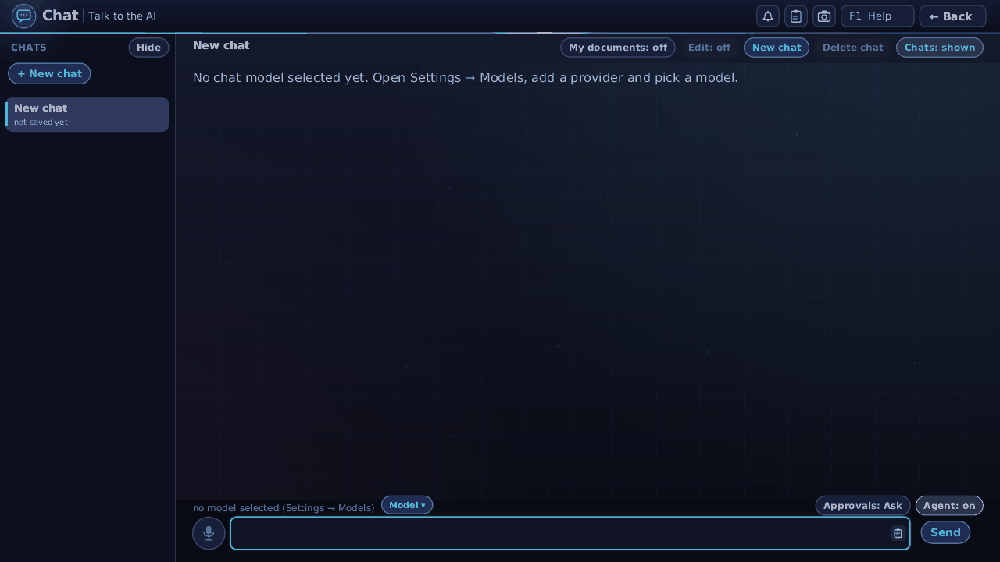

### RAG
Search your documents with hybrid keyword + vector search and ask a model grounded in them, with citations. `Enter` run ·
`Tab` search/ask · `Ctrl+O` your documents (delete what you do not need) · click a result to copy. Documents are `.txt`/`.md`
files in `docs/shared/` (everyone) and `docs/<username>/` (private) of the data folder. External backends (Qdrant, Chroma)
are added in Settings -> RAG.

### MCP
Connect Model Context Protocol servers, browse and call their tools. `Up/Down` choose · `Enter` connect · `N` add · `D` remove.
On the arguments screen type JSON and Enter. A sample server is included. Which servers you may use is part of your policy.

### SKILLS
Short Markdown instructions the assistant follows when a request matches. `v` add what you copied (a skill or a signed `.iyp`
package) · `n` write one in a form · `l` load from a file · `d` delete · `m` only for you or for everyone (if allowed) · `k`
trusted publishers. A package is always shown to you first.

### CLI
Two pages (`Tab`): **Terminal** (policy-checked commands such as `help`, `ls`, `cat`, `policy`, `skill list`, pipes, `curl`,
`date`, `alarm`; `Enter` run, Up/Down history, PgUp/PgDn scroll) and **CLIs**, a catalogue administrators install from:
kubectl, k3s, Helm, Terraform, GitHub CLI, AWS CLI, Google Cloud CLI, Azure CLI, Arduino CLI, esptool, espflash, Ollama, DuckDB,
grpcurl, Claude Code, GitHub Copilot CLI, Codex CLI, Gemini CLI and Aider. `i` install or update (you confirm the exact
command or checksummed download), `x` remove, `s`/`t` start/stop the container cluster (k3s) or Ollama. Installed tools are
available to the chat. The terminal is not a pty: no interactive programs (signing in to Claude Code or GitHub Copilot has its own **Login** button, described next). The list also has the **SSH client**, which is found on
the machine rather than downloaded, and a third tab, **Connections**: saved hosts with a Connect button, the host-key
fingerprint you confirm the first time, and keys made into your vault. `ssh`, `scp`, `sftp`, `sshtrust`, `sshhosts` and `sshforget`
also work in the Terminal tab. See [`CLI-SSH.md`](CLI-SSH.md).

**Login for Claude Code and GitHub Copilot.** When one of them is installed, the CLIs list, Settings → Agents, Store → Setup (the
IYAKKI menu) and the chat's model list (Ctrl+P) show a **Login** button and what is signed in ("signed in as you@example.com" or
"not signed in"); an agent that is installed but not signed in says **Sign in first**. Login opens a dialog: for Claude Code you
choose *Claude subscription* (the usual), *Anthropic Console (API billing)* or *SSO*; then the dialog shows the sign-in address
(with **Copy address** and a QR code you can scan with a phone) and, for GitHub Copilot, a one-time code to enter at
github.com/login/device (**Copy code**). Open the address on any device, sign in, and for Claude Code type the code the browser
shows into the dialog's field and press Enter. To avoid typing the long code of Claude: press **Open in browser** (the dialog hides, you sign in in the BROWSER tile, copy the code, press Back, and tap **Paste the copied code**), or scan the **second QR code** with the phone you signed in with and paste the code there. For GitHub Copilot your token is kept in your vault, not in a plain file (unlock your vault if the dialog says it is locked). **A bigger QR code.** The button **+ bigger QR** (or Ctrl+B) makes the sign-in QR code at least twice as large, up to nearly the height of the dialog, drawn dark on white with the quiet border a phone needs and with every square on whole pixels so it stays sharp; **- smaller QR** (or Ctrl+B again) brings it back. The choice is kept until you restart. With the second QR code (the phone relay) up, the big view shows one code at a time and **Show code 2** (Ctrl+N) switches between them. On screens wider than 2000 pixels the QR code is a little larger from the start. **Scan the code back with the camera.** In the step that waits for the code, **Scan with camera** (Ctrl+K) lets you show the code on your phone to the computer's camera (for example a MacBook's FaceTime camera): on the phone, make a QR code of the code the sign-in page showed (any QR-code maker on the phone will do) and hold it inside the corners of the small live picture. IYAKKI first asks whether the camera may turn on, and the card shows **CAMERA IS ON** with a live picture, a frame to hold the code in and the seconds left. It reads the QR code, puts the text in the field only if it has the shape of a sign-in code, turns the camera off at once and waits for you to check it and press Enter: nothing is sent by itself. A QR code that holds a web address is refused (never put in the field and never opened), and so is anything else that does not look like a code, each with a plain message. Esc, **Stop camera**, closing the dialog, the sign-in ending, or one minute without a code also turn the camera off. If there is no camera the dialog says so. The pictures are looked at in memory only: they are not saved, not sent anywhere and not written to the audit log. (Plain letters go to the code field, which is why these two shortcuts use Ctrl.) The dialog says **Signed in** when it is done; **Cancel** stops it. **Logout**
(Claude Code) signs out. Your login is kept by the vendor's program in your own home folder and survives a restart; IYAKKI never
sees your password or token and records only that a login started or finished. In the CHAT tile and the AI IDE assistant (the same chat) the footer shows the answering agent (`agent: Claude Code · Sonnet`); an agent that is not ready is explained in the empty chat with a Login button or the install command instead of "No chat model selected". With no provider model set and exactly one agent installed and signed in, that agent answers without any choice. After a restart the status is looked up again when you sign in to IYAKKI. Details: [`EXTERNAL-AGENTS.md`](EXTERNAL-AGENTS.md).

### EDIT
An editor written in-house (11 languages highlighted). `Ctrl+S` save · `Ctrl+O` open · `Ctrl+N` new tab · `Ctrl+W` close tab ·
`Ctrl+F` find · `Ctrl+L` comment line · `F5` run (`.py .js .sh .wasm`) · `Ctrl+Z` undo. Chat can propose edits: `y` accept,
`n` reject, `a` accept all, `Enter` apply, `Esc` discard. Nothing changes until you accept and save.

### RUNS
History of every agent run, verified against its hash-chained ledger. Click a run; `c` copy transcript, `d` delete.
The second button, **Jobs** (or `j`), lists the **detached jobs** the assistant or Claude Code started (`job_start`): a spinner or a
check, the time, a sliding or filled progress bar, the last output line, **Log** and **Stop** (**Dismiss** once it ended). Jobs keep
running when the chat ends; the same rows also show in the chat and the AI IDE's chat pane ([`JOBS.md`](JOBS.md)).

### SETTINGS
Settings opens on **Overview**: a **Needs attention** list (the firewall is open, no AI model is chosen, the clock looks wrong,
Bluetooth needs firmware, your data is kept in memory only), each line with a **Fix it** button that opens the page that solves it, and
**Common things** (Join WiFi, Change my password, Bigger text, Choose the AI model, Sound and volume, Time zone and clock, Firewall,
Name of this computer, Where my data is kept). After a crash or a power cut it also says **The last session ended unexpectedly**, with a button to **Last session log** (an administrator's page under System: the last 200 lines of the kernel log kept on the stick, "I have seen it" clears the note; see docs/TROUBLESHOOTING.md). Nothing to fix says "Everything looks fine." You only see lines about pages your role has.

The list on the left has eight headings, in this order, and the pages under them:
**Overview** · **Account & people** (Account, Vault, Secret providers) · **Apps & AI** (Models, Agents, Skills, RAG, Voice,
Browser, Host access) · **Network & sharing** (Network, Firewall, Shared folders) · **Display & sound** (Display, Displays, Screen saver, Home layout,
Sound, System sounds) · **Devices** (Bluetooth, Keyboard) · **System** (Time, Host name, Memory, Storage, Install to disk, Cloud mode) ·
**Developer** (Developer mode, Dev cluster, Git and SSH keys). The left and right arrow keys walk the pages in that order.

**Finding a setting.** Type in the search box (`/` or Ctrl+F) in your own words: "wifi", "password", "dark", "font", "sleep", "mouse",
"backup", "restart", "security" and "assistant" all lead to a page (for example "dark" leads to Display, where brightness is, and "sleep" or "screen off" to Screen saver;
there is no dark theme and no sleep (suspend) timer yet). Enter opens the first match, Esc clears the text. If nothing matches, the list says to try one simple word.

Hardware pages and most changes are administrator-only. Keys per page are shown in the header and F1: Models
`a e d t m b k x c`; Vault `n d Tab l f`; Network `Enter`, `w` join Wi-Fi, `m` private MAC address, `a` apply it now, `n` announce the device's name, `r`; Display `u U + -`; Sound `o t + - m M Enter`; Voice
`s v c m p t y`; Storage `m` make data disk (erases it), `u` compatible USB mode (no UAS); Account `p` change password, `u U` text size; Firewall `1 2 3 a d A`. Details:
[`ADMIN-GUIDE.md`](ADMIN-GUIDE.md).

**Firewall (Settings, Network & sharing, Firewall; administrators).** It opens on a simple page: the big state (FIREWALL ON, OPEN or NOT
PROTECTED), three ways to run it, and the short list **Allowed on this computer**.
**Standard** (the default) blocks everything coming in except what you allow; **Open** blocks nothing and asks first; **Locked down** (also
blocking what goes out) is shown but not available yet, and says so. **Add...** offers Web server, SSH, File sharing, Remote desktop,
Kubernetes (k3s), a custom port, or a computer by name or address (paste a host name, an IP address, a range or a network). **Remove** takes
the selected line away; removing SSH or Remote desktop asks first because it may be how you are connected. Every change waits 60 seconds for
**Keep**; do nothing and it is undone, so a mistake cannot lock you out for good. **Advanced...** opens the full page: every rule, presets,
ping, host-name lookups, the log of blocked attempts, import and export ([`FIREWALL.md`](FIREWALL.md)).

**Models page with a Lemonade server.** Pick the Lemonade provider and its models are listed under the provider card. The
heading says how many are installed and how many are available ("1 installed · 117 available"); the provider card says the
same instead of a model count (a provider that has not been read yet says "models not read yet: press Test or All models").
**Installed** comes first: every model the server has downloaded or loaded, of any type, each chip with its type
("kokoro-v1 · tts"); click one to use it (a chat model, embeddings, the TALES picture model, the reading voice, speech-to-text)
or to load or unload it. Below it, one section per type lists only what is not downloaded yet, as "pull 337 MB" chips (a click
asks first, naming the size). The list scrolls: the mouse wheel over it, PageUp and PageDown (Home and End), and Up and Down
once the list has been used; a thin bar on the right shows where you are. The search box at the top right of the list (press
`/`, or click it) filters while you type by name, type word (chat, vision, tts, stt, embeddings, rerank, image) and label;
the heading then says "12 of 117 shown", Esc clears the text, and clicks keep acting on the model you see.

**Host name (Settings, System, Host name; administrators).** The name your network and the terminal prompt use. It was chosen
in the installer or defaults to the image's own; here `e` types a new one (lower-case letters `a-z`, digits and `-`, up to 63
characters, not starting or ending with `-`; the page says what is wrong when it is refused), `y` **Apply now** changes the
running system and `/etc/hostname` at once and keeps it in `system.conf` for the next boots, `v` only saves it. Other keys of
`system.conf` are left alone. The boot option `iyakki.hostname=NAME` overrides the file and locks the page. On the command line:
`iyakki hostname` shows it, `iyakki hostname NAME` sets it (as root). A desktop window shows the host computer's name and changes
nothing.

**Developer mode (Settings, System, Developer mode; administrators).** Lets a computer you pair install, upgrade, remove, open and
watch apps on this device (`iyakki dev install`, `push --watch`, `logs --follow`, `run`, `screenshot`), like `adb` for IYAKKI. Off by
default. `e` switches it on or off, `h` chooses when it switches itself off (4 h, 1 h, 8 h, 24 h, 72 h or never), `p` shows a pairing code
and this device's key fingerprint for the computer to type, `x` revokes a paired computer, `l` shows the activity log (every action:
which computer, which account, what, when). What it installs is labelled **Developer (local)** everywhere and goes through the STORE's
checks; driver packs cannot be installed this way. Details and the security model: [`DEVELOPER-MODE.md`](DEVELOPER-MODE.md).

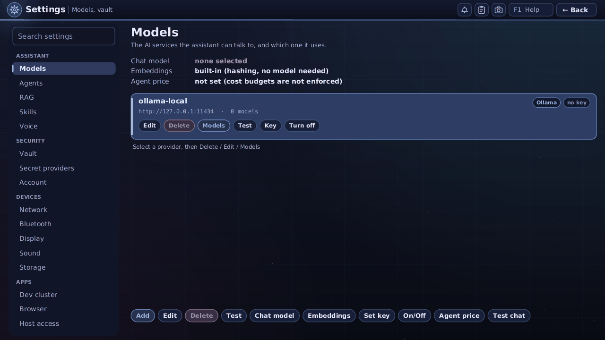

**Private MAC address (Settings, Network).** Every network adapter has a hardware address (the MAC address) that the router sees and
that tracks you from one network to the next. `m` chooses what IYAKKI shows instead, separately for Ethernet and for Wi-Fi:

**Device name (Settings, Network; administrators).** `n` switches "Announce this device on the local network". The device then answers to a random name such as `iyakki-0a1b2c.local`, so a computer that paired with it for developer mode finds it again when its address changes (`iyakki dev scan` lists such devices). It tells the network only that random name, that this is an IYAKKI device, and that developer mode or the web service is on; it never tells who you are and the name is not made from your name or the host name. On by default; off by default in cloud mode. While on, the firewall list shows the rule "device name (mDNS)"; removing it switches the announcing off. Some Wi-Fi access points block this kind of message between devices.

| Choice | What the router sees | Default for |
|---|---|---|
| **Off (hardware address)** | the adapter's real address | Ethernet (so DHCP reservations and router rules keep working) |
| **Per network** | a made-up address that is the same every time you join the same Wi-Fi network (or use the same Ethernet link) and different on every other network and every other device | Wi-Fi |
| **Random each connection** | a new made-up address every time the adapter is brought up or a Wi-Fi network is joined | nobody |

Each adapter's row under the list shows the mode, the hardware address, the address in use now and whether it is locally
administered. A change is saved at once and takes effect on the next connection (start-up, joining a network, switching the adapter
on); `a` applies it now, after a question, because the adapter must go down for a few seconds. The question is stronger when that
adapter carries the SSH or remote-screen session you are using. Some adapters and drivers refuse to change their address; the page
then says "not supported by this driver" and the adapter keeps its hardware address. Everyone sees the address in use on the
System tile (`MAC: aa:bb:... (private)`); only administrators change it. On the command line: `iyakki net mac` ([`ADMIN-GUIDE.md`](ADMIN-GUIDE.md)).
In the desktop window the host computer owns the addresses and the page only shows them.

### BROWSER
A browser written in-house: HTML + CSS, forms, cookies, images, JavaScript (QuickJS in WebAssembly), tabs, find, bookmarks,
history, downloads, reader view. `g` address/search · `Tab` links · `b f r` back/forward/reload · `Ctrl+T/W/Shift+T` tabs ·
`Ctrl+D/B/H/J` bookmark/bookmarks/history/downloads · `Ctrl+K` fill saved sign-in · `Ctrl+F` find · `j` allow JavaScript for
this site · `c` developer panel · `+ - 0` zoom · `R` reader · `U` view source · `X` forget site data · `N` night colours ·
**`F` the full web engine** (WebKit, needs its helper, [`FULL-BROWSER.md`](FULL-BROWSER.md)) · `Q` ask / `S` summarise / `T`
translate / `M` keep in knowledge (asks each time). **Searching:** words typed in the bar are searched on Bing's plain results page (Settings, Browser: DuckDuckGo, Brave Search or Wikipedia); if that page is busy or asks for a check, the next one is tried and a note says so. Google's own results page only answers with "enable JavaScript", so Google searches are run on your chosen engine too. A name that does not exist (`youtub.com`) shows "Couldn't find ..." with a search for it and, for near misses of popular sites, "Did you mean youtube.com?". YouTube, Gmail, Google sign-in and similar apps need the full engine: the `web` or `macweb` image (the Mac image with the web engine). **In the full engine** click a box and type; the keyboard goes to the page (Esc gives it back to the browser, Ctrl+L is the address bar, Ctrl+T/Ctrl+W tabs); Ctrl+C/Ctrl+V and a page's own Copy button use IYAKKI's clipboard; use a mouse (touchpads are not read). **Limits:** no video, canvas or IndexedDB in the built-in engine; CJK
and emoji show as boxes; heavy web apps need `F`. Honest list: [`BROWSER-ROADMAP.md`](BROWSER-ROADMAP.md).

**The Browser's tool bar and tabs.** Left to right: Back, Forward, Reload, Start page; then the address bar with the padlock chip (*Secure* or *Not secure*) inside its left edge and the star (bookmark) and **Go** inside its right end (Enter does the same); then small chips: **Reader** (back to the built-in reader), **Notes**, **Scripts on / Scripts off** (a shield: *Scripts allowed on this site* runs the page's programs, which video, maps and mail need; *Scripts blocked* is faster and safer but some sites stop working; hover it for the sentence), **Play**, and the developer-tools chip. A thin bar under the tool bar slides while a page loads and fills as the engine reports; the page area is dark until the first picture arrives. After 15 seconds a card says the page is taking a while, with **Stop** and **Retry**; a page that cannot be reached shows a card in plain words (can't reach the site, you are offline, the certificate cannot be trusted) with **Retry**. Tabs show a spinner while loading and cut long titles with an ellipsis.

**Tab groups.** **Ctrl+Shift+G** puts the tab in a new group (a coloured chip with its name appears in front of the group's tabs; type the name and press Enter, pick one of six colours, or *Ungroup all*); **F2** edits the group of the tab in use; **Ctrl+Shift+U** takes the tab out of its group; clicking the chip folds the group's tabs away (the one in use stays) and unfolds them again. A group with no tab left disappears. Groups are kept for your account with their addresses and come back as tabs that load when you first open them. **Ctrl+Shift+O** (or the grid button at the right end of the strip) opens the tab overview: every tab as a card under its group, a *Search my tabs* box (Enter opens the first match), the × on a card closes the tab, *Add to group* steps the tab through the groups and **+** starts a new one.

**Video that needs H.264 or AAC** (TikTok and similar, full web engine): the image carries no video codec, so such a page used to show a black player. Now a bar over the bottom of the page says "This video needs the audio and video add-on" with **Install**, **Not now** and **Don't ask for this site**. Install opens Store, Setup, where the vendor, the licence (LGPL) and the size are shown and the download starts only when you press its button; afterwards the browser loads the page again. The bar shows once per site and session. H.264 and AAC are patent-licensed formats in some countries; decoding them is your own choice after your own download ([`FULL-BROWSER.md`](FULL-BROWSER.md), Audio and video add-on).

**Developer tools for you** (full web engine): press **F12** or **Ctrl+Shift+I**, or the small **`</>`** chip at the right end of the tool bar (grey while all is well, amber with failed requests, red with errors; it shows their number), to open a panel with **Console** (errors and warnings, with file and line), **Network** (failed and slow requests; *Failed only*, sort by newest or slowest) and **Timings** (first response, DOMContentLoaded, load, the slowest resources). The keys: `1` `2` `3` or Tab switch tabs, `/` filters by text, `l` level, `f` failed only, `s` sort, `x` clear, `y` (or **Copy as text**) copies what is shown, `d` moves the panel to the right, `+` `-` or the mouse on the divider resize it, Esc closes. It collects only while it is open, keeps everything in memory (addresses without query strings, no page content, headers or cookies) and forgets it when you close it; it does not change the chat agent's switch. The Dev tools button beside the address shows the counts of failed requests and console errors. It cannot run scripts (there is no console prompt). It needs the full web build; the panel says so when the page probe is missing. Details: [`FULL-BROWSER.md`](FULL-BROWSER.md).

**Developer tools for the chat agent** (full web engine, off by default): in Settings, Browser, switch on *Developer tools for the chat agent* (key `d`; every change is audited) and the chat assistant can answer "why is this page broken or slow?" with `browser_failed_requests`, `browser_timings` and `browser_console`: failed requests (address without query string, status, time), load times and the slowest resources, and console errors with file and line. Only addresses, numbers and short messages are kept, in small per-person buffers, with tokens and passwords removed; nothing from the page itself is stored, and switching it off forgets what was collected. While it is off the assistant just says it is turned off. Details: [`BROWSER-AGENT.md`](BROWSER-AGENT.md).

**Page fullscreen** (full web engine): a video player's fullscreen button, the `F` key or a double click in the page shows the page over the whole tile, without tabs, bars or status line. **Esc** asks the page to leave fullscreen (the bars come back when it has); leaving by the player's button or by going to another page works too. While a page is fullscreen every other key goes to the page.

**Camera and microphone for a page** (full web engine; needs an image whose engine was built with media-stream, see [`development/BROWSER-MEDIA-DEVICES.md`](development/BROWSER-MEDIA-DEVICES.md)): when a page asks to use the camera or microphone, the browser asks *Allow SITE to use your camera?* with **1 Allow once**, **2 Allow while this site is open**, **3 Always allow this site**, **4 Block this site** and **Not now** (Esc). Only secure sites (https, or this computer) are asked; screen sharing is not offered; a tab in the background never gets a device. While a page captures, a red **Camera on** / **Microphone on** chip stays in the tool bar. Always and Block are remembered for you only. A USB webcam and a USB microphone are the supported devices; the built-in microphone of a T2 MacBook is off. Until the image carries the new engine, such pages still say that the browser does not support media devices.

**Pointer shapes:** on the desktop window, the remote screen and the framebuffer (a real screen) the pointer follows what is under it: a hand over links and buttons, a text bar over fields, a four-way or resize arrow, a slashed circle, a question mark or a crosshair where the full web engine asks for it; the arrow elsewhere.

**Speed and memory** (Settings, Browser): the browser keeps pages, pictures, styles and scripts so the next visit is faster, separately for each person. **`k`** cycles the cache size (Auto, Large, Small); the page shows how much memory and disk are in use, how many requests it saved and a **Clear cache (`x`)** button. The sizes follow the computer's free memory and shrink by themselves when it runs short. Pages of the built-in reader load their style sheets and scripts together; YouTube and Google open in the full engine, which has its own cache ([`BROWSER-SPEED.md`](BROWSER-SPEED.md)).

**Smooth pages** (Settings, Browser, key **`m`**; off by default): on a computer whose graphics driver the web engine cannot use (the Intel Macs in the standard images), YouTube and other big pages can scroll and play video slowly in the full engine, because every picture is made on the processor. Smooth pages draws them at half the width and height (a quarter of the pixels) and stretches the picture to fit: a 720p video that played at 6 to 8 pictures a second then played at about 27 with no dropped frames, and scrolling uses a third less processor, at the price of softer text and pictures. It applies at once to open pages and can be switched back with the same key. If YouTube still stutters at 1080p, choose a lower quality once in the player's own menu (the gear): YouTube remembers it. On a small window the page shows only a line with the key instead of the switch.

**Ads and trackers** (Settings, Browser, Ads and trackers): **`b`** switches blocking on or off (on by default; it blocks nothing until you have a list). **`l`** downloads EasyList and EasyPrivacy from easylist.to (the page shows their licence), **`n`** updates the lists, **`u`** adds a list by address, **`o`** from a file, **`r`** removes them. Lists are other people's work and are never part of IYAKKI; each shows its licence, age and a hash. In the browser, the bottom bar shows **"N blocked"** for the page, **`B`** lists what was blocked and by which rule, and **`A`** switches blocking off (and on again) for the site you are on. A page a list blocks is never hidden: you see which rule did it and press **`A`** to open it anyway. YouTube's video ads are not promised to go ([`CONTENT-BLOCKING.md`](CONTENT-BLOCKING.md)).

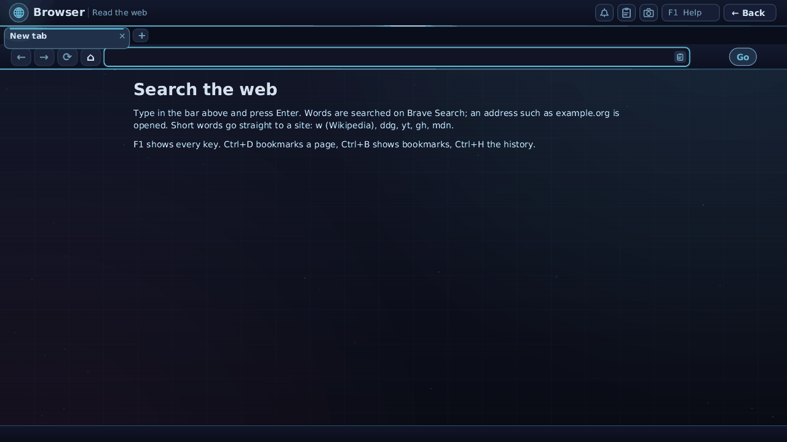

### RADIO
Internet radio in many languages (My stations, Tamil, Telugu, Malayalam, English, Hindi, Spanish, French, Arabic,
Portuguese, Russian, Chinese, Bengali). Left/Right language, Up/Down station, `Enter` play, `Space`/`s` stop, `[ ]` previous/next,
`+ -` volume, `a` keep, `n` add your own (name and stream address), `d` delete, `t` review a failed station's certificate, `f` forget a trusted certificate. Esc leaves; the music keeps playing.
MP3 streams, and HLS stations (`.m3u8` playlists) whose segments carry MP3, play with nothing extra. **AAC** stations (AAC+
such as Hello FM 106.4, HLS stations with AAC such as AIR Kodaikanal) need the **audio add-on**, a separate decoder program
(ffmpeg, installed from the Store's Setup page). Without it the station says so in one calm line and offers **Install audio
add-on**; that opens the same installer as the MEDIA player's (the download comes from the vendor, only when you click, with its
source and licence shown), and the station you chose is tried again afterwards. Stations that need it are marked "needs audio
add-on" until it is installed. HLS lists are followed live (the newest few segments first, new ones as they appear); encrypted
HLS (AES-128, SAMPLE-AES) and fragmented-MP4 HLS are not played. AAC+ (HE-AAC) plays through the add-on's own decoder. Every playlist and
segment address is checked against your account's host policy, and a list may not step down from https to http.

**Secure stations and certificates.** IYAKKI checks a station's HTTPS certificate strictly. Some servers (for example
`https://radios.crabdance.com:8002/3`) send only their own certificate and forget the intermediate one that links it to a
trusted authority; browsers quietly look it up, and so does the radio: it fetches the missing issuer certificate from the
address named inside the certificate (plain `http`, small, certificate files only, allowed by your host policy) and only
plays when the whole chain then verifies against the built-in list of authorities. Nothing is weakened by this. If that does
not work, the station fails with "This station's server did not send its full certificate chain (the issuer is missing).
Browsers hide this; IYAKKI checks strictly.", and shows who the certificate is for, who issued it, until when it is valid and its
SHA-256 fingerprint. **Review certificate… (`t`)** then asks, in a dialog whose focus starts on **Cancel**, whether to trust
exactly that certificate for that station: only do it if you know the station, because someone on your network could pretend
to be it. Nothing is stored unless you choose **Trust this certificate**. The choice belongs to your account and the station
(a row marked "trusted certificate"), covers only that station's server (a redirect to another host is checked normally; the
browser and other apps are never affected), still requires the certificate to be for that host name and within its dates, and
ends when the server shows a different certificate, which happens when it is renewed (Let's Encrypt every 60 to 90 days): the
station then says "the certificate changed since you trusted it" and asks again, never silently. **Forget trust (`f`)** on
the station removes it. The chat assistant can ask the same through `radio_trust_certificate`; that always shows an approval
card with the host and fingerprint, even in Auto mode.

### MEDIA
Your music, videos and pictures from folders your account may read. `Tab` pages (Tracks, Artists, Albums, Videos, Playlists,
Folders, Types, Top rated, Photos, Downloads) · `/` search in plain words ("melody songs by anirudh above 4 stars") ·
`1-5` rate · `t` tags · `D` queue downloads from direct addresses · `Space` stop · `, .` previous/next · `z` shuffle · `l`
repeat. Three CC0 samples are included. MP3 plays inside IYAKKI; other audio/video needs an installed player (mpv, VLC,
ffplay, mplayer), or the web image. [`MEDIA-SEARCH.md`](MEDIA-SEARCH.md).

### CAMERA
A USB webcam as a camera. The tile is greyed with "Connect a camera" until a camera is plugged in (it wakes up within
about two seconds; choosing the greyed tile says why there is none: a Mac mini has no built-in camera, and the built-in
camera of a Mac with a T2 chip is not reachable). The live picture comes as MJPEG from the camera when it offers it, else YUYV.

- **Photo** (`1`): `Space` or the shutter saves a JPEG in your **Pictures** folder (`photo-<date>-<time>.jpg`), with a flash
  and a thumbnail in the strip under the picture; click a thumbnail to look at it (`←` `→` move, `Esc` closes).
- **Video** (`2`): `Space` starts and stops recording; the time and size are shown. Saved as Motion-JPEG in an AVI file in
  **Videos** (`video-<date>-<time>.avi`), which mpv, VLC, ffplay and MEDIA on the web image play. **Picture only, no sound.**
  Past 1 GB a recording continues in a `-part2.avi` file.
- **Passport** (`3`): a frame with guide lines (crown line, eye line, chin band, head oval) for the country chosen with `p`
  (type any word: `india`, `usa visa`, `schengen`, `deutschland`…). The table holds USA passport, US visa (DS-160), India
  passport and e-Visa, UK, Schengen/EU, Germany, France, Canada (50×70 mm), Australia, China passport and visa, Japan,
  Singapore, Malaysia (35×50 mm), UAE, Saudi eVisa, Sri Lanka, New Zealand, South Africa, Brazil, Mexico, Russia and a
  **Custom size** (your own width and height). Each entry shows its official source and the day it was checked; entries
  that could not be confirmed on an official page say **UNVERIFIED** (US visa upload limits, Sri Lanka, New Zealand head
  size, South Africa, Brazil, Mexico, Russia): check those yourself.

  `-` `=` zoom the frame, the arrows move it. The shutter counts down 3 seconds, then saves the crop as a 300 dpi PNG
  (`passport-<country>-...png`) and, where the country has rules for online forms (US, India e-Visa, UK, Canada, China visa,
  Japan, Singapore, Saudi eVisa, New Zealand), a JPEG within its pixel and file-size limits (`...-online.jpg`; for the US visa
  600–1200 px square, at most 240 KB). Then `4` makes a printable sheet on 4×6 in photo paper and `a` one on A4, each as PNG
  and PDF with as many copies as fit and thin cutting lines; print at 100% (no scaling). Stand before a plain wall in the
  colour the country asks for (France does not allow white) with even light; nothing removes the background for you.
- `t` timer off / 3 s / 10 s · `m` mirror the live picture (saved pictures are never mirrored) · `c` choose the camera ·
  `r` picture size · `[ ]` brightness and `; '` contrast when the camera has them · `Esc` back (a recording is finished and kept).

**The assistant and the camera.** In the chat you can say "take my photo", "record 20 seconds of video" or "make an
India e-Visa photo". The assistant uses the tools `camera_list`, `camera_photo`, `camera_record_start` (with a time limit,
at most 10 minutes), `camera_record_stop`, `camera_passport` (country and sheet; it answers with the files and the rules used)
and `camera_recent`. It **asks you every time** it would take a picture; **Allow for 5 minutes** is the longest permission,
and Auto or Autopilot never answer for you. While it uses the camera a red **Camera in use by the assistant** sign shows on
every screen. Pictures go only into your Pictures and Videos folders; the assistant gets the file names, never the image,
and nothing is uploaded. If the CAMERA app is open, the camera is busy for the assistant: close the app first.

Guests have no CAMERA tile. Nothing leaves the machine.

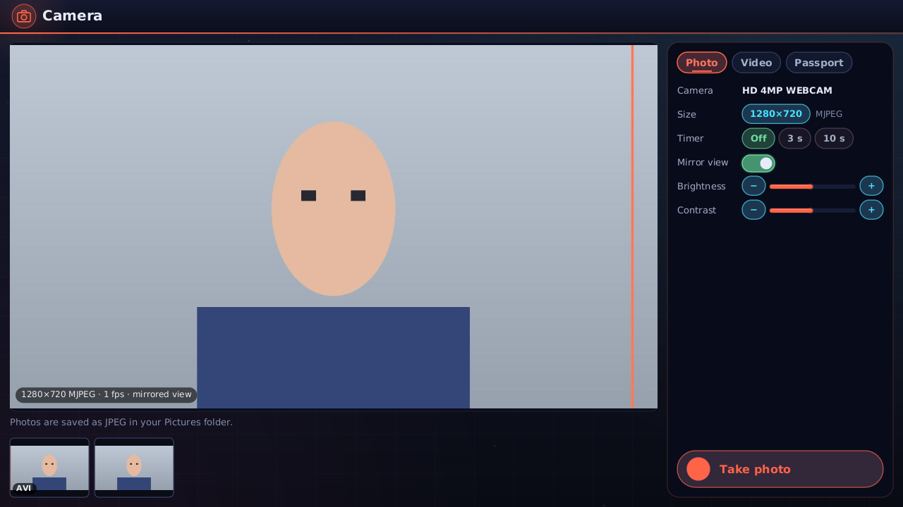
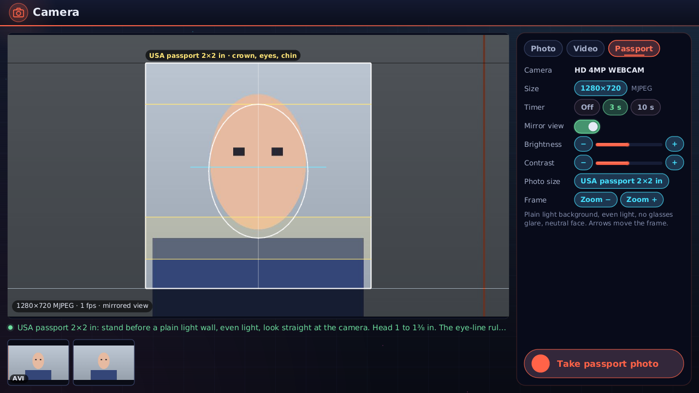

### CALENDAR
Month view, events with repeats and reminders, a clock with alarms. Arrows move, `PgUp/PgDn` month, `T` today, `N` new
event, `A` show alarms, `D` delete, `Tab` clock page. The chat reads and plans in it.

### INBOX
See [Inbox](#inbox).

### SYSTEM
Overview (processor, memory, load, disks, network, heat), Processes (administrators; `k` stop, `K` kill, sort `c m p n`),
Agents (every run going on; `x` stop, `X` stop all), Hardware (administrators). `Tab` pages. The Overview shows the host name. `iyakki top` shows similar
output in a terminal.

**Which service is this process?** With the dev cluster running, the Processes tab names the Quick install service or pod of every
container process (for example `clickhouse (iyakki-data)` instead of an anonymous `java` or `clickhouse-server` under user 101, 1000
or 10001). The name comes from the process's control group (the pod's uid and container) matched with the cluster's pod list, which is
read only (`kubectl get pods -A`) and refreshed every 15 seconds. With the cluster off or unreachable the column is simply empty and
nothing is reported as wrong. `g` (or the "By service" button) adds up the processes of each service; the sort keys `c m n` still
work. The line under the table shows the chosen pod's processor and memory request and limit, and a process at 90% or more of its
limit is marked "near limit". `b` (or "What is it busy with") shows the pod's last log lines (secrets hidden, capped) and the
`kubectl top` numbers, so you can see why a pod sits at a high processor use; it only shows facts. In chat the same is available as
the read-only tools `system_processes` (top N by processor or memory, with the service) and `system_pod_busy`; both are for
administrators and need no approval.

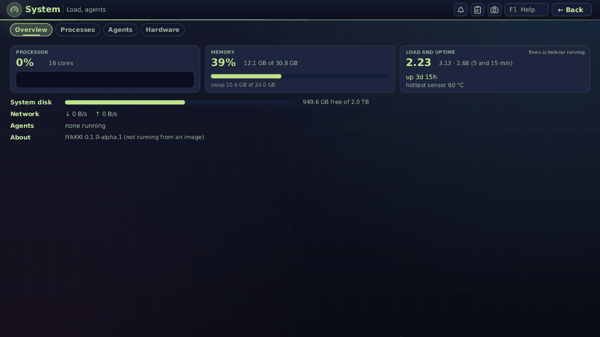

### USAGE
Token usage per model as a chart: `1`-`5` for 24 hours, 7 days, 30 days, 13 weeks, 12 months; `e` (admins) own or everyone.
Only totals are kept, never what was said.

### NET SCAN
Finds Ollama servers, cameras, media servers and other services on private addresses; read-only. `s` scan · `n` next network ·
`t` scan an address or range · `a` add a model server to Models · `c` copy an address · `f`/`1-6` filter. Every scan is audited.

### MESH
Consul service view: Services, Nodes, Key/Value, Setup (`1-4`). `r` reload, `n` new key, `e` change value, `d` delete, `c` connection
(admins), `t` test. Needs a Consul to talk to.

**Shared folders (Settings, Devices, Shared folders).** Share a folder of yours with a phone or laptop on the same network: `n` makes a share
(name, folder, Files or Website, who can open it, read-only or uploads, hidden files, how long, port), `s` starts and stops it, `c` copies the
link, `q` shows a QR code, `e` edits, `t` gives the link a new secret, `d` deletes, `x` stops all sharing. Nothing is shared until you start a share;
a share is read-only unless you allow uploads; the safest way to open it is the **secret link**; a password is sent in clear over plain HTTP; shares
stop when you sign out. In the AI IDE, right-click a folder in the tree and choose **Share this folder…** to look at a website you are building on
another device. Details and limits: [`SHARED-FOLDERS.md`](SHARED-FOLDERS.md).

**Firewall (Settings, Security, Firewall; administrators).** New incoming connections are blocked unless you allow them; replies to what this
machine started, loopback, DHCP and the cluster networks always work. `a` allows a host name, IP address, range or network (with ports, a protocol, an
interface and an end time), `p` opens the presets (SSH, remote desktop, shared folders, Kubernetes, DNS service, ping), `y` applies your changes: you then
have **60 seconds** to press `k` (keep) or `v` (revert), and if you press nothing the old rules come back, so a wrong rule cannot lock you out. `z` or
the **Off** button on the Firewall row of the Devices list (F8) switches it off at once; from a console or SSH use `iyakki firewall off`; the boot
parameter `iyakki.firewall=off` skips it for one boot. The page shows ON, OFF or **NOT PROTECTED** and the last blocked attempts. Details, the
defaults and the DNS-name caveat: [`FIREWALL.md`](FIREWALL.md).

### USERS (administrators)
Accounts, roles and per-user limits. See the next section and [`ADMIN-GUIDE.md`](ADMIN-GUIDE.md#accounts-roles-and-policy).

### SRE PILOT (demo)
An animated picture of a site-reliability assistant with sample data; nothing is connected to a real system. Click a part,
`Space` pauses, `1 2 3` speed, `W` whiteboard photo. "Click To Schedule a Demo" is a dummy button.

### AI IDE
One workspace (folder) per product with editor tabs, file tree, terminal, tests, chat limited to the workspace, a feature
board (reads and writes `FEATURES.md`; rows can wait for other rows, a Graph view draws the order and who is working on what), a Context tab (what the whole team and every agent must remember, kept in the committed `.iyakki/context.json`; say "remember that ..." in the chat to add to it), a Browser tab, parallel tasks, and a Kubernetes view with a Deploy flow
(Build, Get the image to the cluster, Apply, Check the rollout; every step approved). Keys: `Ctrl+Shift+W` workspaces ·
`Ctrl+P` open file · `Ctrl+Shift+F` search project · `Ctrl+B`/`Ctrl+J` tree/panel · `Ctrl+Shift+E D C T` focus tree/editor/chat/terminal
· `Ctrl+Shift+B/G/Y/O/K` board/tasks/context/browser/cluster · `F5` run · `Ctrl+Shift+R` project settings · `Ctrl+=` / `Ctrl+-` density · `F1`.
A lock stops a second window from editing the same workspace (Take over, Open read-only, Cancel).
**Connect Git or Gitea:** *Settings → Git and SSH keys → Add connection* (or the IDE's amber *Connect Git / Gitea* chip, the `⋯` menu, the Repositories
panel) walks five steps: the kind (GitHub, GitLab, Gitea / Forgejo, other), where (the Gitea on your cluster, or an address), how you sign in (a token
you paste, kept in your vault and never shown again, or an SSH key), a test against the host, and the name and email for commits. Cancel at any step
keeps nothing. In the IDE you can then create a repository on that host (a review first, private by default), connect to one you have, push (its own
review), fetch, pull, or disconnect (asks first). See [`GIT-AND-SSH.md`](GIT-AND-SSH.md).
**Git:** the `⋯` menu has *Clone repositories…* (one address per line, `#branch` after it; into this workspace or a new one) and *Repositories…*
(state, Fetch all, Pull all, retry, remove). Keys and tokens for git sites are in **Settings → Git and SSH keys** (make or import an ed25519 key, copy
the public half to GitHub or Gitea, choose which key each site uses). Details: [`GIT-AND-SSH.md`](GIT-AND-SSH.md),
[`AI-IDE.md`](AI-IDE.md), [`K3S-DEV.md`](K3S-DEV.md), [`PARALLEL-TASKS.md`](PARALLEL-TASKS.md).

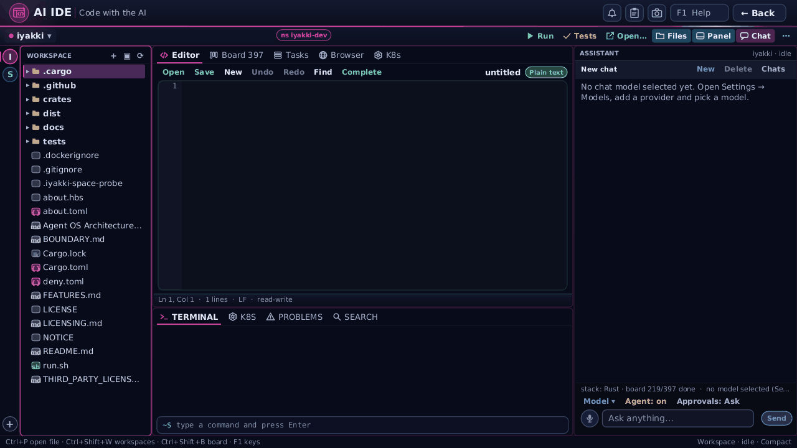
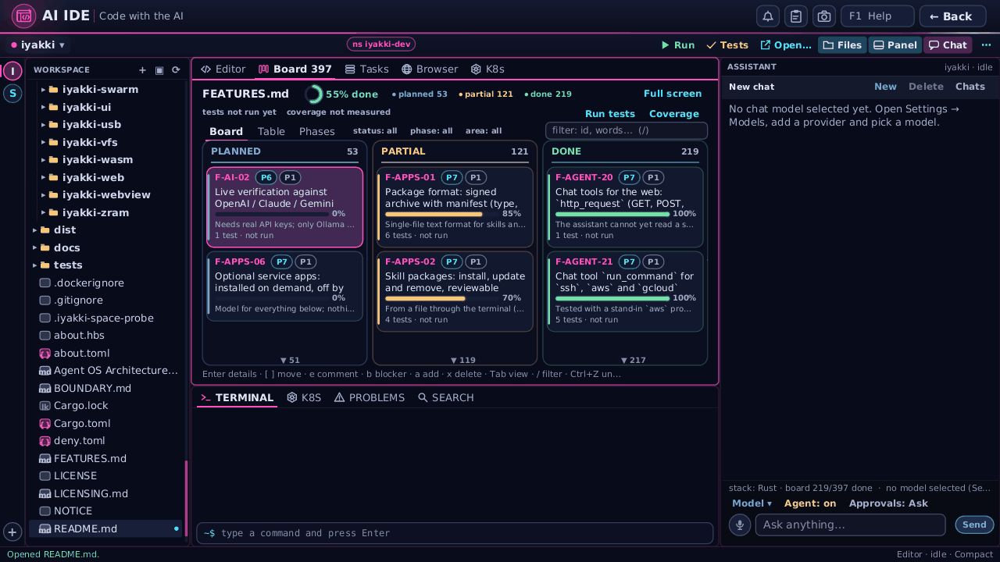
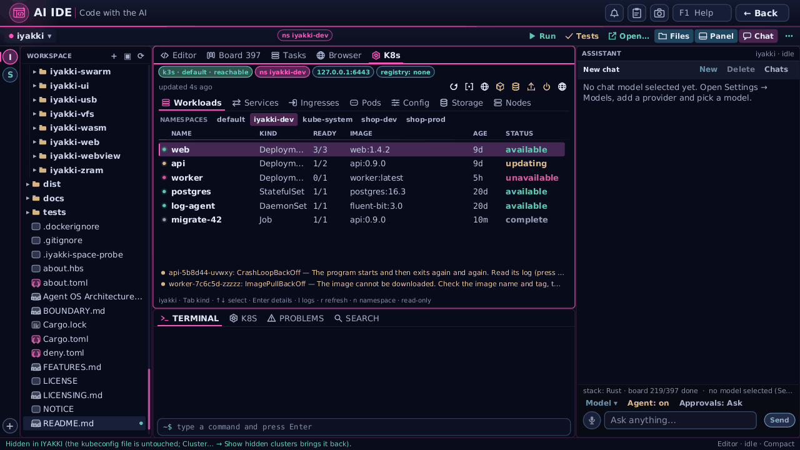

### DATA
Open a CSV, TSV or JSON-lines file in a virtual-scrolled table (a million rows are fine). `o` open · header click sort ·
`/` filter (`price > 10 and contains(name, 'tea')`, `x` clears) · `c`/`r` copy cell/row · `v` filter to this value · `< > =`
column width · `s` summary · `e` export the view as CSV. Files come from your home folder, your workspaces and shared host
folders. The chat assistant can read tables (`data_open`, `data_query`), create a new CSV from rows it generates
(`data_create`) and add rows to one (`data_append`); both ask first, naming the file, the columns and the row count. Ask, for
example, "make a CSV of five sample customers" and then "which are in Chennai?". Editing or deleting rows is not offered.
[`DATA.md`](DATA.md).

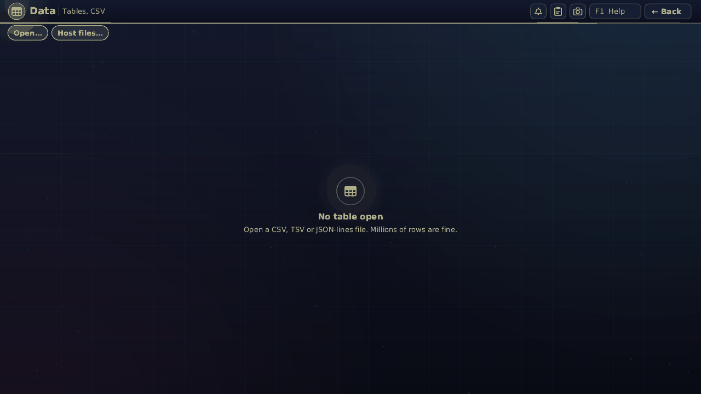

### DASH
Dashboards over Prometheus, Elasticsearch/OpenSearch, ClickHouse and DuckDB, read-only by rule, credentials from the vault.
Panels: line, area, bar, stacked bar, pie, donut, gauge, stat, heatmap, table, text. Arrows choose a panel, `Enter`/`e` edit,
`a` add, `d` duplicate, `Delete` remove (`Ctrl+Z` undo), `1`-`7` time range, `r` refresh, `v` table view, `i` ask the assistant,
`Ctrl+I` assistant pane, `Ctrl+S` save. Dashboards are JSON files in your `Dashboards` folder. [`DASHBOARD.md`](DASHBOARD.md).

**Sources inside the cluster.** The Elasticsearch and Prometheus from Store -> Setup run *inside* the cluster: nothing listens on `localhost:9200`
or `:9090`, and `*.svc` names do not resolve on this machine. Use the sources Setup adds for you (**Cluster Elasticsearch**, **Cluster Prometheus**), or
write the address as `cluster://<namespace>/<service>:<port>`, for example `cluster://iyakki-data/elasticsearch:9200`,
`cluster://iyakki-monitoring/prometheus:9090` or `cluster://<namespace>/<service>:8123` for a ClickHouse. IYAKKI looks the Service up each time, so it keeps
working after the Service is recreated. The cluster must be installed and running. When you add a source, the Address is pre-filled with what is
really there (or left empty with the reason); a failed Test says what is wrong and what to do.
A source that still points at `localhost` for something that lives in the cluster is reported once at the top of the board with a button: **Use cluster address**, **Install … (Store -> Setup)** or **Remove source**; on the Sources page **Fix all** does the cluster ones in one click and **Remove duplicate** clears a copy. Nothing changes until you click.

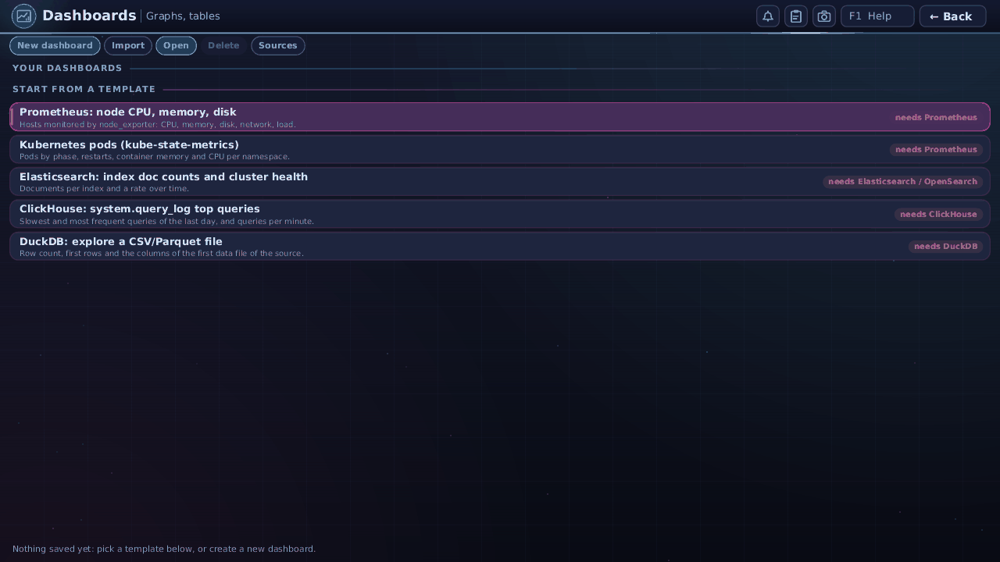

### FLOWS
Design, run, schedule and watch workflows (HTTP, command, browser, gRPC, agent, approval, notify, sub-flow, for-each nodes);
failed runs can be examined by the assistant, which proposes fixes you approve. Tabs `1 2 3` = DESIGN, RUN, BOARD. DESIGN:
`a` add step, `f` fit, `g` arrange, `t` text view, `T` test step, `r` run, `p` publish, `h` versions, Ctrl+Z/Y/C/V/D. RUN: `r` retry,
`s` skip, `R` rerun from here, `c` cancel, `y`/`n` approve/reject. Schedules run while you are signed in. Thrift nodes and
webhook triggers are planned, not built. The assistant pane works on the flow you have open (it edits that flow, one conversation per
flow) and makes flows, never apps; when a run lacks an input it shows a form to fill in (Tab between fields, Enter on the last field or
Ctrl+S sends, Esc cancels; secrets go to your vault and are never shown to it). `d` on the list deletes a flow and `x` in the history
drops a version, both after a confirmation where only `y` confirms.
**Closing and running:** Esc is one step back and the buttons say so ("Close (Esc)"). In a flow it deselects, then closes it
(everything is saved as you go; only a refused edit asks first); in a run it returns to the flow; on the list it leaves FLOWS. "Run (r)"
starts the flow and asks for any required input first. The RUN view says how the run went (Succeeded or "failed at step X: reason")
with "Run again (a)", "Open log (l)" and, while it goes, "Stop run (c)". The line at the bottom always lists the keys of the screen you are on.
**When a flow fails:** open it and a card says where it failed, with "Ask the agent to fix (F)", "Open log (L)" and "Dismiss (x)". The
assistant opens on that flow with the error and the end of the log (never your input values or secrets), explains it and proposes a
fix; every change, and every new run, still asks you first, and it stops after three attempts. If the assistant is already open it
asks "Want me to fix it?" with "Yes, fix it" and "Not now". On the list, "Agent help on failure" (`o`) turns the offer off.
**The assistant knows the flow you have open.** In FLOWS (the "Assistant" button or Ctrl+I) it is told which flow is open, its steps,
the names of its inputs, its version and schedule, its latest runs and, if the last run failed, the failed step, the attempts and the end
of the log (never your input values or secrets). If you leave FLOWS and open the CHAT tile, it still works on that flow: a chip at the top
shows "Flow: NAME (last run failed)" and "x Detach" lets it go. Signing out, deleting the flow or four hours without FLOWS also end it.
[`FLOWS.md`](FLOWS.md).

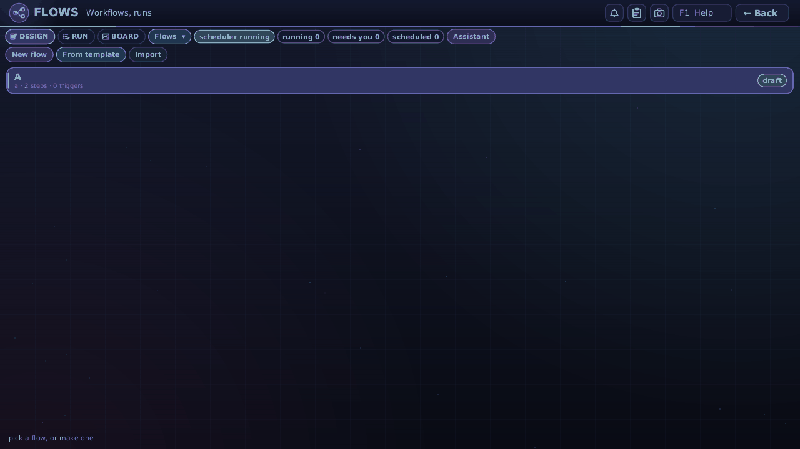

### VOICE
Read text aloud, and speak to type. Two areas, **READ ALOUD** and **DICTATE** (`F2` and `F3`, or `r` and `d` when no box has the keyboard).
It uses the voices and the speech-to-text you already set up (Settings -> Models, Settings -> Voice, Store -> Setup); it adds none.

**READ ALOUD.** Paste (`Ctrl+V`, or **Paste**), type, or open a text file (`Ctrl+O`, **Open file**: only files your account may read) in the
box; it takes 20,000 characters and says with the counts when more was pasted. Choose the **voice** from the drop-down (`v`): the voice
set in Settings -> Voice, every Lemonade text-to-speech model with Kokoro's usual voices (`af_heart`, `am_adam`, ...), other providers'
text-to-speech models and the speech engines found on this computer. The **speed** slider (0.7x to 1.5x, `+` `-`) is there when the voice
takes a speed. **Play** (`Ctrl+Enter` or `Space`), **Pause**, **Stop** (`Esc`); the sentence being read is lit in the box and the bar under
it shows how far it is (click it to jump). Select some text and press **Read selection** to read only that. Under the box a line says what
the text looks like (a warning when the chosen voice cannot read it: Kokoro reads English only) and **where the text goes**: *Text is sent
to lemonade-local at localhost:13305 (this computer)*. A server on your network or the internet asks first, on a card, once per server
(the same yes as Settings -> Models, kept in the settings file); No sends nothing. With no voice at all the page says so and
**Set up Kokoro** opens Store → Setup on Kokoro's card; with no sound output it says *No sound output: choose where sound plays in Settings -> Sound*; a
server that does not answer says so with its address.

**DICTATE.** **Record** starts only when you press it (never by itself); a red **RECORDING** line with the time against the five minute
limit and a level meter shows while it runs. **Stop** turns what was said into text with the speech-to-text of Settings -> Voice, or a
Lemonade whisper model, and puts it in a box you can edit (a second recording is added below). The sound stays in memory and is never
saved to disk; `Esc` while recording cancels and keeps nothing. A server on another machine asks first, like reading. Choose the
**microphone** (`m`) if there are several; USB microphones are marked. **Copy to clipboard** (`c`), **Copy and clear** (`x`), **Read it
back** (`b`, switches to READ ALOUD with the text) and **Clear**. With no microphone the page says: *USB microphones work: plug one in*,
and that the built-in microphones of some laptops are not supported yet (the MacBookPro14,1 microphone has no driver). The tile is
hidden in cloud mode when the computer has no sound output. Not sent to the AI: only to the speech server. [`VOICE.md`](VOICE.md).

### TALES
An AI story teller that writes, draws and reads aloud, as a conversation. The story is on the left; on the right is a chat panel
like the AI IDE's. Type an idea of up to 4000 characters in the idea box (three lines tall, it grows to ten and then scrolls; you can say it in words: *a 5-minute funny story in Tamil about a fox*) and press `Enter` or
**Send** (`Ctrl+J` makes a new line; a longer idea is cut with a notice that gives the counts); choose who it is for (Kids, Teens, Adults), the kind and tone (drop-downs), one **Model: …** chip (`Ctrl+P`, `Ctrl+G` too) that opens the same chooser as the chat: *Same as chat* first, then the models of your providers, then Claude Code, Copilot and the other agents with their models and *Custom model id…* (an agent never gets tools here); **Options ▾** (`Ctrl+O`) has the length, the language,
*Pictures off* and the reading and saving switches. Pictures are automatic (real images when a picture model is set up, otherwise drawings by the writer, or the built-in cartoon composer for small models; **Options -> Drawing** chooses, and the chip says what drew each picture; a character sheet keeps the characters looking the same). **Options -> Pictures: every chapter / cover only / ask me each time** chooses how many pictures the picture model draws (with no picture model selected it says so and points to Settings -> Models; a Lemonade picture model not yet downloaded says *Install first*; pictures wait while memory is short; **Cancel pictures**, **Draw again** and **Delete** work per picture; the time shown is an estimate). Then keep talking: *make it shorter*, *change the goat's name to Beeru*, *translate it to Tamil*, *redraw picture 2 as a
comic*. Each correction is a new **Version** (the earlier ones stay, choose them from *Version ▾*); **Stop** keeps what was written;
a message sent while it writes steers it. The conversation is saved with the story. `Space`/`p` play-pause, `s` stop, `r` replay,
`v` voice, `+ -` speed, `Ctrl+S` save to `Stories/<title>/`, `e` export (.html, .md, audio), `f` favourite, `l` saved stories, `n` a
new story. **Pictures** (Options): tick **Realistic pictures (photo style, people look real)** for photo-like pictures with the most realistic installed model (a small model such as SD-Turbo stays painterly; a GPU Lemonade server with SDXL-Base looks far better, and the page offers to install it); tick several **Styles** and set **Pictures per style** to get a gallery under each scene where you click the one you like (**Keep only the chosen** removes the rest); **Quality** and **Model for this story** choose speed against looks; **Picture log (g)** shows exactly what was asked of the picture model and what came back. new story. Reading aloud needs a voice: open IYAKKI in a browser, or Settings -> Voice (the hint under the player has a **How**).
While it reads, the sentence and the word being said are lit and the page follows; click a sentence to read from there (Settings -> Voice -> Highlight chooses *Sentence + word*, *Sentence only* or *Off*). The model runs with no tools and strict child-safety rules. [`STORY.md`](STORY.md).

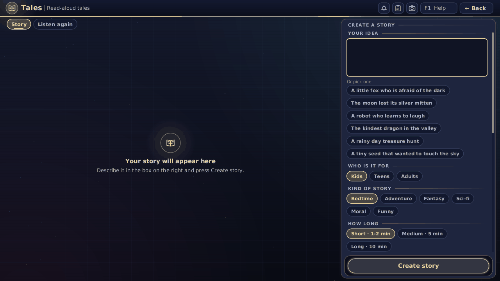

### LAB
Try picture and vision models and compare them (Work section). Three tabs, `F2` / `F3` / `F4`, and a **log** at the bottom of each (time, provider,
model, a request summary without secrets, HTTP status, duration, bytes, errors, notes; **Copy log**, **Clear log**).
**PICTURE**: choose a picture model (every provider's, with its size and its own size and steps), type a prompt (the TALES looks are **Style** buttons),
a negative prompt (only where the server takes one), size, steps and seed (filled from the model, kept in bounds), **Generate** (progress, **Cancel**).
The result shows the time, bytes, size, seed, model and provider; **Save picture** puts it in Pictures, **Copy prompt**; **Compare** draws the same prompt with a
second model after the first (one after the other, both shown with their times). **VISION**: choose a vision model (or **any chat model**, with a warning),
a picture from a file, the camera (asks every time, red sign), the screen (asks every time) or the clipboard; pictures over 1024 pixels are made smaller and
the size sent is shown; ask a question (quick ones: describe, read the text, what is wrong with this screenshot, list the objects); the answer streams in with
time and tokens when the provider says them; a model that cannot take pictures says so. **VIDEO**: pick a video and 4 to 16 frames, evenly spaced or every k
seconds; the frames are taken with ffmpeg (you install it: Store -> Setup -> Media tools; without it the tab says so and offers the setup) and sent with your
question to a vision model. Video generation appears only if a provider lists a video model; none does today and the tab says so. A provider on another
computer asks once per session before anything is sent; the button area always says where a run goes. Nothing is saved except **Save picture**.
`Ctrl+Enter` runs, `Esc` cancels. [`LAB.md`](LAB.md).

### Custom apps (your own tiles)
Apps made for IYAKKI appear as tiles in the section they name (else **Work**) after the system tiles, with the label *custom app*. Open one and it fills the screen; the bar
shows who made it and its trust level, **Reload**, **Info** (what it may do) and **Remove** (it asks whether to keep or delete the app's saved data). *Back* returns to the launcher.
Install them from the STORE (the sample calculator, notes and converter are in the built-in catalog) or build your own in the AI IDE (New app, *IYAKKI tile app*). An
administrator can add a workspace folder as an **unsigned dev app** (marked DEV). An app installed from a paired developer computer in
developer mode is marked DEV too and labelled **Developer (local)**; a new build pushed from that computer reloads it while it is open
([`DEVELOPER-MODE.md`](DEVELOPER-MODE.md)). Accounts that may not use the browser do not get custom apps.

### K8S
*System group. For administrators, operators and users; not guests.* Pick a cluster at the top, a namespace on the left, and look at it.

* **Cluster**: the managed dev k3s (a chip says *Running*, *Starting*, *Waiting for the network* or *Stopped*; **Start** starts it) or one of your saved kubeconfig profiles (added in Settings, Dev cluster; the kubeconfig stays in the vault and is never shown). IYAKKI remembers your last cluster, and for each cluster the namespace and the kind.
* **Namespaces**: *All namespaces* and each namespace with a pod-count badge and a red dot when something fails. `n` jumps to the list, `/` filters it, Esc clears the filter.
* **Kinds**: Pods, Deployments, StatefulSets, DaemonSets, ReplicaSets, Jobs, CronJobs, Services, Ingresses, ConfigMaps, Secrets, PersistentVolumeClaims, Events, Nodes, Namespaces, ServiceAccounts and Custom resources (`k`). Click a column title to sort, `/` to filter. The line over the table counts (`12 pods · 2 not ready`). Lists refresh every 5 s while the tile is on screen.
* **Details**: Summary, YAML (read-only; Secret values are dots until you press *Reveal (asks first)*), Events, Related and, for a pod, **Logs** (container, previous run, last 100/500/2000 lines, follow, pause, wrap, search, copy, save). `c` copies what is shown; *Copy exec command* gives you the `kubectl exec` line to paste into CLI (the tile has no terminal).
* **Changes** are off. An administrator can turn on **Allow changes** (remembered per cluster) to restart or scale a workload, delete a pod, cordon a node or delete another resource (type its name); every change asks first, is recorded and shows its output.
* Keys: arrows, PageUp/PageDown, Home/End, Enter to open, `/`, `n`, `k`, `l` logs, `y` YAML, `r` refresh, Esc back. The wheel and two-finger scrolling work on the list under the pointer. On a phone-sized window it shows one page at a time with *Back*.

* **Several clusters.** If you have more than one cluster (Settings, Clusters), the K8S tile, the AI IDE's K8s panel and the Store's Setup popups for the items that go into a cluster (Registry, Lemonade, DuckDB, Elasticsearch) show the **cluster name** with a small switcher: a list with a coloured dot (green running, grey stopped, red unreachable, amber not checked recently), *local* or *remote*, a GPU badge when known, and *Manage clusters...*. Choosing one only changes where things go; nothing is moved or deleted, and every deploy says the cluster in its question (`Deploy Lemonade to cluster "gpu-box" (remote)`). With one cluster you see no switcher. Setup installs these items into this machine's own cluster only: if another cluster is active, Setup says so and asks you to choose *This machine* in the same popup first. The GPU badge (for example *GPU 2 x NVIDIA GeForce RTX 4090 (24 GB each)*, or *(last known)* when the cluster did not answer the last time) is read from the cluster's nodes in the background; the screen never waits for it.

Details, limits and what is not done: [`K8S-TILE.md`](K8S-TILE.md).

### LEARN

Study plans and quizzes. Ask the chat: "I want to learn programming basics in 21 days", "a yoga session every day for a month", "quiz me with 10 questions on the solar system". The assistant writes the lessons or questions; the program works out the dates, checks them and scores the quiz. The tile has two tabs, PLANS and QUIZZES, over the same store as the chat. In a plan, **click a day (or press Enter) to open its lesson**: the page starts with *What you will learn today* and the assistant writes the lesson as you watch (explanation, worked example, what to do step by step, a practice task, a recap, with pictures); it is saved, so the next time it opens at once. In a lesson: Left / Right move between sections, Space marks the day done, `q` asks a question, `s` makes it simpler, `d` goes deeper, `g` writes it again (asks first), `r` reads it aloud, `c` cancels, Esc goes back to the plan. In the plan, Space ticks a session done; `c` adds the whole plan to your calendar, or takes it out again (the assistant always asks you first). In a quiz, pick an option, see right or wrong with the explanation, press Enter for the next question; the answers are not shown before you answer. If a question looks wrong press `r` (Report a wrong question): it stops counting and the percent is worked out over the rest. Details: [`STUDY.md`](STUDY.md).

### GIT
*Work group. For administrators, operators and users; not guests; stays in Cloud mode.* Browse the repositories of your Git hosts without cloning them.

* **Connection** (`c`): each host of Settings, Git with its status dot, kind, address and where its data lives (*this computer*, *on the network*, *on the cluster*, *on the internet*), **Local clones** (the repositories on this computer, in your Repositories folder) and **Add connection...** (opens Settings, Git). With no connection the tile says how to start and still lists your local clones.
* **Repositories**: name, description, default branch, private or public, age, stars and size; a green dot means a clone is on this computer. Click a title or `o`/`O` to sort, `/` to filter, *Load more* (`m`) for the next 50. If the host stops answering, the last list stays and the tile tries again; if it asks you to slow down, the line says for how long.
* **Open one** (Enter): **Files** (folders open as you go; text with line numbers up to 512 KB, the README first and rendered, pictures, and name/size/type for binary or large files), **Commits** (the last 50, with the message and a coloured diff), **Branches** (and tags), **Issues/PRs** (read-only) and **Info** (clone addresses with Copy). `1` to `5` switch tabs, `g` chooses a branch or tag, Esc steps back.
* **Actions**, each asking first where it changes something: `C` clone into your Repositories folder, `I` open in the AI IDE (offers the clone first if there is none), `F` fetch, `P` pull (asks if the clone has changes of its own), `U` push (its own review), `y` copy the clone address, `w` open the page in the BROWSER (after a yes). Nothing is changed on the host: no delete, rename, settings or issue writing.
* **In the AI IDE**: the **Git** tab (after K8s, `Ctrl+Shift+L`) has *This project* (the open folder's branch, ahead and behind, changed files with their status, recent commits and the diff of a file or commit; `o` opens the file in the editor) and *Connections* (this tile, with the same connection picker). It only reads; clone, fetch, pull and push stay with the IDE's Repositories panel.

Details, limits and what is not done: [`GIT-TILE.md`](GIT-TILE.md).

### DISKS
*System group. For administrators, operators and users; not guests; hidden in Cloud mode.* Every drive of the machine, and what is on it.

* **Left:** the drives, with an icon for how each is connected (USB stick, NVMe chip, SATA drive, SD card), its name and size, a bar for how full its open partitions are, a green dot when something on it is open, and an **eject** button. The drive that holds the running system says SYSTEM and has none. `/` filters.
* **Right:** the chosen drive: a bar with one segment per partition, a table (file system, size, free space, where it is open), and **Mount**, **Unmount**, **Open** (copies the folder's path for a file picker), **Eject**, **Properties**. A grey button has its reason written under the buttons ("This system has no ntfs3 driver...", "Encrypted (BitLocker): unlock needs the key.").
* **Safe by default:** drives open with programs switched off; **Read-only** opens a drive for reading only; administrators have **Allow running programs**. A busy drive is never forced: the message names what is using it. Eject flushes, closes every partition, switches a USB drive off and says *You can remove it now.*
* **Roles:** administrators and operators: any drive that is not the system drive. Users: removable drives (USB, SD cards). Guests: none.
* **Windows and Mac drives:** NTFS opens read and write when the kernel has the driver and Windows shut the drive down cleanly, otherwise read-only with a plain warning. BitLocker and LUKS drives are shown as *Encrypted: unlock needs the key* (not built). Mac APFS is shown and cannot be opened; HFS+ opens read-only when the kernel has the driver.
* **Advanced: change partitions** (administrators, closed until you open it): new GPT or MBR table, add, delete, format (ext4, FAT32), rename; resize, exFAT and NTFS formatting say *not supported yet*. Every change shows its plan, shows the drive's name, size and serial, asks you to type the name (or the last 4 characters of the serial) and needs a second press. The system drive and any mounted or busy drive are refused.
* Keys: arrows, Right or Enter to the partitions, `m` mount, `u` unmount, `e` eject, `o` open, `p` properties, `r` refresh, `/` filter, `a` Advanced (then `n`, `a`, `d`, `f`, `r`, `l`), Esc back. A phone-sized screen shows the list, then the drive, with a *Drives* button back.
* Settings, Storage lists the open drives and `d` opens DISKS; a file picker's **Drives** button goes to your own `media` folder.

Details, the file system table and what is not done: [`DISKS.md`](DISKS.md). Nothing here has been run on a real drive yet.

### Clusters (Settings)
*Settings, Clusters (the old Dev cluster page; press `C` on it). Administrators and operators change the list; users switch among the clusters they may see; guests see none.* One list of the clusters you can work against: **This machine** (the k3s IYAKKI manages), extra **local** clusters you add (each a complete k3s: about 2 GB of memory and CPU cores while it runs; two are allowed, *Advanced* allows four) and **remote** clusters (a kubeconfig file chosen with Browse, or a vault entry; kinds remote, tunnel, cloud-cli). Each row shows a status dot, the kind, *active*, *autostart*, a GPU badge when known, and the version, nodes ready and last error. Keys and buttons: Enter *Set active*, `a` add remote, `l` add local, `r` rename, `t` test (read-only), `b`/`o` start/stop a local cluster (asks with its name), `s` set up an extra local cluster, `x` remove (a local cluster asks and keeps its data unless you choose *Also delete data*; a remote cluster is only forgotten, its vault entry only if you ask), `u` autostart for an extra local cluster (only This machine starts by itself by default), `v` visible to users, `A` Advanced. A second local cluster is refused when the memory is not there, with the numbers. See [`K3S-DEV.md`](K3S-DEV.md), "Clusters".

### STORE
Find, install, update and remove skills, WASM tools, MCP servers, themes, driver packs and CLI tools. Opens on **Installed**.
Every app wears a trust badge (Official, Verified, Trusted, Community, Unsigned, Revoked) and you review hash, signature,
permissions in plain words before anything installs. The online official catalog and payments are not switched on in the alpha
(a built-in catalog, folders and USB sticks work offline). `Enter` details · `/` search · `i` install · `u` update · `r`
remove · `d` turn off/on · `o` open where it lives.

* **Keeping things current.** `c` (Check) looks for news in your catalogs and asks the makers of your command-line tools for their newest
  version; nothing is fetched otherwise (the daily check in Settings is off by default). Rows with an update show **Update**, the
  *Updates N* chip narrows the list to them, and **Update all** (`U`) shows a review first, then updates one item at a time. Anything that
  needs a decision (it asks for **new permissions**, has warnings, comes from another store, is pinned) is skipped and listed; update it
  by hand with `u` and you see exactly what is new before anything changes. After an update the new version is tested; if it does not
  work the old one is put back. `b` **goes back** to the previous version (one is kept) and pins it; `p` pins a version so updates skip it
  (press again to unpin). The item's page shows where it came from, what is new, the version history, its data and what uses it.
  Built-in things say *Built in*; things you wrote or installed from a file say *No way to check*; a store you removed says *Source
  gone*; with no network the list says *Can't check offline*.
* **Removing.** `r` shows what goes, what stays and what uses it. Its data (and vault entries named after it) is **kept** unless you
  choose *Remove and delete data* and type its name. Platform services (Gitea, the private store) are upgraded and removed from the
  SERVICES screen, which names the cluster and asks every time.
* **From the terminal and the assistant.** In the terminal: `store list --outdated`, `store update <id>` or `--all`, `store remove <id>
  [--keep-data|--delete-data --confirm=<name>]`, `store rollback <id>`, `store pin <id>` (an id is `skill:name`, `cli:name`, `mcp:name`).
  The MCP, SKILLS and CLI tiles have `u` for the same actions. The assistant can list what is outdated; updating, removing and going back
  always ask you, every time, and it cannot give an update new permissions.
* **Your own arrangement.** Give things tags (`t`; in Discover `#`), put them in groups (`m`, or drag them in *Group by: My groups*, `v`)
  and give them your own title (`e`). Your title is only for lists: the real name, id and publisher stay under it, on the item's page and
  in every install or update review. Tags and groups are searchable, tags filter (click several), `g` (Discover: `O`) opens the organise
  menu (rename, reorder or delete groups, export or import your arrangement as a file). Keyboard: Shift+Up/Down reorder, on a group
  heading Enter folds, `e` renames, `k` colours, `x` deletes. It is yours alone and is never sent anywhere. Details:
  [`STORE.md`](STORE.md) sections 15 and 16.

* **Store switcher.** With two or more stores, Discover shows a chip **Store: All** (or a store's name). `s` or a click cycles
  through them; the list shows only that store's apps, and your choice is remembered. An app listed by several stores shows which one it
  comes from and "Also in" the others; installing always uses the store of the version you are looking at.
* **Add a store** (administrators): Settings, **Add a store** (`a`), paste the https link of a portal page (ending in `/`) or of a
  `catalog.json`. IYAKKI reads it and shows its name, number of apps, the signer's **fingerprint** and the trust level; nothing is
  enabled until you press `y` ("They match") after comparing the fingerprint with the one the store's owner gave you. `w` adds the
  official IYAKKI store once its address exists (it says "coming soon" today). Up to 8 added stores.
* **Private store.** Your own store on your own cluster (`iyakki store-server`, deployed from Settings, Dev cluster, Platform
  services, or the STORE card "Private store"). Add it like any store; withdrawn packages are hidden, but copies already installed
  stay. To make something to publish, see [`APP-AUTHORING.md`](APP-AUTHORING.md) (the AI IDE's top bar `...`, *New app, MCP server or
  skill...*, `Ctrl+Shift+N`). Details: [`STORE.md`](STORE.md) sections 13 and 14.
  **If the install stopped half-way, or you lost the token or want to start over:** Settings, **Repair, reset or remove the private store...** shows
  what is there and what is missing, and offers **Repair** (puts back what is missing, keeps your apps), **Reset and reinstall** (deletes the store and deploys
  it again; the old apps are gone) and **Remove** (choose *keep my published apps*, the default, or *delete everything*; the image registry is asked about
  separately). Anything that deletes needs the namespace typed. See [`STORE.md`](STORE.md) section 13.2.

### Store → Setup

The tab that replaces the old **Quick install** page of the IYAKKI menu. Open it from the STORE tile (tab **Setup**), or from the
IYAKKI menu (**Quick install**, key `q`, which now simply opens it). **Why "Setup":** people come to the Store to get things onto the
machine, and these are the building blocks that set the machine up (a cluster, runtimes, model servers, voices, coding agents,
drivers); the word is short enough for a 360 px wide tab strip.

Setup is a page of **tiles**, like an app store: one tile for every app, tool or driver, with a click for the details.

* **The tiles.** Each tile has an icon in its category's colour, the name, the category, one line of what it is and its markers:
  a **green tick** when it is installed, a **green dot and "Running"** for a server that is up (k3s, the image registry, Lemonade, Kokoro,
  Elasticsearch), an amber **Update** pill with an arrow when a newer version is out, a **bar** while it installs, a red **warning** when the
  last install failed, a small **star** when it is recommended for this machine. Nothing is folded away: everything this machine can
  install is on the page. The tiles fill the width (one column on a phone, up to six on a big screen) and the page scrolls.
* **Categories.** The bar under the search box: **All**, *Get started* (Node.js, Python 3, k3s), *AI and models* (Lemonade, Ollama,
  *Use a Mac's GPU* guide), *Voices* (Kokoro, **Voice: Whisper tiny + Kokoro**), *Coding agents* (Claude Code, GitHub Copilot), *Data* (DuckDB, Elasticsearch, **Prometheus (metrics)**, **ClickHouse (analytics database)**, **Graph database (for AI)**,
  local image registry), *Media* (ffmpeg), *Hardware* (GPU for local models (Vulkan), NVIDIA driver, Mac Wi-Fi and Bluetooth firmware,
  the MacBook camera: shown only when the machine has the hardware, never in cloud mode) and *Linux apps*. Click one to see only
  its tiles; `c` goes to the next one.
  Elasticsearch and Prometheus run inside the cluster (ClusterIP only): their DASH sources, **Cluster Elasticsearch** and **Cluster Prometheus**, are added for you
  with the addresses `cluster://iyakki-data/elasticsearch:9200` and `cluster://iyakki-monitoring/prometheus:9090`; nothing listens on `localhost` for them (see the DASH section).
  **ClickHouse (analytics database)** is ClickHouse (Apache-2.0, its own pod in `iyakki-data`, about 1 GB of memory, not for machines under 3 GB): Setup makes a password for it, keeps it
  in your vault as `svc.clickhouse` and adds the DASH source **Cluster ClickHouse** (`cluster://iyakki-data/clickhouse:8123`). A ClickHouse source you added by hand at `localhost:8123`
  shows "ClickHouse is not installed" in DASH with **Install** (opens Setup on this item) and **Remove this source**; once it is installed that source offers **Use cluster address**.
  **Graph database (for AI)** is Neo4j Community (GPL-3.0, its own pod, about 500 MB of memory, so not for machines under 3 GB): Setup makes a password for it, keeps it
  in your vault as `svc.graphdb` and adds the DASH source **Cluster graph database** (`cluster://iyakki-data/graphdb:7474`, Cypher, reads only). Ask the assistant
  about relations ("which things are connected to X") and it uses that source through `dash_describe` and `dash_query`; you write to it yourself with a program of your own
  (`kubectl -n iyakki-data port-forward svc/graphdb 7474 7687`, user `neo4j`, the password from the vault).
  **Gitea (versioning for your work)** (under *Coding agents*; needs k3s, about 300 MB of memory) keeps your projects versioned on this machine: it installs a
  Gitea git service (MIT) in the cluster, makes an administrator with a generated password and an API token that only your vault holds, and adds the
  Git connection **Local Gitea**. Open it at `http://127.0.0.1:3300` (only this computer can; the Setup row and the job's last line say the address); clone and push with
  `git` over HTTP using the token. In the AI IDE, a project without a remote shows **Put this project under version control on Local Gitea** in its
  Repositories panel; the GIT tile lists the repositories (Connections: Local Gitea). Remove it from Settings -> Dev cluster -> Platform services.
* **Click a tile** (or press Enter on it) and a **popup** opens: what it is, its status (*Installed v1.37 · Running · Update available
  v1.38*, *Not installed*, *Failed* ...), the size and time ("about 45 MB · about a minute"), the licence, where it goes, what it needs
  ("Installs k3s first") and what needs it ("Needed by Lemonade, DuckDB ..."), the memory it wants, and warnings (not enough memory, not
  runnable, found on the machine and left alone, used by other tools). **One main button** does the sensible thing: **Install**,
  **Upgrade to x**, **Open**, **Start** (a stopped k3s), **Retry**, **Reinstall**, **Sign in**, **Install own copy**, **Review and deploy** or
  **View log**. Next to it only what applies: **Stop** (a running k3s), **Open its page**, **Install all in this category** (it shows the
  steps, sizes and total first, like Install all recommended), **View log** (the installer list beside the clock), **Details** and
  **Close**. Esc or a click outside closes the popup. On a small screen the text scrolls inside the popup and the buttons stay in place.
* **Search and filter.** `/` focuses the search box (live, `Esc` clears, "N of M shown"); the chips **All · Installed · Not installed ·
  Recommended · Updates** (`f` cycles). They work together with the category.
* **Recommended for this machine** (the star, and the *Recommended* chip) comes from what the machine has: no k3s recommends k3s; a GPU
  recommends the GPU entries; a Mac model recommends the Mac firmware; too little memory keeps the heavy ones (Lemonade, Ollama, Kokoro,
  Elasticsearch, the GPU entries) out of the recommendations and puts a plain note in their popup; cloud mode hides the hardware
  tiles; a desktop window never recommends a cluster (and never installs one: the popup says so). **Install all recommended** opens a review
  (every step in order, its size, the total download); `y` or *Install all* starts the jobs.
* **Who may install.** The same people as before: administrators (installing, upgrading, starting and stopping). Everyone else who has the
  Store sees the tiles and popups read-only (the main button says "Ask an administrator"); *Open*, *Details*, search and filters work for
  everyone. Remote sessions are the same as local ones.
* **Keys.** Arrow keys move between tiles (Up and Down go by rows), Enter or Space opens the popup, `i` presses a tile's main button
  without opening it, `d` details, `o` open, `l` installer list, `a` install all recommended, `/` search, `f` filter, `c` category,
  PageUp/PageDown scroll, Home/End first and last tile, Tab changes the Store's tab, Esc steps back (popup, search, filter, category,
  then leaves). In the popup: Enter is the main button, `a` installs all in the category, `s` stops a running k3s, Esc closes.
* **Scrolling.** The mouse wheel over the page, a trackpad two-finger scroll (direction, speed, smoothness and momentum are the choices of
  Settings → Keyboard, *Scrolling*, with a Scroll test list to try them on), the scroll bar (click the track or drag the thumb) and the keys all scroll the same page.
* **Other places.** *Open its page* on the GPU, Mac firmware and Linux apps tiles opens the GPU page, the Mac drivers page and the Linux apps
  page of the IYAKKI menu, which stay where they are. *Open* on k3s opens the K8S tile. The command `iyakki quick-install ITEM` is
  unchanged: it is what every button runs as a job. The VOICE tile's **Set up Kokoro** opens the Store on Setup with Kokoro's popup open;
  Back returns to VOICE.
* **Voice: Whisper tiny + Kokoro.** One tile that gives you listening and a reading voice. It is recommended (the star) when no speech engine is set up in Settings → Voice. Its button opens a review you scroll through: what is downloaded (about 75 MB and about 330 MB, estimates), that it runs in this machine's Lemonade on the CPU, the memory it wants, that Kokoro reads English only, and the licence texts (MIT, Apache-2.0) with a note that Kokoro's phonemizer may be espeak-ng (GPL), which is never shipped with IYAKKI and only downloaded at your click. After you confirm, it downloads the missing models, tests them (Kokoro speaks, Whisper tiny listens; the log says pass or fail), and sets Settings → Voice. If anything fails nothing stays installed. **Remove (undo)** in its popup puts your old engines back and deletes what it downloaded. It needs Lemonade, which is installed first when missing; with another cluster active Setup asks you to switch to "This machine".
* **Removing.** Setup installs; it does not remove (except the voice pack's Remove (undo)). Command-line tools are removed in the CLI tile, store packages in Installed.

### CAMERAS (live view)

Web & Media, for everybody but guests. A grid of 1, 2, 4 or 6 views (keys 1 2 4 6); each view shows the camera's name and what it is doing: Live, Connecting, Lost (with the reason), In use, Needs password, or **Needs video add-on** (a camera that sends H.264). Click a view or press Enter to enlarge it; **s** saves one picture in your Pictures folder and the tile says where it went; **a** adds a network camera (an `rtsp://` or `http://` Motion-JPEG address, a user name and a password typed in a masked field that goes to your vault, and the other people who may watch), **e** edits, **d** removes (it asks). Only the views on the screen are streamed. A camera plugged into this computer appears by itself, and while its picture is on the screen a red band says so; nothing is recorded. The assistant can list your cameras, take a snapshot and add, share or remove one (each asks first; it never sees a password). Details and limits: [`development/CAMERAS.md`](development/CAMERAS.md).

## Hardware firmware (Wi-Fi, Bluetooth, graphics that need a vendor file)

IYAKKI images do not carry vendor firmware (licences). If a part of your computer does not work, open **Store, Setup, Hardware firmware**. The card lists which files this computer asked for ("your Wi-Fi card Intel Wi-Fi 6 AX200 needs iwlwifi-cc-a0-*.ucode"), grouped by vendor with what each licence says (free to redistribute with notice, or restricted to the vendor's hardware; NVIDIA graphics firmware is separate), the size, and four ways to get the files, in this order: Ethernet cable to your router, the other computer's internet through a USB-C cable (this session only), a USB stick with a `firmware-extra` folder, or files sent from another computer over the cable. A Wi-Fi chip without firmware cannot use Wi-Fi to fetch it. **See the licences and install** opens a form: choose the way, tick the licences, accept; only then is anything downloaded. The files come from kernel.org's linux-firmware release 20261019 and every file is checked. Drivers reload when that is safe; otherwise the card shows **Restart to finish** and restarts only after you confirm. The same form removes the extra firmware again. Details: `docs/FIRMWARE-LICENCES.md`, `docs/DEVELOPER-MODE.md` section 10.6, `dist/scripts/firmware-notes/README.md`.

## AI tools and your hardware

Store -> Setup shows the AI tools that make sense for this machine: Apple Silicon (M1 to M6), or a PC with an NVIDIA, AMD or Intel Arc GPU
that has at least 6 GB of memory a model can use (the screen's share is kept free), or a remote cluster with such a GPU. A machine
without one does not see Lemonade, Ollama or the GPU runtime; a card explains why ("Hidden because this machine has no GPU with 6 GB
or more ..."). Settings -> Cloud mode says what IYAKKI found ("NVIDIA GeForce RTX 3060, 12 GB: about 10.5 GB usable for models") and has
the administrator switch **Show all AI tools** (press A), which lists every tool again as "not recommended". Details:
[AI-HARDWARE.md](AI-HARDWARE.md).

## Tokens and tool routing in the chat

A model that sees all of IYAKKI's tools on every request spends thousands of tokens on definitions it does not need, and a local model pays for them in waiting time. The chat therefore offers only the tools the conversation needs: the basics (files, web, questions to you, installed packages) always, and the rest (browser, media, radio, calendar, pictures, flows, dashboards, tables, cluster, app building) when the chat was opened from that place, when your words mention it, or when the assistant asks for the group itself (`more_tools`). Nothing becomes unreachable and your account's permissions are unchanged.

The footer shows what the last request cost, for example `tools: 19 of 134 · request ~3.7k (system 1.1k, tools 2.3k, chat 0.1k, outputs 0)`. Settings -> Models -> **Tool routing** (administrator, key `T`) turns it off, which offers every tool on every request. Numbers and details: [development/TOKEN-BUDGET.md](development/TOKEN-BUDGET.md).

## Choosing a file or a folder

Wherever IYAKKI asks for a file or a folder (installing from a file, adding a licence or a USB folder, opening or saving a table or a document, importing a dashboard or a flow, a shared folder, a key file) the box still takes a typed or pasted path (`Ctrl+V`), and beside it is a **Browse...** button (`Ctrl+O` does the same). A small chip above the box tells you at once what is there: *file found*, *folder found*, *does not exist*, *that is a folder, not a file*, *needs a csv file*, *your account may not use it*, *new file* or *replaces an existing file*.

**Browse** opens a list of the folder you are in: a clickable path at the top (jump to any part), **Up**, **Home**, the location line (type or paste a path there and press `Enter`), a filter box (just start typing), **Hidden** to show dot files, and **New folder** where your account may write. Click a column heading to sort by name, size or date; click again to reverse. Double click or `Enter` opens a folder or chooses a file; `Backspace` goes up; arrows, `Home`, `End`, `PageUp` and `PageDown` move, and the wheel or two-finger scroll moves the list. **Open**, **Select folder** or **Save** answers; `Esc` or **Cancel** closes the browser and leaves the box as it was. You see only what your account may read; a guest sees nothing.

**Drag and drop.** In the desktop window, drop a file or folder from your computer onto a dialog that has a path box and the box is filled in. Inside the browser you can drag a row onto the location line. Only the first dropped item is used.

## Web mode: the desktop in a browser

On a machine started with `iyakki web` (or `iyakki serve --web`, `IYAKKI_WEB=1`, or the boot option `iyakki.web=1`) open
`https://<machine name or address>:8443/` in any current browser (8443 is the default port). The
machine makes its own certificate, so the browser warns once; check the fingerprint the machine logs, or give it a certificate of your
own. Without TLS the password crosses the network unprotected, so use it only on a network you trust.

Sign in with a name and password of an account on the machine (create the first with `iyakki user add NAME --role admin`). You get
your own desktop; closing the tab leaves it running and the next sign-in finds it as it was. One window per account at a time.

* **Display settings:** the small tab at the right edge of the page (or Ctrl+Alt+Q). *Picture quality* is Automatic by default: the
  page and the machine measure the link and choose Lossless, Balanced, Low bandwidth or Very low (half-size picture, five pictures a
  second) by themselves. Pick a level to fix it. **Data saver** never uses better than Low bandwidth.
* **Statistics:** Ctrl+Alt+S shows the level, bytes per second, pictures per second and the round trip.
* **Text and interface stay sharp** at every level; only photographs and video are blurred while they move, and become exact again a
  moment after they stop.
* **Phone or tablet:** tap to click, hold for a right click, drag with one finger, scroll with two, pinch to zoom (two fingers move
  the view while zoomed; *Reset zoom* undoes it). *Keyboard* in the settings opens the phone's keyboard; *Full screen* hides the browser bars.
* Copy and paste go through the browser's clipboard (the browser may ask permission to read it).

## Web service: a small part of IYAKKI for programs (no desktop)

`iyakki serve --profile agent-api` runs only a headless web service: no screen, no desktop, no tiles. A program (or a web page of
your own) signs in over HTTPS and talks to the assistant, with the same approvals as the desktop. Nothing starts unless you ask for a
profile; `iyakki serve` alone is unchanged.

**Profiles.** `agent-api`: sign-in, chat runs and their history, approvals, models, and a short list of read tools (`now`, `web_search`,
`web_fetch`, `web_research`, `web_feed`, `web_links`, `weather`, `stock_quote`, `search_documents`, `data_open`, `data_describe`,
`data_query`). `cloud`: the limited deployment for a server or cloud machine: the same plus read access to your flows and the three data
tools directly. Neither has file writes, commands, a terminal, the vault, sound, camera, USB, firmware, the firewall or developer mode;
those routes do not exist (the answer is 404). The other profiles of the plan (`flows-runner`, `data-api`, `tile-host`) are not built yet.

**Safe by default.**

* HTTPS only. The first start makes a self-signed certificate under `<data dir>/service/tls` and logs its SHA-256 fingerprint; give
  `tls.cert` and `tls.key` to use your own. Clients pin the fingerprint (`iyakki dev` does this for developer mode; any HTTP client can).
* It listens on `127.0.0.1` only. To reach it from the network set `"lan": true` **and** `"allow_from"` (for example
  `["192.168.1.0/24"]`); IYAKKI then adds one firewall rule per network for that port (comment "IYAKKI web service"). The whole internet
  (`0.0.0.0/0`) is refused.
* Signing in is required for everything except `/healthz`, `/readyz`, `/api/v1/version` and `/api/v1/login`. There is no default account:
  create one with `iyakki user add NAME --password-file FILE`. `POST /api/v1/login` with `{"name","password"}` returns a bearer token
  (kept only as a hash; 8 hours idle, 24 hours at most; ends at once when the account is removed). No cookies.
* A tool that asks first on the desktop asks here too: the run waits, `GET /api/v1/approvals` shows the card, and only the person who
  owns the run (or an administrator) answers with `POST /api/v1/approvals/{run}/{call}` `{"verdict":"approve"|"deny"}`, one call at a
  time. Nothing is approved automatically, earlier desktop grants do not count, and an unanswered request is refused after 5 minutes.
* Limits: 60 requests a minute per person, 10 sign-in tries a minute per address, 4 runs at a time per person, bodies up to 1 MiB.
* Browsers from other sites are refused (no CORS) unless you list their exact origin in `cors_origins`.
* Every sign-in, run start, stop, approval answer and data call is one line in the audit log (who, what, address; never a password,
  token or prompt).

**Starting it.** `iyakki serve --profile cloud --config /etc/iyakki/service.json` (or `IYAKKI_PROFILE`, `IYAKKI_SERVICE_CONFIG`,
`IYAKKI_LISTEN`). `--check` only validates the configuration and prints what would start. Examples: `dist/service/service.local.json`
(loopback) and `dist/service/service.cloud.json` (container or VM on a private network, own certificate, token store). Fields:
`profile`, `listen`, `lan`, `allow_from`, `tls.cert`/`tls.key`, `token_store`, `data_dir`, `cors_origins`, `enable_tools`, `limits`;
an unknown field is an error. It appears as "Web service" in the startup list, and runs under any supervisor (it is one foreground
process; SIGTERM stops it after letting running requests finish for up to 10 seconds). For a load balancer use `GET /healthz`
(alive) and `GET /readyz` (200 only when the data directory is writable).

**The API.** `GET /api/v1/openapi.json` (signed in) is the full list for the running profile, generated from the same table the
server uses. A run is started with `POST /api/v1/chat/runs` `{"prompt"}` and followed with
`GET /api/v1/chat/runs/{id}/events?after=N&wait=20` (long poll; WebSocket streaming is not built yet).

## Roles and what you see

| Role | Tiles |
|---|---|
| admin | all, including USERS |
| operator | everything except USERS |
| user | everything except USERS, MESH, NET SCAN (restricted terminal; no MCP servers by default) |
| guest | CHAT, SRE PILOT, INBOX only; no terminal, no files, no network |

An administrator can switch tiles and limits per person in USERS. You cannot do more than your role, and neither can the assistant.

## Touch Bar (MacBook Pro with a Touch Bar)

The Touch Bar shows Esc and F-keys or media keys by itself (the T2 chip draws them); IYAKKI acts on what they send: volume,
brightness, play/pause and so on, with the bar at the bottom of the screen. **Fn** switches between the two layers while held.
Settings -> Keyboard -> *Function keys* chooses which layer is first.

On a T2 MacBook IYAKKI can also draw its own strip on the bar (default; Settings -> Keyboard -> *Touch Bar*: default, strip, keys,
off): **System** (volume and brightness sliders, play/pause, clock), **Recent** (your last six apps), **AI** (Claude Code's state,
Chat, Ask, Stop agent, Approve and Deny) and **App** (shortcuts of the app in front). Esc is at the left; the chip next to it
cycles the strips. **Today the strip is display only**: the kernel in this image does not expose the bar's touch panel, so
buttons and sliders cannot be pressed (the keys on the keyboard still work). If the strip cannot be used for any reason, the T2's
own keys come back by themselves. Details, the test plan and the safety rules: [`TOUCH-BAR.md`](TOUCH-BAR.md).

## Sound

**Where sound plays (Settings, Devices, Sound; administrators).** The radio, MEDIA, reading aloud (TALES, chat), the voice test,
alarms and the Devices popover's Test all play on one output, shown at the top of the page: **Sound output · Automatic** with the
output in use and why ("monitor PDM-15T is connected over HDMI/DP"), or why there is none. Automatic picks, in order: speakers or
headphones that are connected; an HDMI/DisplayPort output with a monitor on it (one whose monitor reports speakers first); a USB audio
device; the built-in speaker of a T2 Mac (Mac image with apple-bce: `Built-in speaker (Apple T2 Audio)`; headphones in its jack come
first); an analog output even when no jack reads as plugged in; and otherwise plays nothing and says *no sound output: connect a monitor
with speakers over HDMI/DP or a USB audio device; built-in speakers on T2 Macs need the apple-bce driver of the Mac image*. It looks again every few seconds, so a monitor plugged in later, or moved to
another port, is used by the next sound, and the radio carries on there after a short gap.

Below that each output is listed by name (`HDMI: PDM-15T`, `HDMI 2 (no monitor)`, `USB Audio: ...`, `Speakers/headphones (...)`) with
its card, device, ALSA name and state, and **IN USE** on the one that plays. `o` (button **Output**) chooses Automatic or one output;
`Enter` on an output row uses it. A chosen output that is unplugged falls back to Automatic until it comes back. `t` (**Test sound**)
plays a short gentle chime on the selected output row, or on the one in use. **IYAKKI volume** (`+` `-`, the slider, `m` mute) is
applied by IYAKKI itself to the sound it plays; HDMI on Intel has no hardware volume, so for HDMI this is the volume. Cards that do
have a mixer keep their own volume rows below. The choice is the machine's and is kept in the settings file. The SYSTEM tile and the
Devices popover show the output in use, or why there is none. A play command in Settings -> Voice that names its own device
(`aplay -D hw:1,0`) is left as it is; other players (`pw-play`, `play`) are not changed. On a computer with PulseAudio or PipeWire,
Automatic leaves the choice to that sound server. Engines that speak by themselves (espeak-ng or speech-dispatcher speaking
directly) use the system's default device; engines that make a WAV (piper, espeak-ng to a file, HTTP) go to the chosen output.

**Mix sounds from several apps (experimental; administrators).** A switch on the Sound page (`M`, button **Mix sounds**, or `Enter` on
its row), off by default. Normally one program plays at a time. With it on, the radio, reading aloud, alarms and notification sounds
play together, and the others get quieter while one speaks (alarm, then speech, then notifications, then media and radio, from most to
least important). While it is on the page shows whether the mixer is running or idle, how much of one processor core it uses and how
many underruns (small gaps) it had. The browser's own sound is mixed only if you also turn on the row below it, **Browser sound through the mixer (experimental)** (`W`; needs the mixer; it applies the next time the web engine starts; untested on real hardware, so turn it off if the browser goes silent). Without it, when a page starts to play while the radio, reading aloud or another program holds the sound card, the browser asks "Radio is playing. Stop it so the browser can play?" with **Stop it**, **Keep it** and **Cancel**; the radio asks the same when a station starts while the browser plays. The
change applies from the next sound, and no app needs to know about it; apps that read aloud through the SDK stop getting *Busy*.

## System sounds

Short quiet cues, made in code (no sound files): a soft rising two-note when you **sign in**, a soft falling two-note when you **sign out**
(the logout sound is played before the screen changes, and sign-out never waits for it more than 0.7 s), a chime for a **new
notification** and a three-note **done** for a finished job (a background job, or an install in the top bar). They go through the same
output and volume as everything else (Settings -> Sound) and are **12 dB quieter than IYAKKI's volume** by default so they never startle;
they are silent when sound is muted, when there is no output, and in cloud mode without sound hardware.

**Settings -> System sounds** (administrators; next to Sound): the master switch (on by default), the **level** (-30 to 0 dB, slider or
`+` `-`), a switch for each of Signing in, Signing out, New notification and A job finished, and a **Preview** button on each (it plays
even when the switches are off; `p` previews the selected one). The choice is the machine's and is kept in the settings file.

## Screen saver and screen off

**Settings -> Display & sound -> Screen saver** (everyone; your own choices): after the idle time you choose (standard: 10 minutes; 1, 2, 5,
10, 15, 30 or Never) the screen shows the **IYAKKI logo** drifting slowly on black (or the logo with the time, a small dim logo for OLED
screens, or a breathing logo), and after more minutes (standard: 10) the screen **turns off**; you can also choose to turn it off directly
or to do nothing. A laptop dims first (standard: to half) and, on the battery, every time is halved (switch it off if you like). Press a key,
click, move the pointer or touch to wake it: **the first key or click only wakes the screen** and is not passed on, so a stray click does
not press a button. Music, the radio, a tale being read, a waiting approval, an alarm, the low-battery card and the drive banner keep the
screen on, and sound is never stopped. **Preview** shows the saver for 5 seconds. Administrators also set the sign-in screen (standard: saver
after 5 minutes, off 10 minutes later). There is no lock screen yet (sign out to protect a session). Details, what is not built and what to
do if the screen stays black: [SCREEN-SAVER.md](SCREEN-SAVER.md).

## Voice

**Omni collections.** A Lemonade collection (such as `LMX-Omni-5.5B-Lite`) shows in Settings -> Models as "omni collection" with its parts. **Use all parts** (administrators) sets chat, TALES pictures, speech-to-text and the reading voice to its parts in one step, all or none, and **Undo Use all parts** puts the old choices back; missing parts are listed with their size and installed with **Install missing parts**. See VOICE.md.
Dictation (`Ctrl+R` in chat, or the VOICE tile) and read-aloud (`Ctrl+O`, TALES, or the VOICE tile) use the engines in Settings -> Voice. **Reading aloud needs no setup when
the computer already has a speech engine**: IYAKKI looks once in the background (piper, espeak-ng, speech-dispatcher, festival, and the
system voices of macOS and Windows) and uses what it finds, unless an administrator chose something else. Settings -> Voice lists each
engine with its voices, whether it speaks your language and can save audio, and for the others why not (for example "piper has no voice
file", with how to install one); choosers for engine, voice and speed, a Test button and Re-check (keys `s v c m p t y`). In the
**desktop window**, when the web engine cannot speak, the button **Browser voice** (also the chip in TALES) opens your default browser
once on a small page that speaks for IYAKKI and shows *connected*; it works on this computer only and closes when you press Disconnect or
close the tab. In a browser tab on `iyakki web` the browser's own voice is used. In chat, a reply read aloud (`Ctrl+O` switches it on) has the same lit sentence and word, a **Pause**/**Resume** button beside **Stop** (`Ctrl+K`), and a click on a sentence reads from there; *Highlight* in Settings -> Voice (key `h`) turns the word or all of it off. The speech engines are not shipped with the images
(licences); with none, the story is still written and saved. [`VOICE.md`](VOICE.md).

**Other languages.** The Indic neural voices were removed on 2026-10-27 (no stated licence for their weights); use espeak-ng, piper or a voice you run through Lemonade.

## Density and text size

Text and button size is per person: Settings -> Account (and Display for administrators): `u` bigger, `U` smaller
(Small 85%, Normal, Large 125%, Larger 150%, Huge 200%). The AI IDE has its own density: `Ctrl+=` looser, `Ctrl+-` denser
(Comfortable, Compact, Dense). `IYAKKI_REDUCED_MOTION=1` freezes the small animations. At very large sizes on a small screen
some pages scroll or cut off.
